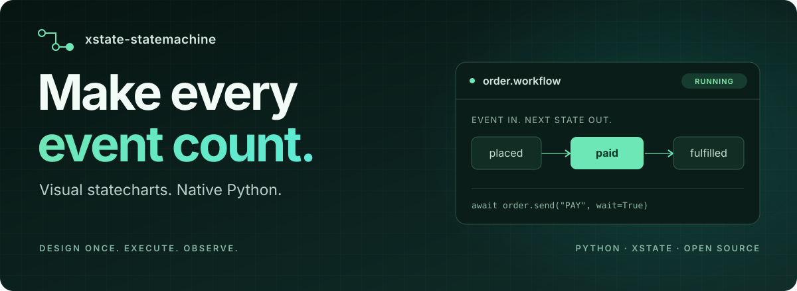
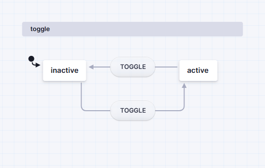

<div align="center">

<a href="https://basiltt.github.io/xstate-statemachine/">
<picture>
  <source media="(max-width: 640px)" srcset="https://raw.githubusercontent.com/basiltt/xstate-statemachine/main/docs/assets/images/readme-hero-mobile.svg">
  
</picture>
</a>

# xstate-statemachine

**State machines and statecharts for Python — define them in plain Python or load XState JSON.**

[](https://pypi.org/project/xstate-statemachine/) [](https://pypi.org/project/xstate-statemachine/) [](https://pypistats.org/packages/xstate-statemachine)
[](https://github.com/basiltt/xstate-statemachine/actions/workflows/ci.yml) [](https://basiltt.github.io/xstate-statemachine/) [](https://github.com/basiltt/xstate-statemachine/blob/main/LICENSE)

`pip install xstate-statemachine` — zero runtime dependencies, `py.typed`, 90% coverage gate enforced in CI.

</div>

**Find your way:** [60-second start](#-60-second-start) · [XState JSON & Stately](#-the-same-chart-as-xstate-json) · [Why a statechart?](#-why-a-statechart) · [A tour in Python](#-a-tour-in-python) · [How it compares](#-how-it-compares) · [What's in the box](#-whats-in-the-box) · [For LLM agents](#-for-llm-agents) · [Install](#-install) · [Cookbook](#-cookbook) · [Docs](https://basiltt.github.io/xstate-statemachine/)

---

## ⚡ 60-second start

```python
from xstate_statemachine import State, StateMachine

class TrafficLight(StateMachine):
    green = State(initial=True)
    yellow = State()
    red = State()
    cycle = green.to(yellow) | yellow.to(red) | red.to(green)  # event CYCLE

    def on_enter_red(self):  # naming-convention hook
        print("Don't move.")
    def on_cycle(self, amount=1):  # only the args you name are injected
        return f"counted {amount}"

with TrafficLight() as light:  # started in `green`; stopped on exit
    print(light.cycle(amount=3))  # counted 3
    print(light.state, light.red.is_active)  # yellow False
    light.cycle()  # Don't move.
```

A transition's attribute name is its event (`cycle` → `CYCLE`); hooks are found by name
(`on_enter_<state>`, `on_exit_<state>`, `on_<event>`, `before_<event>`, `after_<event>`); an
event the current state does not accept is ignored. Inside the block you can also ask:

```python
light.can("CYCLE"), sorted(light.allowed_events)  # True ['CYCLE']
light.configuration, light.context, light.status  # frozenset({'red'}) {} running
light.send("CYCLE", amount=2)  # the same as light.cycle(amount=2)
```

<sub>📝 `create_machine()` still returns the bare `MachineNode` to drive with your own
interpreter (snapshots, custom clocks, actor systems):</sub>

```python
interp = SyncInterpreter(TrafficLight.create_machine()).start()
```

## 🧭 The same chart as XState JSON

Every Python machine compiles to [XState](https://stately.ai/docs/xstate) JSON, and XState v5 JSON loads here with the same statechart semantics (engine event names keep the v4 spelling, such as `done.invoke.<id>`):

```python
from xstate_statemachine import State, StateMachine

class Toggle(StateMachine):
    machine_id = "toggle"
    inactive, active = State(initial=True), State()
    toggle = inactive.to(active) | active.to(inactive)

print(Toggle.create_machine().to_json())
# {"id": "toggle", "states": {"inactive": {"on": {"TOGGLE": {"target": "active"}}}, ...
```

```python
from xstate_statemachine import SyncInterpreter, create_machine

machine = create_machine({"id": "toggle", "initial": "inactive", "states": {
    "inactive": {"on": {"TOGGLE": "active"}}, "active": {"on": {"TOGGLE": "inactive"}}}})
light = SyncInterpreter(machine).start()
light.send("TOGGLE")
print(light.current_state_ids)  # {'toggle.active'}
light.send("BANANA")  # not legal here: ignored
```

<div align="center">
<a href="https://stately.ai/registry/editor/4dbe1227-e533-4104-9772-dd7c7b3a86df?mode=design&machineId=6938bbd2-1666-42dc-838f-542837486866"></a>
<br><sub>🔗 <a href="https://stately.ai/registry/editor/4dbe1227-e533-4104-9772-dd7c7b3a86df?mode=design&machineId=6938bbd2-1666-42dc-838f-542837486866">Open this machine in the Stately editor</a> — public, no account needed.</sub>
</div>

Prefer a loud failure? `strict=True` raises at the call site:

```python
strict = SyncInterpreter(machine, strict=True).start()
strict.send("BANANA")  # UnknownEventError
```

**What is XState / Stately, and why would I care?** [XState](https://stately.ai/docs/xstate) is
the most widely used statechart library in JavaScript; its JSON format describes states, events,
guards, timers and services with [SCXML](https://www.w3.org/TR/scxml/) semantics, and
[Stately](https://stately.ai/editor) is a visual editor for it. You need neither. If you use
them, the whole team reviews **one diagram** while Python executes it, and `xsm generate-template`
turns a drawn chart into typed Python stubs and tests ([CLI](https://basiltt.github.io/xstate-statemachine/guide/cli/)).
The JSON names its guards and actions; Python supplies them:

```python
from xstate_statemachine import MachineLogic, SyncInterpreter, create_machine

config = {"id": "door", "initial": "closed", "context": {"opens": 0, "locked": False},
          "states": {"opened": {"on": {"CLOSE": "closed"}}, "closed": {"on": {"OPEN": {
              "target": "opened", "guard": "isUnlocked", "actions": "countOpen"}}}}}
logic = MachineLogic(
    guards={"isUnlocked": lambda ctx, event: not ctx["locked"]},
    actions={"countOpen": lambda interp, ctx, event, action: ctx.update(opens=ctx["opens"] + 1)},
)
door = SyncInterpreter(create_machine(config, logic=logic)).start()
door.send("OPEN")
print(door.current_state_ids, door.context)  # {'door.opened'} {'opens': 1, 'locked': False}
```

## 🧠 Why a statechart?

Every non-trivial flow starts as a few booleans — and four booleans are sixteen combinations:

```python
if is_loading and not is_error:
    ...
elif is_error and retry_count < 3:
    ...
```

A statechart lists the states that exist and the only legal moves between them, so the
impossible combinations cannot be constructed:

```python
class Fetch(StateMachine):
    idle, loading, failed, done = State(initial=True), State(), State(), State(final=True)
    fetch, ok = idle.to(loading), loading.to(done)
    error, retry = loading.to(failed), failed.to(loading)
```

| Bug | With booleans | With a statechart |
|:--|:--|:--|
| 🕳️ **Impossible states** | `is_loading` *and* `is_error` both true | Exactly one state per region |
| 👻 **Zombie callbacks** | A late API response lands after the user cancelled | `cancelled` does not handle it, so it is discarded |
| 🔁 **Double submission** | A second click before the first finishes | `submitting` has no `SUBMIT` transition — the click does nothing |

In a distributed system those become redelivered messages and retried webhooks, which the
[persistence layer](https://basiltt.github.io/xstate-statemachine/guide/persistence/) handles the same way.

## 🐍 A tour in Python

**Context, guards and payloads.** A guard is a named condition; callbacks declare only the arguments they want.

```python
from xstate_statemachine import State, StateMachine, guard

class Cart(StateMachine):
    initial_context = {"items": 0}
    shopping, paid = State(initial=True), State(final=True)
    add = shopping.to(shopping)  # event ADD
    checkout = shopping.to(paid, guard="has_items")

    def on_add(self, context, qty=1):  # payload fields arrive by name
        context["items"] += qty
    @guard
    def has_items(self, context):
        return context["items"] > 0

with Cart() as cart:
    cart.checkout()  # the guard refuses: nothing happens
    cart.add(qty=2)
    cart.checkout()
    print(cart.state, cart.context)  # paid {'items': 2}
```

**Nested states.** A transition on the parent applies to every child: write `logout` once.

```python
from xstate_statemachine import State, StateMachine

class Session(StateMachine):
    logged_out = State(initial=True)
    class authenticated(State.Compound):
        browsing, paying = State(initial=True), State()
        checkout = browsing.to(paying)
    login = logged_out.to(authenticated)
    logout = authenticated.to(logged_out)  # from EVERY substate

with Session() as session:
    session.login()
    session.checkout()
    print(session.state)  # authenticated.paying
    session.logout()
    print(session.state)  # logged_out
```

**Parallel regions.** Regions run independently; `on_done` fires once, when all are final.

```python
from xstate_statemachine import State, StateMachine

class Release(StateMachine):
    class checks(State.Parallel, initial=True, on_done="deployed"):
        class build(State.Compound):
            compiling, built = State(initial=True), State(final=True)
            build_ok = compiling.to(built)
        class lint(State.Compound):
            linting, clean = State(initial=True), State(final=True)
            lint_ok = linting.to(clean)
    deployed = State(final=True)

with Release() as release:
    release.lint_ok()
    release.build_ok()  # both regions final -> on_done
    print(release.state, release.status)  # deployed done
```

**History.** Return to the step you left, not to the first one.

```python
from xstate_statemachine import State, StateMachine

class Wizard(StateMachine):
    class form(State.Compound, initial=True):
        name, address = State(initial=True), State()
        resume = State(history="shallow")
        next = name.to(address)
    help = State()
    ask, back = form.to(help), help.to(form.resume)

with Wizard() as wizard:
    wizard.next(), wizard.ask(), wizard.back()
    print(wizard.state)  # form.address
```

**Timers.** `after` fires only if the machine is *still* in the state; tests advance a `SimulatedClock`.

```python
from xstate_statemachine import SimulatedClock, State, StateMachine, SyncInterpreter

class Login(StateMachine):
    active = State(initial=True, after={30_000: "expired"})  # 30 s
    expired = State(final=True)

clock = SimulatedClock()
interp = SyncInterpreter(Login.create_machine(), clock=clock).start()
clock.increment(30_000)  # instant, no sleep
print(interp.current_state_ids)  # {'Login.expired'}
```

Delays can be named and computed at runtime, which is how exponential backoff is spelled:

```python
logic = MachineLogic(delays={"BACKOFF": lambda ctx, event: 2 ** ctx["attempt"] * 1000})
```

**Services.** `invoke` runs work while a state is active: return → `onDone`, raise → `onError`.

```python
from xstate_statemachine import State, StateMachine, action, service

class Profile(StateMachine):
    initial_context = {"user": None}
    idle, ready, failed = State(initial=True), State(final=True), State()
    loading = State(invoke={"src": "fetch_user", "onError": "failed",
                            "onDone": {"target": "ready", "actions": "save_user"}})
    load = idle.to(loading)

    @service
    def fetch_user(self, context):
        return {"name": "Ada"}
    @action
    def save_user(self, context, data):  # `data` is the service's result
        context["user"] = data

with Profile() as profile:
    profile.load()
    print(profile.state, profile.context)  # ready {'user': {'name': 'Ada'}}
```

**Strict mode, contained failures, plugins.** `strict = True` raises on an event that cannot be taken.
An action that raises is logged and reported to plugins; the transition completes and the machine runs on.

```python
from xstate_statemachine import PluginBase, State, StateMachine, TransitionNotAllowedError

class Door(StateMachine):
    strict = True
    closed, opened = State(initial=True), State()
    open, close = closed.to(opened), opened.to(closed)
    def on_open(self):
        raise RuntimeError("sensor offline")

class Alerts(PluginBase):  # every lifecycle hook is optional
    def on_action_error(self, interpreter, action, error):
        print("report:", error)

with Door(plugins=[Alerts()]) as door:
    door.open()  # report: sensor offline
    print(door.state)  # opened
    try:
        door.open()
    except TransitionNotAllowedError as exc:
        print(exc)  # Can't 'OPEN' when in 'opened': ...
```

Built-in plugins log every event, transition and action, or trace them with OpenTelemetry:

<!-- doc-fragment -->
```python
from xstate_statemachine import LoggingInspector
interp.use(LoggingInspector())
```

**async.** Any `async def` callback puts the instance on the asyncio engine (the `Interpreter`).

```python
import asyncio
from xstate_statemachine import State, StateMachine

class Fetch(StateMachine):
    idle, done = State(initial=True), State()
    fetch = idle.to(done)
    async def on_fetch(self, url):
        await asyncio.sleep(0)
        return url.upper()

async def main():
    async with Fetch() as sm:
        print(await sm.fetch(url="http://x"))  # HTTP://X

asyncio.run(main())
```

**Snapshots, diagrams, the pure API.** Continuing the JSON toggle above — resume where it
left off, draw it with no graphviz install, ask "what would happen?" without running anything:

```python
snapshot = light.get_snapshot()  # a JSON string: Redis, Postgres, a file...
resumed = SyncInterpreter.from_snapshot(snapshot, machine)
print(resumed.current_state_ids)  # {'toggle.active'}
```

```python
print(machine.to_mermaid())  # also to_plantuml(); `xsm diagram` on the CLI
```

<!-- doc-fragment -->
```python
from xstate_statemachine import initial_transition, pure_transition

start, _ = initial_transition(machine)
after, actions = pure_transition(machine, start, "TOGGLE")
print(after.state_ids, actions)  # {'toggle.active'} []  <- nothing ran
```

Most apps never call `from_snapshot` by hand: `persisted()` wraps load → act → save under an
optimistic version check, with memory, file, SQLite, Redis, SQLAlchemy and Django stores.

```python
from xstate_statemachine import create_machine
from xstate_statemachine.persistence import MemoryStore, persisted

machine = create_machine({"id": "order", "initial": "cart", "states": {
    "cart": {"on": {"PAY": "paid"}}, "paid": {"type": "final"}}})
store = MemoryStore()  # or SQLiteStore("orders.db"), RedisStore(...)
with persisted(store, "order:42", machine) as order:  # loaded or created
    order.send("PAY")  # saved on exit; a racing writer gets ConflictError
print(store.load("order:42").version)  # 1
```

```python
with persisted(store, "order:42", machine) as order:  # later, in another worker
    print(order.current_state_ids)  # {'order.paid'}
```

**Testing is plain Python** — the `[testing]` extra adds pytest fixtures, path walking and
statechart coverage when you want them:

```python
def test_cycle_goes_to_yellow():
    with TrafficLight() as light:
        light.cycle()
        assert light.state == "yellow"
```

A fluent `MachineBuilder` and a functional `build_machine()` compile to the same machine —
see the [Pythonic API guide](https://basiltt.github.io/xstate-statemachine/guide/pythonic-api/).

## ⚖️ How it compares

**Which library should I use?** The honest short answer:

- **Pick `python-statemachine`** if you want a beautiful, pythonic declarative API and don't
  need XState JSON interop — a substantive alternative with compound, parallel and history states.
- **Pick `transitions`** if you want a mature, flexible FSM attached to an existing class.
- **Pick this library** when you want a Python class *and* XState/Stately JSON for the same
  chart, or `invoke`, `after`, actors, persistence and framework adapters as first-class primitives.

Source-noted comparisons:
[python-statemachine](https://basiltt.github.io/xstate-statemachine/guide/vs-python-statemachine/) ·
[transitions](https://basiltt.github.io/xstate-statemachine/guide/vs-transitions/) ·
[django-fsm](https://basiltt.github.io/xstate-statemachine/guide/vs-django-fsm/) ·
[LangGraph](https://basiltt.github.io/xstate-statemachine/guide/vs-langgraph/) ·
[Burr](https://basiltt.github.io/xstate-statemachine/guide/vs-burr/) ·
[@statelyai/agent](https://basiltt.github.io/xstate-statemachine/guide/vs-statelyai-agent/) ·
[AWS Step Functions](https://basiltt.github.io/xstate-statemachine/guide/vs-step-functions/).
Speed: [`benchmarks/competitors/`](https://github.com/basiltt/xstate-statemachine/blob/main/benchmarks/competitors/README.md)
and [Production characteristics](https://basiltt.github.io/xstate-statemachine/guide/production-characteristics/).

## 🧰 What's in the box

| Feature | What you get | Guide |
|:--|:--|:--|
| Hierarchy, parallel, history | Compound states, concurrent regions, shallow/deep history, final states | [Hierarchical](https://basiltt.github.io/xstate-statemachine/guide/hierarchical/) · [Parallel](https://basiltt.github.io/xstate-statemachine/guide/parallel/) |
| Timers, services, actors | `after` with fixed or computed delays; `invoke` with `onDone` / `onError`; spawned child machines and a `systemId` registry | [Delayed transitions](https://basiltt.github.io/xstate-statemachine/guide/delayed-transitions/) · [Services](https://basiltt.github.io/xstate-statemachine/guide/services/) · [Actors](https://basiltt.github.io/xstate-statemachine/guide/actors/) |
| Persistence & durable timers | Stores, locks, idempotency, `after` deadlines that survive restarts, audit log, migrations | [Persistence](https://basiltt.github.io/xstate-statemachine/guide/persistence/) · [Guarantees](https://basiltt.github.io/xstate-statemachine/guide/guarantees/) |
| Integrations | [FastAPI](https://basiltt.github.io/xstate-statemachine/guide/integration-fastapi/) · [Flask](https://basiltt.github.io/xstate-statemachine/guide/integration-flask/) · [Litestar](https://basiltt.github.io/xstate-statemachine/guide/integration-litestar/) · [Starlette](https://basiltt.github.io/xstate-statemachine/guide/integration-starlette/) · [Django](https://basiltt.github.io/xstate-statemachine/guide/integration-django/) · [DRF & Channels](https://basiltt.github.io/xstate-statemachine/guide/integration-drf/) · [SQLAlchemy](https://basiltt.github.io/xstate-statemachine/guide/integration-sqlalchemy/) · [Redis](https://basiltt.github.io/xstate-statemachine/guide/integration-redis/) · [Celery](https://basiltt.github.io/xstate-statemachine/guide/integration-celery/) · [Pydantic](https://basiltt.github.io/xstate-statemachine/guide/integration-pydantic/) — closed by default | [Integrations](https://basiltt.github.io/xstate-statemachine/guide/integrations/) · [Extras](https://basiltt.github.io/xstate-statemachine/guide/integrations-extras/) |
| Event-driven architecture | Kafka, RabbitMQ, NATS, SQS, Redis Streams; outbox, dedup, dead letters, sagas, AsyncAPI | [EDA](https://basiltt.github.io/xstate-statemachine/guide/integration-eda/) · [Brokers](https://basiltt.github.io/xstate-statemachine/guide/integration-brokers/) |
| Observability | `LoggingInspector`, lifecycle plugins, OpenTelemetry, Prometheus, the live Stately Inspector | [Observability](https://basiltt.github.io/xstate-statemachine/guide/integration-observability/) · [Plugins](https://basiltt.github.io/xstate-statemachine/guide/plugins/) |
| Testing | Pure transition API, pytest fixtures, path walking, statechart coverage, replay | [Testing](https://basiltt.github.io/xstate-statemachine/guide/integration-testing/) · [Pure API](https://basiltt.github.io/xstate-statemachine/guide/testing-and-pure-api/) |
| CLI `xsm` | Typed code and tests from JSON, CI / pre-commit validation, diagrams, simulate, inspect, app scaffolds | [CLI](https://basiltt.github.io/xstate-statemachine/guide/cli/) · [Templates](https://basiltt.github.io/xstate-statemachine/guide/cli-templates/) |
| LLM agents | The model proposes, the chart decides: tool allow-lists, budgets, durable human approval | [Agents](https://basiltt.github.io/xstate-statemachine/guide/integration-agents/) |
| Production | Failure semantics, threading, trust model, every error explained, runnable example apps and recipes | [Reliability](https://basiltt.github.io/xstate-statemachine/guide/reliability/) · [Security](https://basiltt.github.io/xstate-statemachine/guide/security/) · [Troubleshooting](https://basiltt.github.io/xstate-statemachine/guide/troubleshooting/) · [FAQ](https://basiltt.github.io/xstate-statemachine/guide/faq/) · [Examples](https://basiltt.github.io/xstate-statemachine/guide/example-gallery/) |

### 🤖 For LLM agents

An agent loop is a statechart the model does not get to rewrite. With the `[agents]` extra the
model is **one invoked service** that *proposes* tool calls and the chart *decides*: per-state
tool allow-lists, budgets as guards, durable human approval. `FakeModel` runs it offline in CI —
[guide](https://basiltt.github.io/xstate-statemachine/guide/integration-agents/), [vs LangGraph](https://basiltt.github.io/xstate-statemachine/guide/vs-langgraph/).

<!-- doc-requires: pydantic -->
```python
# pip install "xstate-statemachine[agents]"   # … the extra's only hard dependency is pydantic
import asyncio
from xstate_statemachine.contrib.agents import FakeModel, run_agent, tool_registry

def get_weather(city: str) -> str:
    """Current weather for a city."""
    return f"sunny in {city}"

model = FakeModel([{"tool": "get_weather", "args": {"city": "Kochi"}}, {"text": "Sunny."}])
tools = tool_registry(get_weather)
res = asyncio.run(run_agent(model, tools=tools, prompt="Weather?", max_turns=5))
assert res.final_state == "toolLoop.done" and res.usage["turns"] == 2
```

## 🚀 Install

```bash
pip install xstate-statemachine                # or: uv add xstate-statemachine
pip install "xstate-statemachine[fastapi]"     # extras: [django] [redis] [kafka] [agents] [testing] ...
pip install "xstate-statemachine[all]"         # every shipped integration and testing extra
```

On Windows, if an Application Control policy (WDAC / AppLocker) blocks `xsm.exe`, run
`python -m xstate_statemachine setup` once, or call `python -m xstate_statemachine` directly
([details](https://basiltt.github.io/xstate-statemachine/guide/cli/#windows-an-application-control-policy-has-blocked-this-file)).

**Supported Python: 3.9 – 3.15** (CPython), tested on Linux plus Windows and macOS spot-checks
on every PR. Framework versions per extra: [Compatibility](https://basiltt.github.io/xstate-statemachine/guide/compatibility/).

**Semantic Versioning.** From **1.0**, the core API, JSON format, `xsm` CLI and persistence
layer (snapshot layout included) follow [Semantic Versioning](https://semver.org/spec/v2.0.0.html):
breaking changes only in a new major. The **0.x** series is pre-1.0; `contrib` extras remain
**provisional**. Deprecations warn first — see the [Deprecation Policy](https://basiltt.github.io/xstate-statemachine/guide/deprecation-policy/).

## 📚 Cookbook

CI-tested solutions, each a runnable folder under [`examples/recipes/`](https://github.com/basiltt/xstate-statemachine/tree/main/examples/recipes).
**[All recipes →](https://basiltt.github.io/xstate-statemachine/guide/recipes/)**

- [Stripe webhooks](https://basiltt.github.io/xstate-statemachine/guide/stripe-webhooks/) — signature checks, `event.id` idempotency, replays answered with the stored receipt.
- [Durable timers with APScheduler](https://basiltt.github.io/xstate-statemachine/guide/apscheduler-timers/) — a 7-day follow-up that survives restarts.
- [Task-queue workers](https://basiltt.github.io/xstate-statemachine/guide/task-queue-workers/) — RQ / arq / Dramatiq with optimistic-version retries.
- [Circuit breaker + retry](https://basiltt.github.io/xstate-statemachine/guide/circuit-breaker-retry/) — jittered backoff and a breaker that half-opens on a timer.

## 🤝 Contributing and license

Issues and PRs are welcome — see [CONTRIBUTING.md](https://github.com/basiltt/xstate-statemachine/blob/main/CONTRIBUTING.md)
and [AGENTS.md](https://github.com/basiltt/xstate-statemachine/blob/main/AGENTS.md). Every Python
block in this README and the guides is executed in CI.

[Documentation](https://basiltt.github.io/xstate-statemachine/) ·
[API reference](https://basiltt.github.io/xstate-statemachine/api/) ·
[Changelog](https://basiltt.github.io/xstate-statemachine/guide/changelog/) ·
[PyPI](https://pypi.org/project/xstate-statemachine/) ·
[Security policy](https://github.com/basiltt/xstate-statemachine/blob/main/SECURITY.md) ·
[MIT License](https://github.com/basiltt/xstate-statemachine/blob/main/LICENSE)
