<div align="center">

<a href="https://basiltt.github.io/xstate-statemachine/">
<picture>
  <source media="(max-width: 640px)" srcset="docs/assets/images/readme-hero-mobile.svg">
  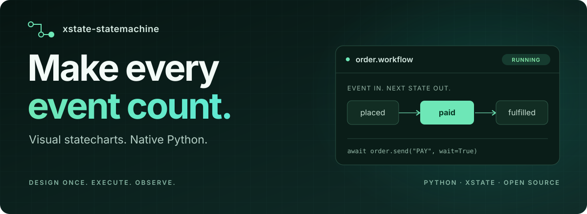
</picture>
</a>

<a id="-xstate-statemachine"></a>

# xstate-statemachine

<a id="event-driven-python-with-the-diagram-as-the-source-of-truth"></a>

**The event-driven workflow toolkit for Python.**

Design the flow. Make the rules explicit. Build systems you can explain.

[](https://pypi.org/project/xstate-statemachine/)
[](https://pypi.org/project/xstate-statemachine/)
[](https://github.com/basiltt/xstate-statemachine/actions/workflows/ci.yml)
[](https://github.com/basiltt/xstate-statemachine/blob/main/LICENSE)
<br>
[](https://github.com/basiltt/xstate-statemachine/tree/main/tests/)
[](.github/workflows/ci.yml)
[](pyproject.toml)
[](src/xstate_statemachine/py.typed)

<br>

**From a two-state toggle to an event-driven order system, keep the workflow in one place.**

Draw it in [Stately](https://stately.ai/), load XState-compatible JSON, or define it in Python.
Run it with an async or sync engine. Let `xsm` generate the typed code, tests and docs.
Add persistence, broker messaging and framework integrations when your application needs them.

**Zero runtime dependencies in the core. MIT licensed. Infrastructure is optional.**

<br>

[**Try it in 60 seconds →**](#-the-60-second-start) &nbsp; · &nbsp; [**Explore event-driven architecture**](#-event-driven-architecture-the-main-event) &nbsp; · &nbsp; [**Compare your options**](#-how-it-compares) &nbsp; · &nbsp; [**Read the docs**](https://basiltt.github.io/xstate-statemachine/)

</div>

<br>

<table>
<tr>
<td width="33%" valign="top">
<strong>Design</strong>
<p>Visual statecharts.<br>Shared JSON.<br>Native Python logic.</p>
</td>
<td width="33%" valign="top">
<strong>Execute</strong>
<p>Guards and services.<br>Timers and actors.<br>Explicit recovery.</p>
</td>
<td width="33%" valign="top">
<strong>Operate</strong>
<p>Durable snapshots.<br>Broker support.<br>Traces and replay.</p>
</td>
</tr>
</table>

<a id="-find-your-way"></a>

<details>
<summary><strong>Find your way — the complete guide, examples and API reference</strong></summary>

<br>

New here? Start with the quick start. Evaluating for a project? Explore the use cases,
event-driven architecture and comparisons. The full technical reference stays on this page.

|   | Section | What you get |
|:--|:--|:--|
| ⚡ | [**60-Second Start**](#-the-60-second-start) · [**Install**](#-install) | Running before your coffee cools |
| 🧰 | [**Real problems this solves**](#-real-problems-this-solves) | 13 shipped, battle-tested examples: LLM agents with human approval, FastAPI behind N workers, Stripe webhooks, Django approvals, EDA, workers, breakers, durable timers |
| 🧠 | [**Why a statechart?**](#-why-a-statechart) · [**Mental model**](#-the-mental-model) | Three bug classes to prevent and six concepts to learn |
| 📨 | [**Event-driven architecture**](#-event-driven-architecture-the-main-event) | Charts that talk only through a broker: outbox, dedup, DLQ, sagas, AsyncAPI — runnable in-process |
| 🏭 | [**Automatic code generation**](#-automatic-code-generation) | `xsm gt` turns JSON into typed Python, recorded tests and docs, with structural checks before writing |
| 🔗 | [**Stately ⇄ Python**](#-one-json-two-runtimes) | Share a workflow definition; inspect the source-backed Stately diagrams and Python examples |
| 🧩 | [**Context**](#-context--the-machines-memory) · [**Guards**](#-guards--conditional-transitions) · [**Actions**](#-actions--side-effects) · [**Services**](#-services--invoke) · [**Timers**](#-timers--delayed-transitions) | The building blocks |
| 🌳 | [**Nested**](#-nested--parallel-states) · [**Parallel**](#parallel-states--concurrent-regions) · [**History**](#-history--final-states) · [**Actors**](#-the-actor-model) | Real-world hierarchy and systems of machines |
| 💾 | [**Persistence**](#-persistence--snapshots-stores-and-durable-timers) | Stores, locks, idempotency, durable `after`, audit log, migrations |
| 🔌 | [**Integrations**](#-integrations--optional-extras) | FastAPI · Starlette · Litestar · Flask · Django (+DRF, Channels) · SQLAlchemy · Redis · Celery · five brokers |
| 🤖 | [**For LLM agents**](#-for-llm-agents) | The model proposes, the machine decides: tool allow-lists, budgets, durable human approval |
| 🔭 | [**Observability**](#-observability--inspection) · [**Introspection & plugins**](#-introspection--plugins) · [**Pure API**](#-the-pure-api--no-interpreter) | OTel, Prometheus, the live Stately Inspector; observe and test |
| 🐍 | [**Pythonic API**](#-prefer-pure-python-three-more-ways-to-define-a-machine) · [**CLI**](#-cli-tool) | No JSON required; the whole terminal toolkit |
| 📚 | [**Cookbook**](#-cookbook) · [**Recipes**](https://basiltt.github.io/xstate-statemachine/guide/recipes/) · [**FAQ**](#-faq) | Copy-paste solutions and eight CI-tested recipes |
| ⚖️ | [**How it compares**](#-how-it-compares) | vs [transitions](https://basiltt.github.io/xstate-statemachine/guide/vs-transitions/), [python-statemachine](https://basiltt.github.io/xstate-statemachine/guide/vs-python-statemachine/), [django-fsm](https://basiltt.github.io/xstate-statemachine/guide/vs-django-fsm/), [LangGraph](https://basiltt.github.io/xstate-statemachine/guide/vs-langgraph/), [Burr](https://basiltt.github.io/xstate-statemachine/guide/vs-burr/), [@statelyai/agent](https://basiltt.github.io/xstate-statemachine/guide/vs-statelyai-agent/), [AWS Step Functions](https://basiltt.github.io/xstate-statemachine/guide/vs-step-functions/) |
| 🛡️ | [**Production**](#-running-it-in-production) · [**Security**](#-security--trust-model) · [**API reference**](#-api-reference) · [**Troubleshooting**](#-troubleshooting) | Failure semantics, threat model, every kwarg, every error |

</details>

---

## ⚡ The 60-Second Start

```bash
pip install xstate-statemachine
```

```python
from xstate_statemachine import create_machine, SyncInterpreter

machine = create_machine(
    {
        "id": "toggle",
        "initial": "inactive",
        "states": {
            "inactive": {"on": {"TOGGLE": "active"}},
            "active": {"on": {"TOGGLE": "inactive"}},
        },
    }
)

light = SyncInterpreter(machine).start()

print(light.current_state_ids)  # {'toggle.inactive'}
light.send("TOGGLE")
print(light.current_state_ids)  # {'toggle.active'}
light.send("BANANA")  # not a legal event here
print(light.current_state_ids)  # {'toggle.active'}  ← ignored, not crashed
light.stop()
```

<div align="center">
<a href="https://stately.ai/registry/editor/4dbe1227-e533-4104-9772-dd7c7b3a86df?mode=design&machineId=6938bbd2-1666-42dc-838f-542837486866">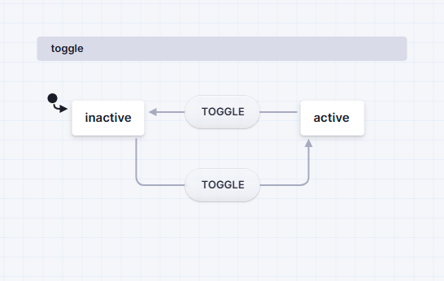</a>
<br><sub>🔗 <a href="https://stately.ai/registry/editor/4dbe1227-e533-4104-9772-dd7c7b3a86df?mode=design&machineId=6938bbd2-1666-42dc-838f-542837486866">Open this machine in the Stately editor</a> — public, no account needed.</sub>
<br><sub>That dict, as the Stately editor draws it. Paste the JSON into <a href="https://stately.ai/editor">stately.ai/editor</a> and you get this picture; export from the editor and you get that dict.</sub>
</div>

<br>

You just declared the **complete** set of legal states and the **only** legal moves between
them. `TOGGLE` advances the machine. `BANANA` is ignored — not raised, not silently
mishandled — because the current state does not accept it. (Prefer it to raise?
`SyncInterpreter(machine, strict=True)` → `UnknownEventError` at the call site.)

You have a running machine: explicit states, named events and predictable transitions.
The same model scales to workflows that cross process restarts, message brokers and teams.

<details>
<summary><strong>Already using asyncio? Run the same machine with the async engine.</strong></summary>

<br>

This is the async version of the toggle above, as a complete runnable program.
`wait=True` waits for the event to finish processing before you inspect the result.

```python
import asyncio
from xstate_statemachine import Interpreter, create_machine


async def main() -> None:
    """Toggle a light with the asynchronous engine."""
    machine = create_machine(
        {
            "id": "toggle",
            "initial": "inactive",
            "states": {
                "inactive": {"on": {"TOGGLE": "active"}},
                "active": {"on": {"TOGGLE": "inactive"}},
            },
        }
    )
    light = await Interpreter(machine).start()
    try:
        receipt = await light.send("TOGGLE", wait=True)
        print(sorted(receipt.state_ids))  # ['toggle.active']
    finally:
        await light.stop()


asyncio.run(main())
```

</details>

<table>
<tr>
<td width="50%" valign="top">

**👋 New to statecharts?** Read [Why a statechart?](#-why-a-statechart) and the
[Mental model](#-the-mental-model) (five minutes), then run `xsm` with no arguments — the
interactive launcher will walk you through generating a project from a JSON file. The
[Cookbook](#-cookbook) has a complete 40-line checkout you can paste and run.

</td>
<td width="50%" valign="top">

**Building a production workflow?** Jump to
[Event-driven architecture](#-event-driven-architecture-the-main-event) for an in-process
example of broker messaging, inbound deduplication and outbox delivery — then
[Persistence](#-persistence--snapshots-stores-and-durable-timers) for the
ordering guarantees, and [Production](#-running-it-in-production) for what is contained
when things fail.

</td>
</tr>
</table>

### Why choose xstate-statemachine?

| What you want to ship | What you get here |
|:--|:--|
| **A workflow the whole team can understand** | An XState-compatible definition you can visualize in Stately, review in Git and execute in Python. JSON, class-based, builder and functional APIs compile to the same model. |
| **Business rules that live in one place** | Guards, nested and parallel states, history, `invoke`, `after` and actors make the allowed transitions explicit. `can()`, tags and metadata let the UI ask the machine what is possible. |
| **A fast path from diagram to working code** | `xsm` generates implementation stubs, types, recorded tests and documentation, with structural round-trip checks for Python-generating templates. |
| **A practical path to durable workflows** | Optional stores, version checks, idempotency, migrations and persisted deadlines support workflows that outlive a request or worker. |
| **Event-driven services with shared tooling** | CloudEvents envelopes, inbound dispatch, an outbox, dead letters, sagas and AsyncAPI export, plus adapters for five broker families. |
| **Confidence before and after deployment** | A pure transition API, virtual time, replay, statechart coverage, lifecycle plugins, OpenTelemetry, Prometheus and live inspection. |
| **Control over adoption and dependencies** | Start in one Python process with no infrastructure. Add only the integrations you need; keep your definitions, data and deployment under your control. |

The advantage is the combination: **visual statecharts, native Python execution and
operational building blocks around the same definition**. See
[How it compares](#-how-it-compares) for specific trade-offs and reproducible benchmarks.

---

## 🚀 Install

```bash
pip install xstate-statemachine          # the core: zero runtime dependencies, Python 3.9 → 3.15
xsm info                                 # verify the install
xsm update                               # later: upgrade with the installer that installed you
```

Everything else is an **extra** you opt into — `pip install "xstate-statemachine[fastapi]"`,
`[django]`, `[redis]`, `[kafka]`, `[agents]`, `[observability]`, `[testing]`, … or `[all]`.
The full table is under [Integrations](#-integrations--optional-extras).

> **Match the docs to your version.** This README covers the repository's **0.11.0**
> source version. The PyPI badge shows the published package, which may be older.
> Run `xsm info` to check your installation; use the source checkout below when evaluating
> features that are not in your installed release yet.

[](https://basiltt.github.io/xstate-statemachine/guide/cli/#in-ci-and-pre-commit) [](https://basiltt.github.io/xstate-statemachine/guide/cli/#in-ci-and-pre-commit) — validate machine JSON and keep generated code current in CI. Starting a service from scratch? `xsm new my_service --template fastapi` scaffolds one from a tested example app.

<details>
<summary><b>uv · poetry · pipx · source checkout · Windows · supply chain</b></summary>

<br>

```bash
uv add xstate-statemachine
poetry add xstate-statemachine
pipx install xstate-statemachine     # if you only want the `xsm` CLI
```

**Try the development version from source:**

```bash
git clone https://github.com/basiltt/xstate-statemachine.git
cd xstate-statemachine
python -m pip install -e .
python -m xstate_statemachine info
# Add only the extras you need, for example:
python -m pip install -e ".[fastapi]"
```

**Windows, `xsm.exe` blocked by an Application Control policy?** That is pip's unsigned
launcher stub being refused by WDAC / AppLocker, not the package. Run
`python -m xstate_statemachine setup` once: it parks the blocked launcher and installs a batch
shim, after which `xsm` works normally (re-run after `pip install --upgrade`; `--undo` reverts).
`python -m xstate_statemachine …` always works too.
Details: [CLI → Windows](https://basiltt.github.io/xstate-statemachine/guide/cli/#windows-an-application-control-policy-has-blocked-this-file).

**Supply chain.** Releases are published from GitHub Actions through PyPI **Trusted
Publishing** (no long-lived token) and carry **PEP 740 build provenance attestations** binding
each wheel and sdist to the exact run, commit and workflow that built it:

```bash
pip install pypi-attestations
pypi-attestations verify pypi --repository https://github.com/basiltt/xstate-statemachine \
  pypi:xstate_statemachine-0.10.5-py3-none-any.whl   # example published wheel; choose your release
```

The verifier prints `OK: <file>` on success. Use a filename from the published release
you installed; development versions do not have PyPI attestations before publication.

Want the code generator's output line-wrapped to match your linter? `pip install "xstate-statemachine[format]"`
adds `black` and `isort`; without them generated code is still valid, just not reformatted.

</details>

---

## 🧰 Real Problems This Solves

Start with a problem that looks like yours. The examples cover customer-facing APIs,
background workflows, event-driven services and supervised AI agents. Each row links to
a shipped example and its setup instructions; the associated suites exercise failure paths
as well as the happy path.

**Build an API** with [FastAPI orders](examples/integrations/fastapi_orders/) or
[Django approvals](examples/integrations/django_approvals/). **Connect services** with
[event-driven fulfilment](examples/integrations/eda_fulfilment/). **Control an agent** with
the [offline support bot](examples/integrations/agents_support_bot/).

<details>
<summary><strong>Explore all 13 use cases — implementation, behavior and runnable code</strong></summary>

<br>

| The problem you have | How the example handles it | Run it |
|:--|:--|:--|
| **An LLM agent that calls tools — and must not refund money on its own.** Prompt-engineering "please ask first" does not hold. | The model proposes, the machine decides: per-state tool **allow-lists**, token/USD **budgets** that cut the loop, and a `refund_order` call that parks in `awaiting_human` — a persisted state with a one-hour escalation deadline — until a person approves. Works with pydantic-ai, LangGraph or a raw client. | [`agents_support_bot`](https://github.com/basiltt/xstate-statemachine/tree/main/examples/integrations/agents_support_bot) · [guide](https://basiltt.github.io/xstate-statemachine/guide/integration-agents/) |
| **A FastAPI order service behind N uvicorn workers; 200 concurrent payment requests race on one order.** | The example's lock + version check admits one payment transition; the other requests get **409**. Persisted `after: 15 min` deadlines survive restarts, and OpenAPI shows the events. Payment-provider idempotency is still required for external charges across failures. | [`fastapi_orders`](https://github.com/basiltt/xstate-statemachine/tree/main/examples/integrations/fastapi_orders) · [guide](https://basiltt.github.io/xstate-statemachine/guide/integration-fastapi/) |
| **Stripe retries webhooks; the same `invoice.paid` arrives twice, out of order, a day late, or forged.** | Signature + timestamp verified at the edge; the `Idempotency-Key` inbox answers the replay with the **stored receipt** without touching the machine; an event the current state does not accept is a clean `200` no-op, never a double credit. | [`stripe_webhooks`](https://github.com/basiltt/xstate-statemachine/tree/main/examples/recipes/stripe_webhooks) · [recipe](https://basiltt.github.io/xstate-statemachine/guide/recipes/stripe-webhooks/) |
| **A Django approval flow: legal and finance review in parallel, each with its own role, visible in the admin, with a live status page.** | Parallel regions on one row; `StatechartField` keeps the denormalised state columns; a DRF viewset with per-event permissions; Channels broadcasts each transition; the audit log is written in the **same transaction** as the state change. | [`django_approvals`](https://github.com/basiltt/xstate-statemachine/tree/main/examples/integrations/django_approvals) · [guide](https://basiltt.github.io/xstate-statemachine/guide/integration-django/) |
| **Two services that must never call each other, but an order has to make it from checkout to shipped.** | Charts talk only through a broker (Redis Streams, Kafka, RabbitMQ, NATS, SQS): a transactional **outbox** so no event is lost between commit and publish, consumer-side dedup, a dead-letter queue, and a compensating saga when the warehouse says no. | [`eda_fulfilment`](https://github.com/basiltt/xstate-statemachine/tree/main/examples/integrations/eda_fulfilment) · [guide](https://basiltt.github.io/xstate-statemachine/guide/integration-eda/) |
| **Background jobs (RQ, arq, Dramatiq) that each touch the same long-running workflow.** | Load → send one event → save under an optimistic version; a stale worker's write is refused, not silently last-writer-wins; durable `after` timers are woken by a scanner, not by a worker that happened to be alive. | [`task_queue_workers`](https://github.com/basiltt/xstate-statemachine/tree/main/examples/recipes/task_queue_workers) · [recipe](https://basiltt.github.io/xstate-statemachine/guide/recipes/task-queue-workers/) |
| **A flaky upstream: retry with backoff, but stop hammering it when it is down.** | Per-request retry with jittered backoff as a chart, a shared circuit breaker that opens on N failures and half-opens on a timer — every state visible, every transition testable without the network. | [`circuit_breaker_retry`](https://github.com/basiltt/xstate-statemachine/tree/main/examples/recipes/circuit_breaker_retry) · [recipe](https://basiltt.github.io/xstate-statemachine/guide/recipes/circuit-breaker-retry/) |
| **A 7-day and a 14-day follow-up email that must fire even if the process was restarted in between.** | `after` deadlines are **persisted on the wall clock**; `DueTimerScanner` (APScheduler, cron, anything) wakes exactly the instances that are due. | [`apscheduler_timers`](https://github.com/basiltt/xstate-statemachine/tree/main/examples/recipes/apscheduler_timers) · [recipe](https://basiltt.github.io/xstate-statemachine/guide/recipes/apscheduler-timers/) |
| **A multi-step signup / onboarding wizard with Back, validation and resumable sessions.** | Steps, navigation and validation live in the chart; only a JSON snapshot lives in the session or the UI state, so Flask, Streamlit and Gradio all drive the same machine. | [`flask_wizard`](https://github.com/basiltt/xstate-statemachine/tree/main/examples/integrations/flask_wizard) · [`form_wizard`](https://github.com/basiltt/xstate-statemachine/tree/main/examples/recipes/form_wizard) |
| **A chatbot that has to collect N fields in any order and nudge for the missing ones.** | A self-transition fills slots; an `allSlotsFilled` guard moves on; the chart, not the prompt, knows what is still missing. | [`slot_filling`](https://github.com/basiltt/xstate-statemachine/tree/main/examples/recipes/slot_filling) · [recipe](https://basiltt.github.io/xstate-statemachine/guide/recipes/slot-filling/) |
| **A feature rollout (internal → 1 % → 25 % → GA) that can be rolled back from any stage.** | Staged states with timed auto-advance, a `ROLLBACK` handled at the parent so it works from every stage, and an audit trail of who moved it. | [`feature_flag_rollout`](https://github.com/basiltt/xstate-statemachine/tree/main/examples/recipes/feature_flag_rollout) · [recipe](https://basiltt.github.io/xstate-statemachine/guide/recipes/feature-flag-rollout/) |
| **A WebSocket client that reconnects with backoff and never ends up with two open sockets.** | `disconnected ↔ reconnecting → connected` with `RetryPolicy`; the live socket is an invoked service, so leaving the state **closes it** — by construction. | [`websocket_reconnect`](https://github.com/basiltt/xstate-statemachine/tree/main/examples/recipes/websocket_reconnect) · [recipe](https://basiltt.github.io/xstate-statemachine/guide/recipes/websocket-reconnect/) |
| **An order row in SQLAlchemy whose state column must agree with its history.** | The chart lives on the ORM row (`StatechartMixin`); the state column, the snapshot and the outbox are written in one `commit()`. | [`sqlalchemy_orders`](https://github.com/basiltt/xstate-statemachine/tree/main/examples/integrations/sqlalchemy_orders) · [guide](https://basiltt.github.io/xstate-statemachine/guide/integration-sqlalchemy/) |

Each of these is also a **battle-test** in the suite: the FastAPI example is hammered with 200 concurrent payments across several worker processes; the Stripe example is fed 1,000 deliveries with forged signatures, tampered bodies and day-old timestamps; the agent example is given a model that tries to call a tool it was not offered. The guarantees above are the assertions.

</details>

> **Deployment matters.** These are tested scenarios, not a promise of exactly-once
> external I/O. Use the documented store, locking, inbox and broker configuration;
> make payment calls and other external effects idempotent. The
> [Guarantees](https://basiltt.github.io/xstate-statemachine/guide/guarantees/) page
> explains the crash windows explicitly.

---

## 🧠 Why a Statechart?

Every non-trivial flow starts as a few booleans. Then it grows.

<table>
<tr>
<td width="50%" valign="top">

**😖 Boolean soup**

```python
if is_loading and not is_error:
    ...
elif is_error and retry_count < 3:
    ...
elif is_authenticated and not is_loading:
    ...
```

Four booleans = **16 combinations**. If only six are meaningful,
the remaining ten need to be ruled out explicitly — including
`is_loading=True, is_error=True, is_success=True`.

Without a shared model, every handler has to maintain those
invariants independently.

</td>
<td width="50%" valign="top">

**😌 A statechart**

```jsonc
"states": {
    "idle":    {"on": {"FETCH": "loading"}},
    "loading": {"on": {"OK": "done",
                       "ERR": "failed"}},
    "failed":  {"on": {"RETRY": "loading"}},
    "done":    {"type": "final"},
}
```

Four states = **exactly four possibilities**. The impossible
ones cannot be constructed, because you never wrote a path
to them.

Illegal events in the current state are simply ignored.

</td>
</tr>
</table>

<a id="the-three-bugs-this-eliminates"></a>

### Three bug classes the model helps prevent

| Bug | How booleans cause it | How a statechart prevents it |
|:--|:--|:--|
| 🕳️ **Impossible states** | `is_loading` *and* `is_error` both true | The machine is in exactly one state per region |
| 👻 **Zombie callbacks** | A late API response fires after the user cancelled | The event isn't handled in `cancelled`, so it's discarded |
| 🔁 **Double submission** | A second click before the first finishes | `submitting` has no `SUBMIT` handler — the click does nothing |

Now scale that up. In a distributed system the "late API response" is a **redelivered
message**, the "second click" is a **retried webhook**, and the "boolean soup" is a status
column plus six feature flags plus a cron job that nobody fully understands. The same
design addresses the same problems — when paired with durable persistence, input
deduplication and reliable output delivery. That is what the rest of this library provides
building blocks for.

> **The rule** — a machine is in **exactly one state per region**. Parallel states have
> multiple regions, so multiple states are active at once, which is why
> `current_state_ids` returns a *set*.

---

## 🧩 The Mental Model

Six concepts give you the foundation. The rest of the library builds on them.

| Concept | What it is | In JSON |
|:--|:--|:--|
| **State** | A named mode the machine can be in | `"states": {"idle": {}}` |
| **Event** | A message you send in | `interp.send("FETCH")` |
| **Transition** | "In state X, event E moves to Y" | `"on": {"FETCH": "loading"}` |
| **Context** | Everything that isn't a state — the data | `"context": {"retries": 0}` |
| **Guard** | A condition that must hold for a transition | `{"target": "x", "guard": "isReady"}` |
| **Action** | A side effect that fires during a transition | `{"target": "x", "actions": ["save"]}` |

The split that matters: **state** is *where you are*, **context** is *what you know*.
`retries` is context. `retrying` is a state. Keeping that boundary clear makes workflows
easier to understand and change.

<div align="center">
<a href="https://stately.ai/registry/editor/4dbe1227-e533-4104-9772-dd7c7b3a86df?mode=design&machineId=4ef7b8e7-dda0-44a9-9b3a-b5d59f2b0763">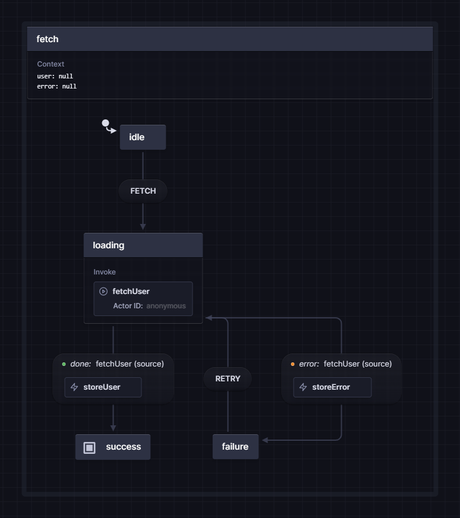</a>
<br><sub>🔗 <a href="https://stately.ai/registry/editor/4dbe1227-e533-4104-9772-dd7c7b3a86df?mode=design&machineId=4ef7b8e7-dda0-44a9-9b3a-b5d59f2b0763">Open this machine in the Stately editor</a> — public, no account needed.</sub>
</div>

Two more words you'll meet constantly: an **`invoke`** runs a service (an API call, a Celery
task, a child machine) while a state is active and routes its result back as `onDone` /
`onError`; an **`after`** is a timer that fires a transition if you are *still* in the state
when it elapses. Everything else — nesting, parallel regions, history, actors, persistence,
brokers — is those six things composed.

---

## 📨 Event-Driven Architecture: the main event

**Events describe what happened. Statecharts decide what is allowed to happen next.**

A checkout publishes `OrderPaid`. The warehouse reacts by packing the order. A shipping
service reacts when packing completes. Each service owns its behavior and communicates
through an event contract, rather than reaching into another service's internals.

This is why event-driven architecture matters: it lets workflows grow beyond one request,
one process and one team while keeping the hand-offs explicit.

### Why build around events?

| Architectural advantage | What it means for your application |
|:--|:--|
| **Looser coupling** | Producers describe business facts; consumers decide how to respond. Add a notification or analytics consumer without embedding that behavior in the checkout workflow. |
| **Independent scaling** | Separate work by consumer and instance key. Scale the busy parts of the system without treating every workflow step as one synchronous request. |
| **Resilience across interruptions** | With a durable broker and correctly configured stores, committed state and pending outbound events can outlive a worker. Retry policy and recovery paths stay explicit. |
| **A traceable business story** | Named events, correlation and causation ids connect the lifecycle of an order across services. Statecharts show where each instance is waiting and why. |
| **Testable contracts** | Exercise the event flow with fake brokers and virtual time, then expose the chart's publish/consume declarations through AsyncAPI. |

You do not need microservices to benefit. Start with events inside one application;
introduce a broker when independent consumers, buffering or cross-process delivery become
useful. Event-driven systems introduce their own responsibilities: **eventual consistency,
duplicate delivery, ordering, schema evolution and operational monitoring**. The library
provides explicit tools for these concerns; it does not remove the need to design for them.

A statechart is a **consumer** (it reacts to events) and a **producer** (its transitions mean
something to other services). Here is how the pieces fit together:

```text
Producer → Broker → InboundDispatcher → Statechart
                           │                │
                    validate + dedup   guards + actions
                                            │
                             snapshot + inbox mark + outbox
                                  one shared transaction
                                            │
                                      OutboxRelay
                                            │
                                 Broker → Next consumer
```

The transaction shown above requires a shared transactional store and the documented
locking strategy. The incoming delivery is acknowledged after the state commit;
the relay publishes committed outbox records separately and may retry.

### Reliability is part of the workflow

| The problem | The failure to design for | The building block |
|:--|:--|:--|
| A message is delivered twice | A duplicate applies the same business operation again | With an inbox configured, `InboundDispatcher` deduplicates on the envelope id before the machine sees it and returns the original receipt within the configured retention window |
| You save state, then the publish fails | The order is "paid" and nobody heard | With a shared transactional store and `PessimisticLock`, `OutboxPlugin` writes the outgoing event in the same transaction as the snapshot; `OutboxRelay` publishes afterwards and retries |
| A poison message loops forever | A worker restarts every 30 s | After `max_attempts` the envelope is a `DeadLetter` record; `xsm dlq replay` is a dry run by default |
| Two consumers handle one order at once | Lost update, or a global lock | Per-subject ordering in the dispatcher, plus `OptimisticLock` / fenced `PessimisticLock` on the store |
| Nobody knows what your service emits | A wiki page from last year | `meta.publish` on the chart **is** the contract; `xsm asyncapi` renders it as AsyncAPI 3.0 |
| The broker is Kafka today and SQS next quarter | Transport-specific logic spreads through the workflow | Shared async and sync adapter protocols; five broker families with a contract suite, and fake adapters for tests. Transport configuration and ordering still depend on the broker |

### Two charts, one broker, no servers

The order-fulfilment chart below shows a richer workflow: payment, packing, shipping,
escalation and cancellation, all visible in the model.

<div align="center">
<a href="https://stately.ai/registry/editor/4dbe1227-e533-4104-9772-dd7c7b3a86df?mode=design&machineId=8232a8c5-b681-4e0f-a26d-57983804d72c">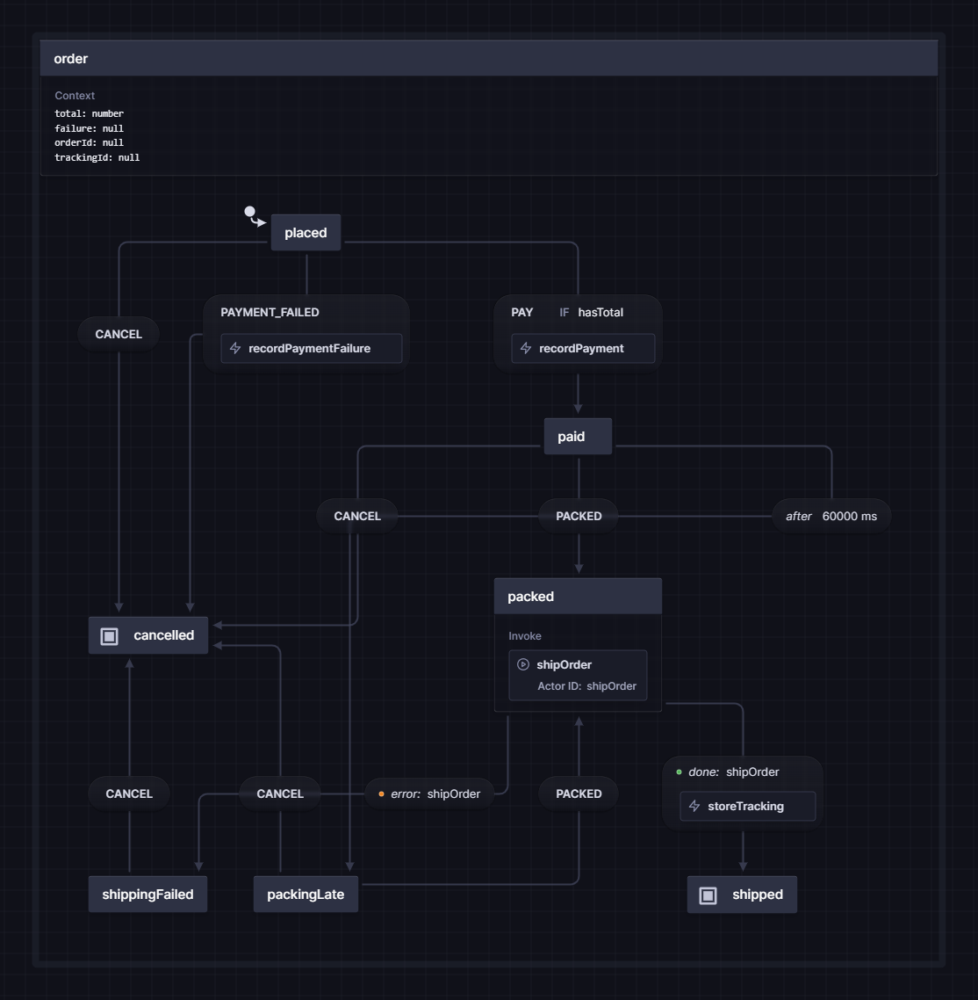</a>
<br><sub>🔗 <a href="https://stately.ai/registry/editor/4dbe1227-e533-4104-9772-dd7c7b3a86df?mode=design&machineId=8232a8c5-b681-4e0f-a26d-57983804d72c">Open this machine in the Stately editor</a> — public, no account needed.</sub>
</div>

Start with a smaller, runnable version: an order chart and a warehouse chart that never
call each other. Every hand-off is an event. The broker, store, inbox and outbox are all
in-process, so you can try the full conversation without running a server. The demo's
`PACKED` event completes the order directly; it does not invoke the richer chart's
`shipOrder` service.

<div align="center">
<a href="https://stately.ai/registry/editor/4dbe1227-e533-4104-9772-dd7c7b3a86df?mode=design&machineId=e42d1fe7-8c71-42a2-b9a2-e9591112bc19">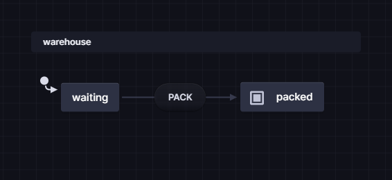</a>
<br><sub>🔗 <a href="https://stately.ai/registry/editor/4dbe1227-e533-4104-9772-dd7c7b3a86df?mode=design&machineId=e42d1fe7-8c71-42a2-b9a2-e9591112bc19">Open this machine in the Stately editor</a> — public, no account needed.</sub>
</div>

```python
from xstate_statemachine import MachineLogic, assign, create_machine
from xstate_statemachine.eda import (
    Envelope,
    InboundDispatcher,
    MemoryOutboxStore,
    OutboxPlugin,
    OutboxRelay,
    SyncFakeBrokerAdapter,
)
from xstate_statemachine.persistence import MemoryInbox, MemoryStore

ORDER = {
    "id": "order",
    "initial": "placed",
    "context": {"total": 0},
    "states": {
        "placed": {
            "on": {
                "PAY": {
                    "target": "paid",
                    "guard": "hasTotal",
                    "actions": assign(
                        {"total": lambda a: a["event"].payload["total"]}
                    ),
                    "meta": {
                        "publish": {"type": "OrderPaid", "data": ["total"]}
                    },  # ← the contract
                }
            }
        },
        "paid": {"on": {"PACKED": "shipped"}},
        "shipped": {"type": "final"},
    },
}
WAREHOUSE = {
    "id": "warehouse",
    "initial": "waiting",
    "states": {
        "waiting": {
            "on": {
                "PACK": {
                    "target": "packed",
                    "meta": {"publish": "OrderPacked"},
                }
            }
        },
        "packed": {"type": "final"},
    },
}
order = create_machine(
    ORDER,
    logic=MachineLogic(
        guards={"hasTotal": lambda ctx, e: e.payload.get("total", 0) > 0}
    ),
)
warehouse = create_machine(WAREHOUSE)

store, inbox = (
    MemoryStore(),
    MemoryInbox(),
)  # in-memory demo, not crash-durable
outbox, broker = MemoryOutboxStore(), SyncFakeBrokerAdapter()
publisher = OutboxPlugin(
    outbox, topic="events"
)  # meta.publish → staged outbox record
relay = OutboxRelay(outbox, broker)  # committed outbox records → broker

ROUTES = {  # envelope type → (machine, the event it means to it)
    "xsm.order.PAY": (order, "PAY"),
    "OrderPaid": (
        warehouse,
        "PACK",
    ),  # the warehouse reacts to the order's event…
    "OrderPacked": (
        order,
        "PACKED",
    ),  # …and the order reacts to the warehouse's
}
dispatcher = InboundDispatcher(
    store,
    lambda t: ROUTES[t][0] if t in ROUTES else None,
    event_type=lambda env: ROUTES[env.type][1],
    key_for=lambda env, m: f"{m.id}:{env.subject}",  # one order id, two machines
    plugins=[publisher],
    inbox=inbox,  # dedup on envelope.id
)

# checkout publishes a command; nothing else is called directly
broker.publish(
    "events",
    Envelope.new(
        type="xsm.order.PAY",
        subject="order-1",
        data={"total": 42},
        source="checkout",
    ),
)

for _ in range(4):  # PAY → OrderPaid → PACK → OrderPacked → PACKED
    dispatcher.run_once_sync(broker, "events")
    relay.relay_once_sync()

import json

print(json.loads(store.load("order:order-1").snapshot)["value"])  # shipped
print([e.type for e in broker.published_on("events")])
# ['xsm.order.PAY', 'OrderPaid', 'OrderPacked']
```

**Take the same design to production in three steps:**

1. **Make state and outgoing events durable.** Use `SQLiteStore("app.db")`,
   `SQLiteInbox(store)` and `SQLiteOutboxStore(store)` with `PessimisticLock()` passed to
   `InboundDispatcher`. Sharing the store and transaction is what makes snapshot, inbox
   mark and outbox commit together. Replacing only `MemoryStore` is not enough.
2. **Choose the broker and execution model.** The sync loop can use
   `SyncRedisStreamsBroker(...)` or `SyncSqsBroker(...)`. For `RedisStreamsBroker(...)`,
   `KafkaBroker(...)`, `RabbitMQBroker(...)`, `NatsBroker(...)` or `SqsBroker(...)`, use the
   async dispatcher and relay APIs. The machine definitions and event contracts stay the
   same; connection settings, queue setup and ordering requirements are broker-specific.
3. **Exercise redelivery and recovery.** Publish the same envelope twice: with the inbox
   configured, the second delivery is a `duplicate` and runs no actions. Configure a
   dead-letter store and `max_attempts=3`, then inject a delivery-processing failure: an
   exhausted delivery becomes a DLQ record. An invoked service such as `shipOrder` instead
   reports its failure through `onError`; that alone does not make a broker delivery fail.

> **Delivery contract:** outbox delivery is **at least once**, not exactly once. Keep
> external effects idempotent. Per-subject order needs the broker topology described in
> the guide; SQS Standard does not preserve it. Kafka has no broker-side delivery count,
> so the dispatcher's poison-attempt counter does not survive a consumer restart there.

### What's in the box

| Piece | What it does |
|:--|:--|
| `Envelope` | A CloudEvents 1.0 envelope (`id`, `type`, `subject`, `source`, `data`, extensions) with size and nesting caps; `redact_record()` before anything is logged. The `[cloudevents]` extra adds SDK / HTTP-binding interop |
| `InboundDispatcher` | Consumes from any adapter: dedup by envelope id, **per-subject ordering**, bounded in-flight, `max_attempts` then dead-letter, unknown types dead-lettered (or ignored, your call). Sync and async APIs |
| `OutboxPlugin` + `OutboxRelay` | **Transactional outbox** from `meta.publish` when sharing the snapshot transaction: records are relayed after commit and retried on broker failure. `SQLiteOutboxStore`, `SQLAlchemyOutboxStore`, `DjangoOutboxStore`; `MemoryOutboxStore` for in-process use |
| `DeadLetter` · `SQLiteDeadLetterStore` · `BrokerDeadLetterSink` | Every refused or exhausted envelope is a record with its attempts and reason; `xsm dlq list / show / replay / purge` |
| `ChoreographyRouter` · `SagaBuilder` | Route a bus of many services' events to many charts by type; or orchestrate a saga with compensation steps and `causationid` dedup (`xstate_statemachine.patterns`) |
| `RetryPolicy` · `CircuitBreaker` · `DeadLetterPlugin` | Resilience as guards, delays and plugins — full/equal jitter, caps, half-open probes |
| `asyncapi_document()` · `xsm asyncapi` | An **AsyncAPI 3.0** document from the charts' publish / consume declarations |
| `FakeBrokerAdapter` · `SyncFakeBrokerAdapter` | The whole pipeline in-process, with `fail_next_publish()`, `crash()`-style redelivery and `published_on()` for assertions — the same contract the real adapters pass |
| Celery bridge | `celery_service` (a task as an `invoke`), `@statechart_task` (a worker that runs the persisted loop), `DurableTimerScheduler` (Beat fires `after` deadlines), `outbox_relay_task` |

The complete worked example — two charts, five brokers behind one flag, Celery in eager
mode, Prometheus + OpenTelemetry + the live inspector, a poison message, a crashed consumer —
is [`examples/integrations/eda_fulfilment`](https://github.com/basiltt/xstate-statemachine/tree/main/examples/integrations/eda_fulfilment):

```bash
pip install "xstate-statemachine[redis,celery,observability]" "fakeredis[lua]" opentelemetry-sdk
cd examples/integrations && python -m eda_fulfilment --broker redis-streams
```

Guides → [Event-driven architecture](https://basiltt.github.io/xstate-statemachine/guide/integration-eda/) ·
[Broker adapters](https://basiltt.github.io/xstate-statemachine/guide/integration-brokers/) ·
[Celery](https://basiltt.github.io/xstate-statemachine/guide/integration-celery/) ·
[Guarantees](https://basiltt.github.io/xstate-statemachine/guide/guarantees/) (the exact order of save, outbox write, inbox mark and publish, and what a crash between any two of them means).

---

## 🏭 Automatic Code Generation

The chart already declares every action, guard, service and delay it needs, every event it
accepts and every state it can be in. Typing that twice is where the bugs come from. So don't:

```bash
xsm generate-template subscription.json -t pythonic-class --with-tests --with-types -o ./billing
```

```text
OK Generated logic file: billing/subscription_logic.py
OK Generated runner file: billing/subscription_runner.py
OK Generated pytest file: billing/test_subscription.py
OK Generated typed file: billing/subscription_types.py
```

<div align="center">
<a href="https://stately.ai/registry/editor/4dbe1227-e533-4104-9772-dd7c7b3a86df?mode=design&machineId=330b8f3c-e2c5-44c8-8c35-16c23839e9ff">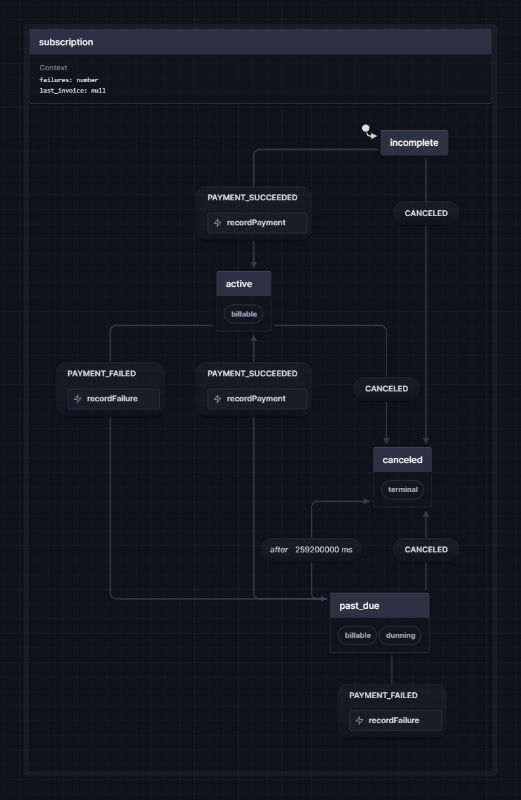</a>
<br><sub>🔗 <a href="https://stately.ai/registry/editor/4dbe1227-e533-4104-9772-dd7c7b3a86df?mode=design&machineId=330b8f3c-e2c5-44c8-8c35-16c23839e9ff">Open this machine in the Stately editor</a> — public, no account needed.</sub>
<br><sub>The input: the Stripe-subscription chart from the recipes.</sub>
</div>

<br>

What came out — abridged, but these are the real files:

<table>
<tr>
<td width="50%" valign="top">

**`subscription_logic.py`** — the machine in the class-based API, plus a stub for every
piece of logic the chart names. A typo'd guard name is a missing method here, not a
transition that mysteriously never fires in production.

```python
class SubscriptionMachine(StateMachine):
    machine_id = "subscription"
    initial_context = {"failures": 0, "last_invoice": None}

    incomplete = State(
        "incomplete",
        initial=True,
        on={
            "PAYMENT_SUCCEEDED": {
                "target": "active",
                "actions": ["recordPayment"],
            },
            "CANCELED": "canceled",
        },
    )
    active = State("active", on={...}, tags=["billable"])
    past_due = State("past_due", on={...}, tags=["billable", "dunning"])
    canceled = State("canceled", tags=["terminal"])

    @action
    def record_payment(self, interpreter, context, event, action_def) -> None:
        # TODO: implement action logic
        ...
```

</td>
<td width="50%" valign="top">

**`test_subscription.py`** — not a template. Every assertion was **recorded from the
engine**: the chart was run with stub logic on a `SimulatedClock` and the configuration after
each step written down. Green on day one; red the day the chart changes.

```python
def test_step_01_PAYMENT_SUCCEEDED(interp, clock):
    interp.send("PAYMENT_SUCCEEDED")
    assert sorted(interp.current_state_ids) == ["subscription.active"]


def test_every_declared_event_is_known(machine): ...
def test_snapshot_round_trip(interp, clock, machine): ...
```

**`subscription_types.py`** — the chart's vocabulary as types your IDE and mypy enforce:

```python
EventType = Literal["CANCELED", "PAYMENT_FAILED", "PAYMENT_SUCCEEDED"]
StateId = Literal["subscription.active", "subscription.canceled", ...]


class Context(TypedDict): ...
```

</td>
</tr>
</table>

**The generator checks structural equivalence before writing.** For templates that build the machine
in Python, `xsm` compiles the generated code, runs it, and compares the resulting machine
against `create_machine(your.json)`. If anything diverges it prints what and exits non-zero —
nothing is written. Nesting, parallel regions, history, timers (numeric *and* named delays),
composite guards, `invoke`, tags and meta all round-trip exactly.

This verifies the generated machine's structure, not the business correctness of the
implementations you add. Recorded tests start with stub logic; extend them with your own
guard, action and service scenarios.

| Template | Produces |
|:--|:--|
| `pythonic-class` · `pythonic-builder` · `pythonic-functional` | The machine in one of the [three Python styles](#-prefer-pure-python-three-more-ways-to-define-a-machine) + stubs |
| `class-json` · `function-json` | Stubs that load the JSON at runtime (the file stays the source of truth) |
| `pytest` (`--with-tests`) | A recorded test module, one test per reachable step |
| `typed` (`--with-types`) | `TypedDict` context, `Literal` events and state ids, typed stub signatures |
| `plugin` (`--with-plugin`) | A `PluginBase` wired for exactly the hooks the chart can fire |

Three more things fall out of the same idea — the chart knows itself:

```bash
xsm generate-template subscription.json -t pythonic-class -o ./billing --check   # CI: has the code drifted from the JSON?
xsm docs machines/*.json -o docs/           # a Markdown reference page per machine
xsm diagram subscription.json -f mermaid    # or plantuml / ascii — no graphviz
xsm paths subscription.json                 # one path to every reachable configuration
```

…and the `[testing]` pytest plugin turns that last list into a parametrised `xsm_path`
fixture, with `pytest --xsm-coverage` telling you which states and transitions your suite
never reached. Django projects get all of this as `manage.py xsm_*`.

Full reference → [CLI](https://basiltt.github.io/xstate-statemachine/guide/cli/) ·
[Templates deep dive](https://basiltt.github.io/xstate-statemachine/guide/cli-templates/) ·
[Hierarchical generation](https://basiltt.github.io/xstate-statemachine/guide/cli-hierarchy/) (parent + child charts in one go).

---

## 🔗 One JSON, Two Runtimes

Your frontend team models a checkout flow in [Stately](https://stately.ai/). They export
`checkout.json` and wire it into React with XState.

You take **that exact file** — unedited — and run it in Python:

<!-- doc-fragment -->
```python
import json
from xstate_statemachine import create_machine, MachineLogic, SyncInterpreter

with open("checkout.json") as f:  # ← straight from the frontend repo
    config = json.load(f)

machine = create_machine(
    config,
    logic=MachineLogic(
        actions={"charge_card": charge_card},  # you supply the Python side
        guards={"has_stock": has_stock},
    ),
)

checkout = SyncInterpreter(machine).start()
```

One definition. Two runtimes. **The UI and backend can share the same workflow contract**
instead of reimplementing the state graph independently. Keep implementations and versions
aligned, and continue to enforce authorization and business rules on the backend.

The statechart screenshots in this README come from the Stately editor — the source configs live in
[`docs/assets/images/machines/machines.json`](docs/assets/images/machines/machines.json).
Examples show the corresponding workflow or an explicitly simplified subset.
`xsm diagram` and `machine.to_mermaid()` render a machine without leaving the terminal.
The round trip, the `version` key, meta conventions and the editor JSON Schema are in
[Stately editor → Python](https://basiltt.github.io/xstate-statemachine/guide/stately-export/).

<details>
<summary><b>How compatible is "compatible"? (real numbers)</b></summary>

<br>

The test suite includes **104 real-world machines exported from Stately.ai**. 103 of them parse
structurally unmodified. The single exception has no top-level `states` key at all — it isn't a
well-formed machine.

Both XState **v4** (`cond`) and **v5** (`guard`) transition spellings are accepted.
Structural parsing is not a claim that every JavaScript API or runtime extension is supported;
the library targets XState v5 statechart semantics.

What is *not* supported: JS/TS action implementations embedded in the JSON. Those are code, not
data — you supply the Python equivalents via `MachineLogic`, which is the whole point of the
separation.

</details>

> **Note** — this library implements the **SCXML** transition-selection algorithm (the W3C
> standard XState itself follows). That is what makes nested and parallel-region behaviour
> match XState rather than merely resemble it. It does *not* import or export `.scxml` files.

---

## 💾 Context — The Machine's Memory

Context is a plain dict. Update it declaratively with `assign`:

```python
from xstate_statemachine import create_machine, SyncInterpreter, assign

cart = SyncInterpreter(
    create_machine(
        {
            "id": "cart",
            "initial": "shopping",
            "context": {"items": 0, "total": 0.0},
            "states": {
                "shopping": {
                    "on": {
                        "ADD_ITEM": {
                            "actions": assign(
                                {
                                    "items": lambda a: a["context"]["items"]
                                    + 1,
                                    "total": lambda a: a["context"]["total"]
                                    + a["event"].payload["price"],
                                }
                            )
                        },
                        "CLEAR": {
                            "actions": assign(
                                lambda a: {"items": 0, "total": 0.0}
                            )
                        },
                    }
                }
            },
        }
    )
).start()

cart.send("ADD_ITEM", price=9.99)
cart.send("ADD_ITEM", price=5.01)
print(cart.context)  # {'items': 2, 'total': 15.0}
```

`assign` takes either a **dict of per-key updaters** or a **single callable** returning a
partial dict. Each updater receives one mapping with `"context"` and `"event"` keys.

> **Tip** — keyword arguments to `send()` land in `event.payload`.
> `send("ADD_ITEM", price=9.99)` → `a["event"].payload["price"]`.

Keys that start with `_xsm_` (`PRIVATE_CONTEXT_PREFIX`) are **private context**: they
round-trip through snapshots but are stripped by `public_context()` and never leave the
process through the web adapters. Want typed context? `[pydantic]` validates it on every
`assign` — see [Integrations](#-integrations--optional-extras).

---

## 🛡️ Guards — Conditional Transitions

A guard is a pure function returning `bool`. List transitions in priority order; the **first**
whose guard passes wins.

<div align="center">
<a href="https://stately.ai/registry/editor/4dbe1227-e533-4104-9772-dd7c7b3a86df?mode=design&machineId=d83d2253-ce02-483b-a7a1-bc559c9110e1">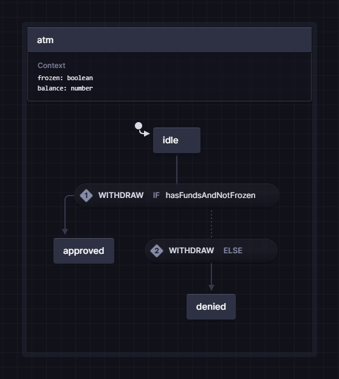</a>
<br><sub>🔗 <a href="https://stately.ai/registry/editor/4dbe1227-e533-4104-9772-dd7c7b3a86df?mode=design&machineId=d83d2253-ce02-483b-a7a1-bc559c9110e1">Open this machine in the Stately editor</a> — public, no account needed.</sub>
</div>

```python
from xstate_statemachine import create_machine, SyncInterpreter, MachineLogic

config = {
    "id": "atm",
    "initial": "idle",
    "context": {"balance": 100, "frozen": False},
    "states": {
        "idle": {
            "on": {
                "WITHDRAW": [
                    {
                        "target": "approved",
                        "guard": {
                            "type": "and",
                            "params": {
                                "guards": [
                                    "hasFunds",
                                    {
                                        "type": "not",
                                        "params": {"guards": ["isFrozen"]},
                                    },
                                ]
                            },
                        },
                    },
                    {"target": "denied"},  # fallback — no guard
                ]
            }
        },
        "approved": {},
        "denied": {},
    },
}

logic = MachineLogic(
    guards={
        "hasFunds": lambda ctx, e: ctx["balance"]
        >= e.payload.get("amount", 0),
        "isFrozen": lambda ctx, e: ctx["frozen"],
    }
)

atm = SyncInterpreter(create_machine(config, logic=logic)).start()
atm.send("WITHDRAW", amount=50)
print(atm.current_state_ids)  # {'atm.approved'}
```

**Composite guards** — `and`, `or`, `not` nest arbitrarily via `params.guards`. There's also
`stateIn` for "only if some other region is in state X":

```python
{"guard": {"type": "stateIn", "params": {"state": "auth.loggedIn"}}}
```

> **Note** — guards must be **pure**. They can be evaluated more than once, and a guard with
> side effects will surprise you. Put side effects in actions. A guard that *raises* is
> treated as `False` by default (`guardErrorPolicy` lets you change that), and a guard that is
> declared but never implemented fails loudly at `create_machine()`.

---

## 🎬 Actions — Side Effects

Actions fire **during** a transition, or on entering/leaving a state.

```jsonc
"states": {
    "loading": {
        "entry": ["showSpinner"],          # on the way in
        "exit":  ["hideSpinner"],          # on the way out
        "on": {"CANCEL": {"target": "idle", "actions": ["logCancel"]}},
    }
}
```

Order is guaranteed: **exit actions → transition actions → entry actions**.

### Built-in action creators

You rarely need to hand-write these — import them and go:

| Creator | Does |
|:--|:--|
| `assign` | Update context |
| `log` | Structured log line |
| `raise_` | Send an event to *this* machine |
| `send_to` | Send to another actor by id or `systemId` |
| `send_parent` | Send to the machine that spawned you |
| `choose` | Run the first action list whose guard passes |
| `pure` | Compute actions from context at runtime |
| `enqueue_actions` | Imperatively queue actions in a callback |
| `spawn_child` / `stop_child` | Start / stop a child actor |
| `cancel` | Cancel a delayed `send_to` |
| `emit` | Emit an event to external subscribers |
| `escalate` | Raise an error to the parent |
| `forward_to` | Forward the current event to another actor |

> **Note** — if an action raises, the error is **logged and contained** by default. The
> transition still completes and the interpreter keeps running; one buggy side effect can't
> take down a long-lived machine. `actionErrorPolicy: "rollback"` or `"fail"` changes that
> per machine — see [Failure semantics](#failure-semantics--know-what-is-contained).

<details>
<summary><b>Worked examples — the ones that aren't obvious from the name</b></summary>

<br>

**`choose` — first passing guard wins.** The declarative form of `if/elif/else`:

```jsonc
"on": {"GO": {"target": "b", "actions": [choose([
    {"guard": "isBig",   "actions": [assign({"label": lambda a: "big"})]},
    {"guard": "isSmall", "actions": [assign({"label": lambda a: "small"})]},
    {"actions": [assign({"label": lambda a: "other"})]},   # no guard = default
])]}}
```

**`pure` — decide the action list at runtime.** Return actions, or nothing:

```jsonc
"actions": [pure(lambda a:
    [assign({"n": lambda b: b["context"]["n"] * 2})]
    if a["context"]["n"] < 10 else []
)]
```

**`raise_` — feed an event back to *this* machine.** "And then immediately…" without a fake
external trigger:

```jsonc
"actions": [raise_("VALIDATE")]
```

**`send_to` / `send_parent` — talk to other actors.** Delayed sends are cancellable:

```jsonc
"actions": [send_to("timer", "TICK", delay=1000, send_id="tick")]
# elsewhere
"actions": [cancel("tick")]
```

**`emit` — publish outward without coupling.** The machine says *what happened*;
subscribers decide what to do:

```jsonc
"actions": [emit("saved")]                        # or emit({"type": "saved", "id": 7})
interpreter.on("saved", lambda ev: analytics.track(ev.type))
```

</details>

---

## 🔌 Services & Invoke

`invoke` runs an async or sync callable when a state is entered, and routes its result back
into the machine as `onDone` / `onError`. This is how you do I/O.

```python
import asyncio
from xstate_statemachine import (
    create_machine,
    Interpreter,
    MachineLogic,
    assign,
    wait_for,
)

config = {
    "id": "fetch",
    "initial": "idle",
    "context": {"user": None, "error": None},
    "states": {
        "idle": {"on": {"FETCH": "loading"}},
        "loading": {
            "invoke": {
                "src": "fetchUser",
                "onDone": {
                    "target": "success",
                    "actions": assign({"user": lambda a: a["event"].data}),
                },
                "onError": {
                    "target": "failure",
                    "actions": assign(
                        {"error": lambda a: str(a["event"].data)}
                    ),
                },
            }
        },
        "success": {"type": "final"},
        "failure": {"on": {"RETRY": "loading"}},
    },
}


async def fetch_user(interpreter, ctx, event):
    await asyncio.sleep(0.01)
    return {"id": 1, "name": "Ada"}


async def main():
    machine = create_machine(
        config, logic=MachineLogic(services={"fetch_user": fetch_user})
    )
    svc = await Interpreter(machine).start()

    await svc.send("FETCH")
    await wait_for(svc, lambda s: s.matches("fetch.success"), timeout=2)

    print(svc.context["user"])  # {'id': 1, 'name': 'Ada'}
    await svc.stop()


asyncio.run(main())
```

- **Success** → `onDone`, with the return value on `event.data`
- **Failure** → `onError`, with the *exception object* on `event.data`
- Leaving the state **cancels** the invocation and discards stale completion events.
  Cancellation is cooperative; it cannot forcibly stop a blocking thread or undo an external request
- A plain-`def` service under the async engine runs on a private thread pool
  (`service_pool_size`, or your `service_executor`) so a blocking call cannot stall the loop

Beyond callables, `src` can be **actor logic**: `from_callback` (push events in from a socket
or a thread), `from_iterator` / `from_async_iterator` (each item becomes a `StreamEvent`),
`from_coroutine`, `from_interpreter` (a whole child machine), or a Celery task via
`celery_service`.

> **Tip** — use `wait_for` (async) or `wait_for_sync` rather than `asyncio.sleep()` guesses.
> It waits on a predicate with a real timeout, so tests do not depend on guessed delays.

---

## ⏱️ Timers & Delayed Transitions

`after` fires a transition if the machine is *still* in that state when the timer elapses.
Leave early and the timer is cancelled for you.

```jsonc
"connecting": {
    "after": {5000: "timedOut"},          # 5000 ms
    "on": {"OPEN": "online"},             # ...unless we connect first
}
```

Name your delays to keep magic numbers out of the config — and to compute them at runtime,
which is exactly how you express **exponential backoff**:

```python
logic = MachineLogic(
    delays={
        "TIMEOUT": 60_000,
        "BACKOFF": lambda ctx, e: 2 ** ctx["attempt"]
        * 1000,  # 1s, 2s, 4s, 8s…
    }
)
```

```jsonc
"retrying": {"after": {"BACKOFF": "loading"}}
```

Three things make timers production-grade here rather than a `threading.Timer` per state:

- **No OS thread per timer.** The async engine fires `after` through a priority lane the run
  loop checks ahead of its inbox; the sync engine fires a due timer on the caller's thread
  inside `send()` or `tick()`.
- **Virtual time in tests.** `SimulatedClock().increment(30_000)` fires a 30-second `after`
  instantly.
- **Durable across restarts.** Deadlines persist as wall-clock instants; `persisted()`
  resumes the *remaining* time and `DueTimerScanner` wakes a machine whose deadline passed
  while nothing was running — a 7-day dunning timer survives every worker dying. See
  [Persistence](#-persistence--snapshots-stores-and-durable-timers).

---

## 🌳 Nested & Parallel States

### Nested (compound) states

Group related substates so shared transitions live in one place:

<div align="center">
<a href="https://stately.ai/registry/editor/4dbe1227-e533-4104-9772-dd7c7b3a86df?mode=design&machineId=f09dfce3-a06f-46b5-b68f-8cb9a0298313">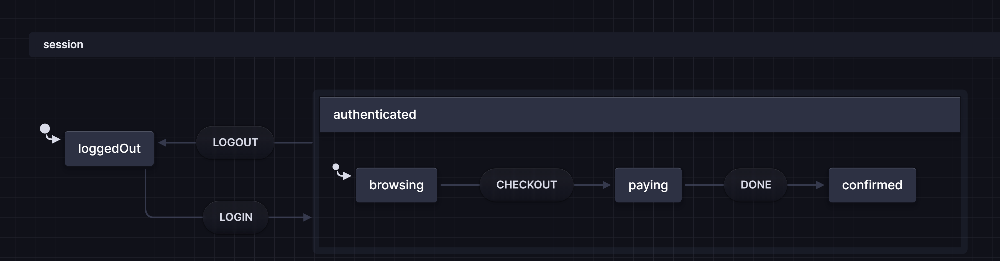</a>
<br><sub>🔗 <a href="https://stately.ai/registry/editor/4dbe1227-e533-4104-9772-dd7c7b3a86df?mode=design&machineId=f09dfce3-a06f-46b5-b68f-8cb9a0298313">Open this machine in the Stately editor</a> — public, no account needed.</sub>
</div>

```jsonc
"states": {
    "loggedOut": {"on": {"LOGIN": "authenticated"}},
    "authenticated": {
        "initial": "browsing",
        "on": {"LOGOUT": "loggedOut"},     # ← applies to EVERY substate
        "states": {
            "browsing":  {"on": {"CHECKOUT": "paying"}},
            "paying":    {"on": {"DONE": "confirmed"}},
            "confirmed": {},
        },
    },
}
```

`LOGOUT` works from `browsing`, `paying`, *and* `confirmed`. Write it once.

### Parallel states — concurrent regions

Regions run independently. `onDone` fires **exactly once**, when *all* of them reach a final
state — fan-out and fan-in with no bookkeeping:

<div align="center">
<a href="https://stately.ai/registry/editor/4dbe1227-e533-4104-9772-dd7c7b3a86df?mode=design&machineId=f5951ce8-b462-41e3-868b-e641ada282c6">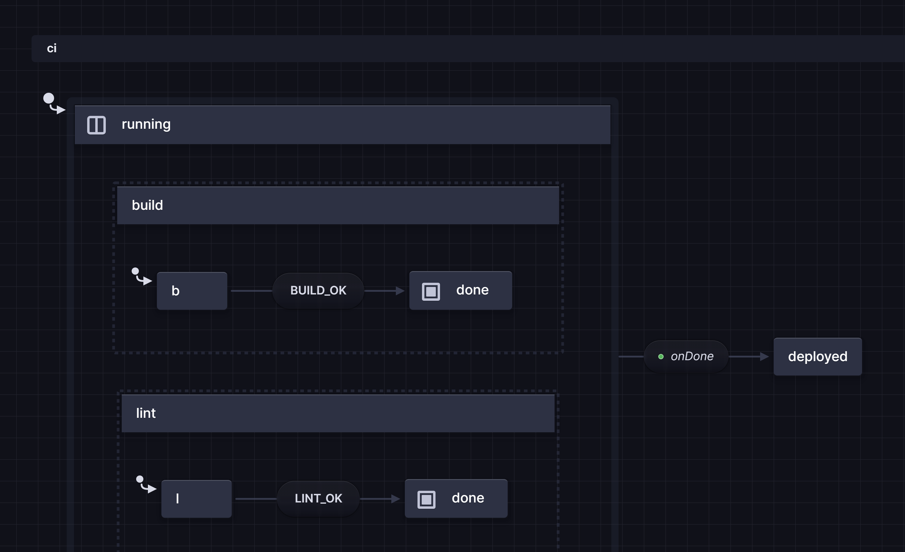</a>
<br><sub>🔗 <a href="https://stately.ai/registry/editor/4dbe1227-e533-4104-9772-dd7c7b3a86df?mode=design&machineId=f5951ce8-b462-41e3-868b-e641ada282c6">Open this machine in the Stately editor</a> — public, no account needed.</sub>
</div>

```python
from xstate_statemachine import create_machine, SyncInterpreter

ci = SyncInterpreter(
    create_machine(
        {
            "id": "ci",
            "initial": "running",
            "states": {
                "running": {
                    "type": "parallel",
                    "onDone": "deployed",
                    "states": {
                        "build": {
                            "initial": "b",
                            "states": {
                                "b": {"on": {"BUILD_OK": "done"}},
                                "done": {"type": "final"},
                            },
                        },
                        "lint": {
                            "initial": "l",
                            "states": {
                                "l": {"on": {"LINT_OK": "done"}},
                                "done": {"type": "final"},
                            },
                        },
                    },
                },
                "deployed": {},
            },
        }
    )
).start()

print(
    sorted(ci.current_state_ids)
)  # ['ci.running.build.b', 'ci.running.lint.l']
ci.send("BUILD_OK")
print(
    sorted(ci.current_state_ids)
)  # ['ci.running.build.done', 'ci.running.lint.l']
ci.send("LINT_OK")
print(sorted(ci.current_state_ids))  # ['ci.deployed']   ← fan-in fired
```

This is where `current_state_ids` returning a **set** finally makes sense.

---

## 🕰️ History & Final States

**History** remembers where you were, so an interruption doesn't lose progress — the classic
"resume the wizard where the user left off":

<div align="center">
<a href="https://stately.ai/registry/editor/4dbe1227-e533-4104-9772-dd7c7b3a86df?mode=design&machineId=051ddb7e-0e0b-4d5e-befa-8028f9871591">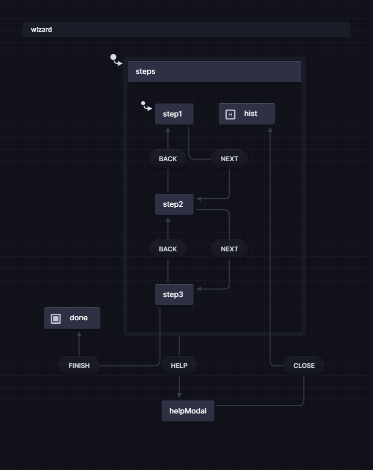</a>
<br><sub>🔗 <a href="https://stately.ai/registry/editor/4dbe1227-e533-4104-9772-dd7c7b3a86df?mode=design&machineId=051ddb7e-0e0b-4d5e-befa-8028f9871591">Open this machine in the Stately editor</a> — public, no account needed.</sub>
</div>

```jsonc
"states": {
    "steps": {
        "initial": "step1",
        "on": {"HELP": "helpModal"},
        "states": {
            "step1": {"on": {"NEXT": "step2"}},
            "step2": {"on": {"NEXT": "step3", "BACK": "step1"}},
            "step3": {"on": {"FINISH": "#wizard.done", "BACK": "step2"}},
            "hist":  {"type": "history", "history": "shallow"},   # or "deep"
        },
    },
    "helpModal": {"on": {"CLOSE": "steps.hist"}},    # ← back to the exact step
    "done": {"type": "final"},
}
```

**Final states** mark completion. A final state in a compound state fires its parent's
`onDone`; a top-level final state stops the machine and can produce `output`. Await it with
`to_promise(interp)` or `interp.wait_done()`.

---

## 🎭 The Actor Model

Machines can spawn other machines. Each child gets its own state, context and lifecycle —
a supervision tree, not a callback pile. Register a child under a `systemId` and any machine
in the system can address it by name.

<div align="center">
<a href="https://stately.ai/registry/editor/4dbe1227-e533-4104-9772-dd7c7b3a86df?mode=design&machineId=d7897555-d098-4080-b33f-95c06f3ce8a7">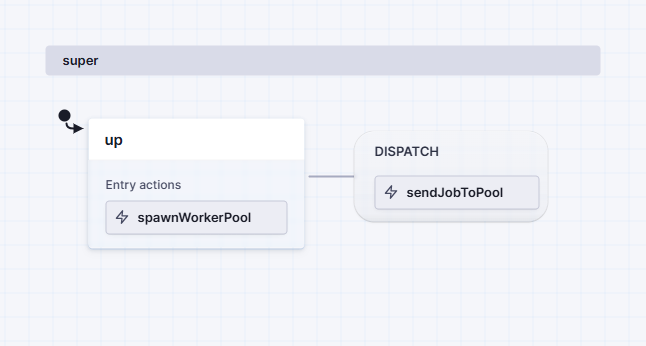</a>
<br><sub>🔗 <a href="https://stately.ai/registry/editor/4dbe1227-e533-4104-9772-dd7c7b3a86df?mode=design&machineId=d7897555-d098-4080-b33f-95c06f3ce8a7">Open this machine in the Stately editor</a> — public, no account needed.</sub>
</div>

```python
from xstate_statemachine import create_machine, SyncInterpreter, MachineLogic

# The child machine — an independent actor with its own context.
worker = {
    "id": "worker",
    "initial": "idle",
    "context": {"jobs": 0},
    "states": {
        "idle": {"on": {"JOB": {"target": "idle", "actions": ["count"]}}}
    },
}
worker_logic = MachineLogic(
    actions={
        "count": lambda i, ctx, e, a: ctx.__setitem__("jobs", ctx["jobs"] + 1),
    }
)

parent = {
    "id": "super",
    "initial": "up",
    "context": {},
    "states": {
        "up": {
            "entry": [
                {
                    "type": "spawnChild",
                    "params": {
                        "src": "worker",
                        "id": "pool",
                        "systemId": "pool",
                    },
                }
            ],
            "on": {
                "DISPATCH": {
                    "actions": [
                        {
                            "type": "sendTo",
                            "params": {"to": "pool", "event": {"type": "JOB"}},
                        }
                    ]
                }
            },
        }
    },
}

logic = MachineLogic(
    services={
        "worker": lambda i, ctx, e: create_machine(worker, logic=worker_logic),
    }
)

sup = SyncInterpreter(create_machine(parent, logic=logic)).start()
print(list(sup.system.get_all()))  # ['pool']

sup.send("DISPATCH")
sup.send("DISPATCH")
print(sup.system.get("pool").context["jobs"])  # 2
```

Children talk back with `send_parent`, escalate failures with `escalate`, and are torn down
with `stop_child` — or automatically when the parent stops. Spawned actors inherit the
parent's plugins and are captured in its snapshot.

**Good fit for:** LLM agent orchestration (each tool call a supervised child — see
[`spawn_agent`](#-for-llm-agents)), connection pools, per-user session machines, job workers.

---

## 💾 Persistence — Snapshots, Stores and Durable Timers

Serialize a running machine to JSON, store it anywhere, rebuild it later. Long-running flows
survive deploys and restarts.

<!-- doc-fragment -->
```python
from xstate_statemachine import create_machine, SyncInterpreter

job = SyncInterpreter(create_machine(config)).start()
job.send("NEXT")

snapshot = job.get_snapshot()  # a JSON string → Redis, Postgres, a file…
job.stop()

# …new process, hours later…
resumed = SyncInterpreter.from_snapshot(snapshot, create_machine(config))
print(resumed.current_state_ids)  # {'job.step2'}   ← exactly where it left off
resumed.send("NEXT")
```

State, context, pending events (with their lane), deferred events, armed delayed sends,
history, child actors, `after` deadlines and `systemId` registrations all round-trip.
Every snapshot carries an envelope (`version` — layout **4** — `machine_id`, `machine_hash`,
`machine_version`), so `from_snapshot()` refuses a structurally different machine with
`SnapshotDriftError` instead of silently resuming into it; a newer layout than this release
understands is `SnapshotVersionError`, never a guess.

### The safe loop: load → act → persist → discard

Most apps never call `from_snapshot` by hand. `xstate_statemachine.persistence` ships the
whole loop with built-in stores — `MemoryStore`, `FileStore` (atomic writes, `0600`),
`SQLiteStore` (WAL, stdlib `sqlite3`) — and `RedisStore`, `SQLAlchemyStore` /
`AsyncSQLAlchemyStore` and `DjangoStore` in their extras:

```python
from xstate_statemachine import MachineLogic, create_machine
from xstate_statemachine.persistence import MemoryStore, persisted

cfg = {
    "id": "order",
    "initial": "cart",
    "context": {"items": 0},
    "states": {
        "cart": {"on": {"ADD": {"actions": "add"}, "PAY": "paid"}},
        "paid": {"type": "final"},
    },
}
machine = create_machine(
    cfg,
    logic=MachineLogic(
        actions={
            "add": lambda i, ctx, e, a: ctx.__setitem__(
                "items", ctx["items"] + 1
            )
        }
    ),
)
store = MemoryStore()  # or SQLiteStore("orders.db"), RedisStore(...)

with persisted(
    store, "order:42", machine
) as order:  # loaded (or created), started
    order.send("ADD")
    order.send("ADD")
# saved with expected_version on clean exit; a concurrent writer gets ConflictError

with persisted(store, "order:42", machine) as order:
    assert order.context["items"] == 2
    assert order.send("PAY", wait=True).changed
assert store.load("order:42").version == 2
```

`apersisted()` is the async twin; `persisted_retry()` reloads and re-applies on
`ConflictError`. What the loop gives you, all documented on the
[Guarantees](https://basiltt.github.io/xstate-statemachine/guide/guarantees/) page:

| Concern | What you get |
|:--|:--|
| Two workers, one instance | `OptimisticLock` (version check + jittered retry) or a fenced `PessimisticLock` — **never a silent lost update** |
| Duplicate webhooks | `IdempotencyPlugin(inbox, principal=…)` answers a replay with the **original receipt** before the machine sees it; scope is per tenant. `MemoryInbox`, `SQLiteInbox`, `RedisInbox`, `DjangoInbox` |
| Timers across restarts | `after` deadlines are persisted as wall-clock instants; `persisted()` resumes the **remaining** time, and `DueTimerScanner` wakes machines whose deadline passed while nothing was running (drive it from cron, APScheduler or Celery Beat) |
| Audit / replay | `AuditPlugin` + `TransitionLogPlugin` (who, what, when) into `MemoryLog`, `JSONLinesLog`, `SQLiteLog` or `RedisLog`; `replay()` a log into a fresh machine and `assert_replay_consistent()` in tests |
| Schema drift | `@migrator.register("1.0", "1.1")` steps upgrade in-flight instances across a deploy; `xsm snapshots --stale` finds the ones written by another machine version; unknown or newer layouts are refused, never guessed at |
| Adopting an existing table | `from_state_ids(machine, ids, context)` mints a valid snapshot from the state column you already have (how `xsm_migrate_fsm` moves a django-fsm model over) |
| Secrets | One `redact()` denylist applied by every built-in sink; a `SnapshotCodec` seam for encryption at rest; `SnapshotTooLargeError` caps blob size |
| The store is down | `StoreUnavailableError` → **503** in the web adapters; a failed save does not commit a new snapshot. External effects performed before the failure still need idempotency |

The honest boundary: the persistence layer's **exactly-once transition** guarantee applies
to idempotency-keyed events while deduplication evidence is retained, using the documented
store and locking setup. Actions' external side effects and outbox delivery are
**at-least-once**, and a memory-only inbox is not durable retention. Use `invoke` to model
I/O, use the [transactional outbox](#-event-driven-architecture-the-main-event) for outgoing
messages, and make external effects idempotent. Full guide →
[Persistence & Durability](https://basiltt.github.io/xstate-statemachine/guide/persistence/).

---

## 🔌 Integrations — Optional Extras

The core stays zero-dependency; every integration is an extra under `xstate_statemachine.contrib`
that you install explicitly (`pip install "xstate-statemachine[fastapi]"`). Each has a guide
page with a **Guarantees** box and a **Threat model** box — CI refuses a page without them —
and every framework version it claims is proven by a CI cell on the
[Compatibility](https://basiltt.github.io/xstate-statemachine/guide/compatibility/) page.

| Extra | What you get | Guide |
|:--|:--|:--|
| `[pydantic]` | Typed context validated on every `assign`, `EventModel` discriminated unions → `event_schemas=`, `validate_machine_json()`, JSON Schema | [Pydantic](https://basiltt.github.io/xstate-statemachine/guide/integration-pydantic/) |
| `[redis]` | `RedisStore` / `RedisInbox` / `RedisLog` with fenced locks (Lua, fencing tokens) for multi-host deployments; `RedisStreamsBroker` | [Redis](https://basiltt.github.io/xstate-statemachine/guide/integration-redis/) |
| `[sqlalchemy]` | `StatechartType` + `StatechartMixin` (state on your row, `version_id_col` locking, `in_state()`), `SQLAlchemyStore` / `AsyncSQLAlchemyStore`, transactional outbox (`SQLAlchemyOutboxStore`) | [SQLAlchemy](https://basiltt.github.io/xstate-statemachine/guide/integration-sqlalchemy/) |
| `[starlette]` | `StatechartRegistry` — the store-backed create → act → persist loop as ASGI middleware; receipt → HTTP status; principal-scoped `Idempotency-Key`; RFC 9457 problems; SSE and WebSocket transition streams | [Starlette](https://basiltt.github.io/xstate-statemachine/guide/integration-starlette/) |
| `[fastapi]` | `StatechartRouter` generates `GET /{id}`, `POST /{id}/send` (discriminated-union body), one route per event, `/events`, `/diagram.mmd`, `/stream`, `/ws` — with OpenAPI that reflects your chart; `Depends(get_interpreter(...))`; `xsm new --template fastapi` | [FastAPI](https://basiltt.github.io/xstate-statemachine/guide/integration-fastapi/) |
| `[litestar]` | `XStatePlugin` + a generated `Controller` on the same registry | [Litestar](https://basiltt.github.io/xstate-statemachine/guide/integration-litestar/) |
| `[flask]` | `init_app` extension, statechart blueprint, `SessionStore` wizards, `flask xsm` CLI, Quart shim; `xsm new --template flask` | [Flask](https://basiltt.github.io/xstate-statemachine/guide/integration-flask/) |
| `[django]` | `StatechartField` on your model (`in_state()`, `__state` lookups), `send()` in `atomic()` with `lock="optimistic"` or a row lock, `pre_transition` / `post_transition` / `statechart_error` signals, `TransitionLog` audit in the same transaction, `PermissionGuard` / `RoleGuard` / `AnyOf` / `AllOf`, `DjangoStore`, `DjangoOutboxStore`, admin transition buttons (CSRF-protected), `manage.py xsm_inspect / xsm_diagram / xsm_docs / xsm_simulate / xsm_snapshots --stale / xsm_deadlines`, `xsm_migrate_fsm` + `FSMDualWriteMixin` to leave django-fsm | [Django](https://basiltt.github.io/xstate-statemachine/guide/integration-django/) |
| `[drf]` / `[channels]` | `StatechartViewSetMixin` (an `@action` per event, closed by default, receipt → status, drf-spectacular schema, `DjangoInbox` for `Idempotency-Key`); `StatechartConsumer` (live transitions over WebSocket, requires `AuthMiddlewareStack`) | [DRF & Channels](https://basiltt.github.io/xstate-statemachine/guide/integration-drf/) |
| `[celery]` | A Celery task as an `invoke` service (`celery_service`), `@statechart_task` worker act-loop, Celery Beat as the durable `after` scheduler (`DurableTimerScheduler`), `outbox_relay_task`; refuses pickle / YAML serializers | [Celery](https://basiltt.github.io/xstate-statemachine/guide/integration-celery/) |
| `[kafka]` `[rabbitmq]` `[nats]` `[sqs]` + `[redis]` | Broker adapters (`KafkaBroker`, `RabbitMQBroker`, `NatsBroker`, `SqsBroker` / `SyncSqsBroker`, `RedisStreamsBroker` / `SyncRedisStreamsBroker`): at-least-once delivery, topology-dependent per-subject ordering and poison → DLQ. Broker redelivery counts become attempts where available; Kafka has no such count. Shared contract tests; `xsm plugins` lists the adapters | [Brokers](https://basiltt.github.io/xstate-statemachine/guide/integration-brokers/) |
| *(core)* + `[cloudevents]` | The [event-driven core](#-event-driven-architecture-the-main-event) above; the extra adds CloudEvents SDK / HTTP binding interop | [Event-driven](https://basiltt.github.io/xstate-statemachine/guide/integration-eda/) |
| `[agents]` | [LLM agents](#-for-llm-agents): `TOOL_LOOP`, per-state tool allow-lists, budgets (`BudgetPlugin`, `budget_guards`, `Usage`), durable human approval, `spawn_agent`; `agent_logic`, `run_agent_sync`, `structured_output`, `handoff_guard`, `AgentTracePlugin`, `ToolDeniedError`; OpenAI / Anthropic providers are soft imports | [LLM agents](https://basiltt.github.io/xstate-statemachine/guide/integration-agents/) |
| `[observability]` | `OpenTelemetryPlugin` spans, `PrometheusPlugin` metrics, structlog / loguru context, Sentry breadcrumbs — `instrument_all()` in one line; label allow-list by default | [Observability](https://basiltt.github.io/xstate-statemachine/guide/integration-observability/) |
| `[testing]` | A pytest plugin: `xsm_*` fixtures (machine, interpreter, simulated clock, recorded scenarios), `xsm_path` walks every engine-verified path, state / transition coverage with `--xsm-fail-under-*`, Hypothesis strategies (`model_test`, `events_strategy`), `replay()` / `assert_replay_consistent()`, fake brokers | [Testing](https://basiltt.github.io/xstate-statemachine/guide/integration-testing/) |
| `[format]` | `black` + `isort` so `xsm generate-template` output matches your linter | [CLI](https://basiltt.github.io/xstate-statemachine/guide/cli/) |
| `[web]` · `[eda]` · `[all]` | Convenience bundles: selected web integrations · Celery/Redis/Kafka/RabbitMQ/CloudEvents/observability · all shipped integration and testing extras. Add `[nats]` or `[sqs]` to `[eda]` when needed; install `[format]` separately for formatting tools | [Integration extras](https://basiltt.github.io/xstate-statemachine/guide/integrations-extras/) |

<!-- doc-fragment -->
```python
from fastapi import FastAPI
from xstate_statemachine.contrib.fastapi import (
    StatechartRouter,
    instrument_app,
)
from xstate_statemachine.contrib.starlette import StatechartRegistry
from xstate_statemachine.persistence import SQLiteStore

# … order_machine, AddItem/Pay/Cancel event models and my_authorizer defined elsewhere
registry = StatechartRegistry(
    SQLiteStore(DB_PATH), run_timers=True
)  # or RedisStore for many hosts
registry.register(
    "orders", order_machine, authorize=my_authorizer
)  # closed by default

app = FastAPI()
instrument_app(app, registry)  # lifespan, /_xsm/health, /_xsm/ready
app.include_router(
    StatechartRouter(registry, "orders", event_models=[AddItem, Pay, Cancel])
)
# POST /orders/42/events/PAY  →  200 {state, state_ids, changed, available_events, …}
#                            →  409 when a business rule (guard) refuses, 422 on a bad body
#                            →  503 when the store is unavailable
```

Every web integration is **closed by default** — `authorize=` is required, `GET` returns
state only unless you opt into a `context_serializer`, and error bodies never carry exception
text. The multi-worker model (why an interpreter cannot live in a uvicorn worker, where timers
run, how 4 workers × 200 concurrent `PAY` yields exactly one success) is the
[FastAPI guide's](https://basiltt.github.io/xstate-statemachine/guide/integration-fastapi/) first section.

Six runnable, README-driven apps live under
[`examples/integrations/`](https://github.com/basiltt/xstate-statemachine/tree/main/examples/integrations)
— `fastapi_orders` (N uvicorn workers, a 200-payment stress test, gateway-outage and
rolling-upgrade scenarios), `django_approvals` (parallel Legal/Finance review, roles, admin,
DRF, Channels), `flask_wizard`, `sqlalchemy_orders`, `eda_fulfilment` and
`agents_support_bot`. CI installs each one into a fresh venv from its own `pip install` line.

---

### 🤖 For LLM agents

An agent loop is a statechart the model does not get to rewrite. With
`pip install "xstate-statemachine[agents]"` the model becomes **one invoked service** that
*proposes* text or tool calls, and the chart *decides* what happens next. This is the
reference `TOOL_LOOP` chart the extra ships — every budget check, timeout, denial and
human-approval wait is a state you can see, test, persist and diagram:

<div align="center">
<a href="https://stately.ai/registry/editor/4dbe1227-e533-4104-9772-dd7c7b3a86df?mode=design&machineId=20b6e732-e957-448d-9584-ae207227d9f1">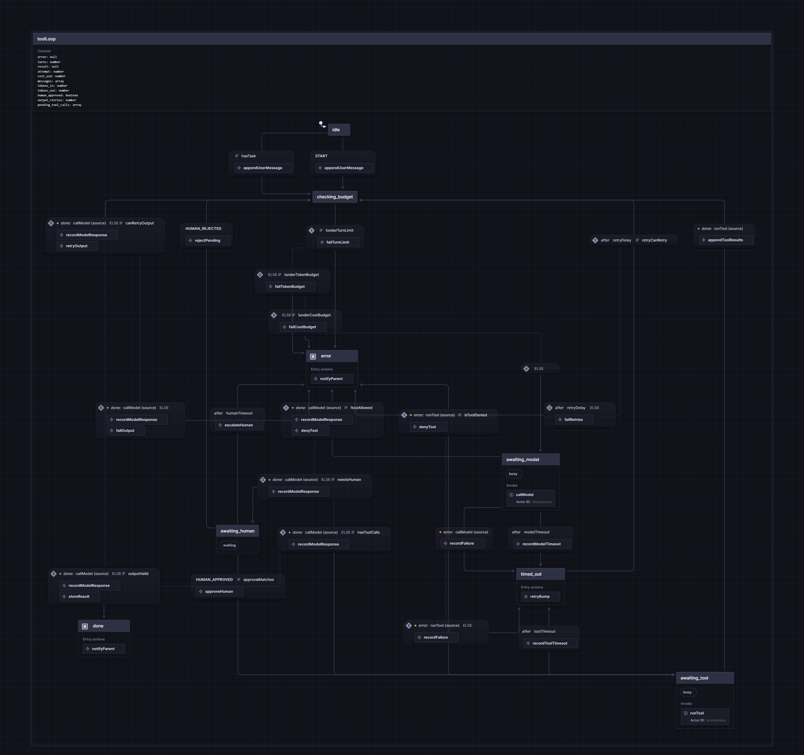</a>
<br><sub>🔗 <a href="https://stately.ai/registry/editor/4dbe1227-e533-4104-9772-dd7c7b3a86df?mode=design&machineId=20b6e732-e957-448d-9584-ae207227d9f1">Open this machine in the Stately editor</a> — public, no account needed.</sub>
</div>

- **Per-state tool allow-lists** (`meta.tools`) are re-checked inside `run_tool` — editing
  the guard out of the chart does not let a forbidden tool through.
- **Budgets are guards**: turns, tokens and cost are context the chart refuses to exceed.
  `BudgetPlugin` rolls them up across a tree of spawned agents.
- **Timeouts are `after` deadlines**, retried with backoff through `timed_out`.
- **Human approval is a durable state.** `awaiting_human` persists with the exact pending
  call ids and an escalation deadline; the approval event must name the call it approves.
- **Structured output** is validated (pydantic) with bounded retries; a bad answer is a
  state, not an exception in your handler.
- **Multi-agent**: `spawn_agent` runs children as actors with per-child and global budgets;
  `supervisor`, `pipeline` and `debate` reference charts ship alongside `TOOL_LOOP`.
- **Offline by default**: `FakeModel` scripts the model's answers, so the whole loop runs in
  CI with no key. OpenAI and Anthropic providers are soft imports; it interoperates with
  [LangGraph and pydantic-ai](https://basiltt.github.io/xstate-statemachine/guide/integration-agents/).

<!-- doc-requires: pydantic -->
```python
# pip install "xstate-statemachine[agents]"   # … the extra's only hard dependency is pydantic
import asyncio
from xstate_statemachine.contrib.agents import (
    FakeModel,
    run_agent,
    tool_registry,
)


def get_weather(city: str) -> str:
    """Current weather for a city."""
    return f"sunny in {city}"


model = FakeModel(
    [{"tool": "get_weather", "args": {"city": "Kochi"}}, {"text": "Sunny."}]
)
res = asyncio.run(
    run_agent(
        model, tools=tool_registry(get_weather), prompt="Weather?", max_turns=5
    )
)
assert res.final_state == "toolLoop.done" and res.usage["turns"] == 2
```

`AgentTracePlugin` writes JSONL traces with `gen_ai.*` attributes and secret scrubbing. The
two-minute offline walkthrough is
[`examples/integrations/agents_support_bot`](https://github.com/basiltt/xstate-statemachine/tree/main/examples/integrations/agents_support_bot)
(`python run.py --fake --prompt "refund order 42"` — one refund, never two). Honest
[comparisons](https://basiltt.github.io/xstate-statemachine/guide/vs-langgraph/) with LangGraph, Burr and
@statelyai/agent include checked-version notes and scheduled drift checks.

---

## 🔭 Observability & Inspection

Three ways to see inside a running machine, from zero-dependency to full APM.

**Built in** — `LoggingInspector` prints every event, transition and action;
`InspectorPlugin` speaks the `@statelyai/inspect` protocol so `xsm inspect --live` (or an
`SseSink` in your app) streams any machine into the **Stately Inspector** in your browser;
`JsonLinesSink` records a session and `xsm replay` plays it back, live or as a transcript.

**`[observability]`** — one line:

<!-- doc-fragment -->
```python
from xstate_statemachine.contrib.observability import instrument_all

# OpenTelemetry spans per transition/service, Prometheus counters and histograms,
# structlog / loguru context vars, Sentry breadcrumbs — whichever SDKs are installed
instrument_all(interpreter)  # … any running Interpreter / SyncInterpreter
```

Metric labels are an **allow-list** by default (state and event names, never payloads), and
every sink runs the same `redact()` denylist as the stores. For agents, `AgentTracePlugin`
writes JSONL traces with `gen_ai.*` attributes and secret scrubbing.

**Programmatic** — `subscribe()`, `on()`, `send(wait=True) → Receipt`, plugin hooks for every
lifecycle moment, and the pure API below. Guide →
[Observability](https://basiltt.github.io/xstate-statemachine/guide/integration-observability/) ·
[Live inspector](https://basiltt.github.io/xstate-statemachine/guide/integration-inspector/).

---

## 🧪 The Pure API — No Interpreter

Sometimes you want to ask *"what would happen if…"* without running anything. The pure API is
a set of side-effect-free functions over immutable snapshots — ideal for tests, planning, and
"preview the next step" UI.

```python
from xstate_statemachine import (
    MachineLogic,
    create_machine,
    initial_transition,
    pure_transition,
)

machine = create_machine(
    {
        "id": "fetch",
        "initial": "idle",
        "states": {
            "idle": {
                "on": {"FETCH": {"target": "loading", "actions": "logStart"}}
            },
            "loading": {"on": {"OK": "done"}},
            "done": {"type": "final"},
        },
    },
    logic=MachineLogic(),
)  # 📝 no implementations needed — nothing runs

snapshot, entry_actions = initial_transition(machine)
next_snapshot, actions = pure_transition(machine, snapshot, "FETCH")

print(snapshot.state_ids)  # {'fetch.idle'}
print(next_snapshot.state_ids)  # {'fetch.loading'}
print([a.type for a in actions])  # ['logStart'] — what WOULD have run
```

Both functions return `(snapshot, actions)`. If you only want the next state,
`get_next_snapshot(machine, snapshot, "FETCH")` returns the snapshot alone.

A `PureSnapshot` exposes `state_ids`, `context`, `status`, `output`, `configuration`
and `matches()`. No timers start. No services fire. Nothing mutates.

The graph module goes further: `reachable_states()`, `shortest_paths()`, `simple_paths()`
and `transition_coverage_targets()` enumerate a machine — which is what `xsm paths` prints
and what the `[testing]` plugin's `xsm_path` fixture walks, one engine-verified path per test.

---

## 🔍 Introspection & Plugins

A running machine can answer questions about itself — which is what lets you drive a UI
from it without duplicating its logic in your view layer.

```python
from xstate_statemachine import (
    create_machine,
    MachineLogic,
    SyncInterpreter,
    assign,
    emit,
)

editor = create_machine(
    {
        "id": "editor",
        "initial": "clean",
        "context": {"saves": 0},
        "states": {
            "clean": {
                "tags": ["idle"],
                "meta": {"hint": "Nothing to save"},
                "on": {"EDIT": "dirty"},
            },
            "dirty": {"tags": ["unsaved"], "on": {"SAVE": "saving"}},
            "saving": {
                "tags": ["unsaved", "busy"],
                "on": {
                    "OK": {
                        "target": "clean",
                        "actions": [
                            assign(
                                {"saves": lambda a: a["context"]["saves"] + 1}
                            ),
                            emit("saved"),
                        ],
                    }
                },
            },
        },
    },
    logic=MachineLogic(),
)

ed = SyncInterpreter(editor).start()

ed.matches("editor.clean")  # True  — nested paths work: "a.b.c"
ed.can("EDIT")  # True  — would this event do anything *right now*?
ed.can("SAVE")  # False — not handled in `clean`
ed.has_tag("idle")  # True
ed.tags  # {'idle'}
ed.get_meta()  # {'editor.clean': {'hint': 'Nothing to save'}}
ed.context  # {'saves': 0}
ed.is_running  # True
```

### `can()` — disable buttons without duplicating logic

The machine already knows which events are legal. Ask it, instead of re-deriving
the rule in your template:

```python
save_button.disabled = not ed.can("SAVE")
```

### Tags — style many states with one check

`saving` and `dirty` are different states but share the `unsaved` tag, so a spinner
needs one condition rather than a growing `or` chain:

```python
if ed.has_tag("busy"):
    show_spinner()
```

### `subscribe()` — react to every settled transition

The listener receives the **interpreter**, so read whatever you need from it:

```python
unsubscribe = ed.subscribe(
    lambda i: print(sorted(i.current_state_ids), i.context)
)
# … later
unsubscribe()
```

### `on()` — listen for emitted events

`emit` publishes a named event outward. Subscribe to it by name:

```python
ed.on("saved", lambda ev: print("saved!", ev.type))
```

### Plugins — the whole lifecycle, one line

<!-- doc-fragment -->
```python
from xstate_statemachine import LoggingInspector

ed.use(LoggingInspector())  # complete transition audit trail
```

Subclass `PluginBase` for metrics, tracing, or persistence-on-every-transition. Every
hook is optional:

| Hook | Fires when |
|:--|:--|
| `on_interpreter_start` / `on_interpreter_stop` | Lifecycle boundaries (`restored_from_snapshot` tells a resume from a bring-up) |
| `on_before_send` / `on_event_received` / `on_event_processed` | An event is offered (and may be refused), arrives, and has run its macrostep |
| `on_event_refused` / `on_event_sent` / `on_resolve_error` | A later plugin refused an event you had already approved (release your claim); this actor addressed an event to another actor (`sendTo` / `sendParent` / `forwardTo`); a transition target failed to resolve |
| `on_transition` | A transition settles |
| `on_guard_evaluated` / `on_guard_error` | A guard returns — "why didn't it fire?" — or raised |
| `on_action_execute` / `on_action_error` | Before each action runs; an action raised. **Failures are contained**, so without this hook they are invisible |
| `on_service_start` / `on_service_done` / `on_service_error` | `invoke` lifecycle |
| `on_unhandled_event` / `on_invalid_event` / `on_event_dropped` | An event nobody handled, one `strict` or a schema refused, one a bounded inbox dropped |
| `on_transition_failed` / `on_chain_budget_exceeded` / `on_invocation_stranded` | A policy stopped a step, a runaway chain was cut, a cut parked a state whose service will never finish |
| `on_snapshot_error` / `on_plugin_error` / `on_receipt_dropped` | Serialization failed; another plugin raised (never stops the machine); a `wait=True` receipt was dropped unawaited |
| `on_done` / `on_error` | The machine reached a final state, or stopped with an error |

<!-- doc-fragment -->
```python
from xstate_statemachine import PluginBase


class Metrics(PluginBase):
    def on_transition(self, interpreter, from_states, to_states, transition):
        statsd.increment(f"fsm.{transition.event}")

    def on_action_error(self, interpreter, action, error):
        sentry.capture_exception(error)  # otherwise silently contained


ed.use(Metrics())
```

`register_global(plugin)` attaches a plugin to every interpreter constructed afterwards —
including spawned children and `from_snapshot()` restores. Third-party packages can publish
plugins, stores and brokers under the `xstate_statemachine.plugins` / `.brokers` entry-point
groups; `xsm plugins` lists what is installed and `attach_discovered(interp, allow=[...])`
loads **only** the distributions you name (it never runs an unmarked callable — see
[Security](#-security--trust-model)).

---

## ⚖️ How It Compares

**Choose for the workflow you need, not the longest feature list.** The distinctive
combination here is XState JSON portability, Python statechart execution and optional
persistence, web and event-driven integrations around the same model.

The seven detailed comparisons include source notes and checked versions. The repository
also runs scheduled release/API drift checks; those are not a claim to test every feature
of every competing product on every release:
[transitions](https://basiltt.github.io/xstate-statemachine/guide/vs-transitions/) ·
[python-statemachine](https://basiltt.github.io/xstate-statemachine/guide/vs-python-statemachine/) ·
[django-fsm](https://basiltt.github.io/xstate-statemachine/guide/vs-django-fsm/) ·
[LangGraph](https://basiltt.github.io/xstate-statemachine/guide/vs-langgraph/) ·
[Burr](https://basiltt.github.io/xstate-statemachine/guide/vs-burr/) ·
[@statelyai/agent](https://basiltt.github.io/xstate-statemachine/guide/vs-statelyai-agent/) ·
[AWS Step Functions](https://basiltt.github.io/xstate-statemachine/guide/vs-step-functions/).

### Python state-machine libraries

The feature comparison is scoped to the APIs recorded in the
[comparison source notes](docs/_data/comparisons.json), including `transitions 0.9.3` and
`python-statemachine 3.2.1`. Application code and third-party extensions can add capabilities
beyond those listed. See the projects' own documentation for their current surface:
[transitions](https://github.com/pytransitions/transitions) and
[python-statemachine](https://python-statemachine.readthedocs.io/).

| Capability | **xstate-statemachine** | **transitions** | **python-statemachine** |
|:--|:--|:--|:--|
| XState / Stately JSON | **Native input**; Python implements the named logic | Its own configuration format | Its own JSON/YAML/SCXML formats |
| Compound (nested) states | Built in | `HierarchicalMachine` | `StateChart` |
| Parallel regions | Built in | Hierarchical extension | `State.Parallel` |
| History states | Shallow and deep | Application-managed in the checked API | Shallow and deep |
| Invoked services and completion/error events | `invoke` + `onDone` / `onError` | Application callbacks | Built-in `invoke`, including child machines |
| Delayed transitions | `after`; durable with persistence + a scanner | `Timeout` and thread-free `AsyncTimeout`; in-process | `delay=` / timeout helpers; in-process |
| Actor model / spawning | Spawned actors, messaging and `systemId` registry | Application-managed | Invoked children; not the same spawn/registry API |
| Snapshot persistence, stores, locks, idempotency | Integrated persistence layer | Model-state storage / serialization + application integration | Model-field persistence + application integration |
| Sync **and** async runtimes | Two explicit engines | Sync and async extensions | Sync and async engines |
| Framework adapters (FastAPI, Django, Flask, Celery, brokers) | Optional integration packages | Application / ecosystem integration | Django model mixin; other integrations are application-specific |
| Diagram export | Mermaid, PlantUML, ASCII; no rendering binaries required | Graphviz or Mermaid | Graphviz or Mermaid |
| CLI: generate, inspect, simulate, diagram, docs | `xsm` developer and operations toolkit | Application / ecosystem tooling | Diagram CLI and documentation tooling |
| Live inspector (Stately Inspector protocol) | `xsm inspect --live` | No bundled Stately bridge in the checked API | No bundled Stately bridge in the checked API |
| Virtual clock for tests | `SimulatedClock` | Test-specific clock control | Test-specific clock control |
| Bounded inbox / backpressure | Async `max_queue_size` + overflow policies | Different queueing model | Different queueing model |
| Core runtime dependencies | **0** | 1 (`six`) | 0 |

**Pick `transitions`** if you want a mature, flexible FSM attached to an existing class,
with extensions for hierarchy, async execution and diagrams.

**Pick `python-statemachine`** if you want a beautiful, pythonic declarative API and don't
need XState JSON interop. Its compound, parallel and history states, invoked services and
diagram tooling make it a substantive alternative.

**Pick this library** when you want XState/Stately JSON to run in Python unchanged, or you
want `invoke`, `after`, actors, persistence and framework adapters as first-class primitives
instead of patterns you assemble yourself.

### Beyond a state-machine library

| Your priority | Consider | Why choose this library for that project? |
|:--|:--|:--|
| **A lightweight FSM on a Django model** | [django-fsm / django-fsm-2](https://basiltt.github.io/xstate-statemachine/guide/vs-django-fsm/) | When the workflow needs nested or parallel states, durable deadlines, broker events and the broader statechart toolkit. A migration command and dual-write mixin support incremental adoption. |
| **Graph-based AI orchestration, checkpoints and debugging** | [LangGraph](https://basiltt.github.io/xstate-statemachine/guide/vs-langgraph/) or [Burr](https://basiltt.github.io/xstate-statemachine/guide/vs-burr/) | When explicit statechart semantics, per-state tool permissions and durable approval deadlines should govern the agent alongside ordinary application workflows. These tools can also be integrated rather than replaced. |
| **XState-native agents in TypeScript** | [@statelyai/agent](https://basiltt.github.io/xstate-statemachine/guide/vs-statelyai-agent/) | When your services and business logic live in Python and you want to keep a portable statechart definition. |
| **AWS-managed workflow orchestration** | [AWS Step Functions](https://basiltt.github.io/xstate-statemachine/guide/vs-step-functions/) | When you want an embedded Python runtime and control over the hosting, database and broker. This library is not a managed service; you operate and scale the deployment. |

### Speed

Same machine shape, each library through its own idiomatic API, all measured in one session
on 0.11.0 (**October 11, 2026**, Python 3.14, median of 7 runs, GC disabled, setup excluded
except for the construction scenario). These are a **recorded benchmark snapshot**, not
live measurements or a throughput guarantee. Events per second;
**bold** is fastest in the row.

| Scenario | **xstate-statemachine** (sync) | transitions 0.9.3 | python-statemachine 3.2.1 | sismic 1.6.14 |
|:--|--:|--:|--:|--:|
| Flat toggle | 71,210 | **124,773** | 7,365 | 12,153 |
| 3-level nested | **28,502** | 7,806 | 2,901 | 4,669 |
| Parallel regions | **25,349** | 5,654 | 2,537 | 4,333 |
| Delayed transitions (timers/s) | **7,706** | 79 | 2,077 | 5,037 |
| Construction (machines/s) | **8,684** | 7,649 | 854 | 220 |
| 1,000 instances (inst/s) | **33,213** | 30,215 | 2,221 | 7,109 |

In this recorded run, `transitions` leads the *flat* scenario by approximately **1.8×**.
`xstate-statemachine` leads the two measured nested/parallel scenarios by **3.7–4.5×**
over the next library. Construction and the 1,000-instance scenario are **14% and 10%
ahead** of `transitions`, while retaining build-time validation.

These are workload-specific microbenchmarks. They do not measure database writes, broker
delivery, network calls or model latency, and they do not establish a universal ranking.
Full table, method and caveats:
[`benchmarks/competitors/`](https://github.com/basiltt/xstate-statemachine/blob/main/benchmarks/competitors/README.md). The production numbers (throughput budget, `after` lateness under load) come from [`benchmarks/production_characteristics.py`](https://github.com/basiltt/xstate-statemachine/blob/main/benchmarks/production_characteristics.py); run it with `--json` on your own hardware to gate CI on your figures.

### When *not* to use this

For a three-state toggle with no I/O, a plain `enum` and an `if` is less machinery and easier
to read. Around five states, a sketch may be enough; at twenty interacting states, an
explicit model can be much easier to reason about. State count is only a heuristic:
**concurrency, timeouts, cancellation and recovery paths** are better reasons to adopt
a statechart. Use a managed workflow service when managed operations are the requirement,
and a task queue when all you need is independent background jobs.

---

## 📚 Cookbook

Real problems, small solutions.

> 🍳 **Full recipes**, each a runnable folder under
> [`examples/recipes/`](https://github.com/basiltt/xstate-statemachine/tree/main/examples/recipes)
> and tested in CI — hostile inputs included: **Stripe webhooks** (HMAC verification,
> `event.id` as the idempotency key, 1,000 deliveries with forged / stale / tampered ones
> among them), **APScheduler durable timers**, **RQ / arq / Dramatiq workers** with
> `ConflictError` retry, a **Streamlit / Gradio wizard**, chatbot **slot filling**,
> **feature-flag rollout** on a `SimulatedClock`, **WebSocket reconnect** with `RetryPolicy`
> backoff, and **circuit breaker + retry** for an HTTP client:
> **[Recipes →](https://basiltt.github.io/xstate-statemachine/guide/recipes/)**

Every recipe below is a fragment for readability. Here is one **complete, runnable**
program first — a checkout that guards an empty cart, retries a declining card, and
records the failure reason, in 40 lines:

<details open>
<summary><b>🧾 A whole machine, end to end</b></summary>

<br>

<div align="center">
<a href="https://stately.ai/registry/editor/4dbe1227-e533-4104-9772-dd7c7b3a86df?mode=design&machineId=3cda1413-fd94-434c-b10e-418d8153fb35">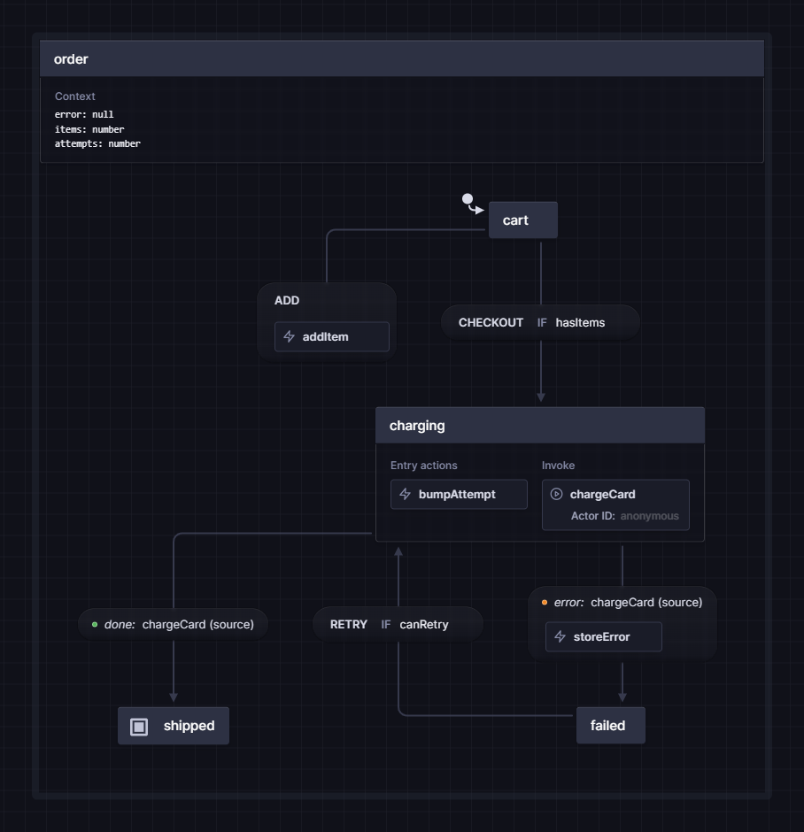</a>
<br><sub>🔗 <a href="https://stately.ai/registry/editor/4dbe1227-e533-4104-9772-dd7c7b3a86df?mode=design&machineId=3cda1413-fd94-434c-b10e-418d8153fb35">Open this machine in the Stately editor</a> — public, no account needed.</sub>
</div>

```python
from xstate_statemachine import (
    MachineLogic,
    SyncInterpreter,
    assign,
    create_machine,
)

ORDER = {
    "id": "order",
    "initial": "cart",
    "context": {"items": 0, "attempts": 0, "error": None},
    "states": {
        "cart": {
            "on": {
                "ADD": {
                    "actions": assign(
                        {"items": lambda a: a["context"]["items"] + 1}
                    )
                },
                "CHECKOUT": {"target": "charging", "guard": "hasItems"},
            },
        },
        "charging": {
            "entry": assign(
                {"attempts": lambda a: a["context"]["attempts"] + 1}
            ),
            "invoke": {
                "src": "chargeCard",
                "onDone": "shipped",
                "onError": {
                    "target": "failed",
                    "actions": assign(
                        {"error": lambda a: str(a["event"].data)}
                    ),
                },
            },
        },
        "failed": {
            "on": {"RETRY": {"target": "charging", "guard": "canRetry"}}
        },
        "shipped": {"type": "final"},
    },
}


def charge_card(interpreter, context, event):
    """Fails the first time, succeeds on the retry."""
    if context["attempts"] < 2:
        raise RuntimeError("card declined")
    return {"receipt": "r-123"}


logic = MachineLogic(
    guards={
        "hasItems": lambda ctx, e: ctx["items"] > 0,
        "canRetry": lambda ctx, e: ctx["attempts"] < 3,
    },
    services={"charge_card": charge_card},
)

order = SyncInterpreter(create_machine(ORDER, logic=logic)).start()

order.send("CHECKOUT")  # guard blocks — the cart is empty
print(sorted(order.current_state_ids))  # ['order.cart']

order.send("ADD")
order.send("CHECKOUT")  # charges; the service raises
print(sorted(order.current_state_ids))  # ['order.failed']
print(order.context["error"])  # card declined

order.send("RETRY")  # second attempt succeeds
print(sorted(order.current_state_ids))  # ['order.shipped']
print(order.context["attempts"])  # 2
```

Note what is **absent**: no `try/except` around the charge, no `is_charging` flag, no
"did we already ship?" check. A declined card is an `onError` edge and "cart is empty" is
a guard. A repeated `CHECKOUT` cannot start another local charge: `shipped` is `final`
and `charging` has no `CHECKOUT` handler. For a real payment provider, also use durable
persistence and provider-side idempotency to handle retries across failures.

</details>

<details open>
<summary><b>🔁 Retry with exponential backoff and a give-up limit</b></summary>

<br>

<div align="center">
<a href="https://stately.ai/registry/editor/4dbe1227-e533-4104-9772-dd7c7b3a86df?mode=design&machineId=738d033e-bb9b-4e1e-9e08-18e4edb72900">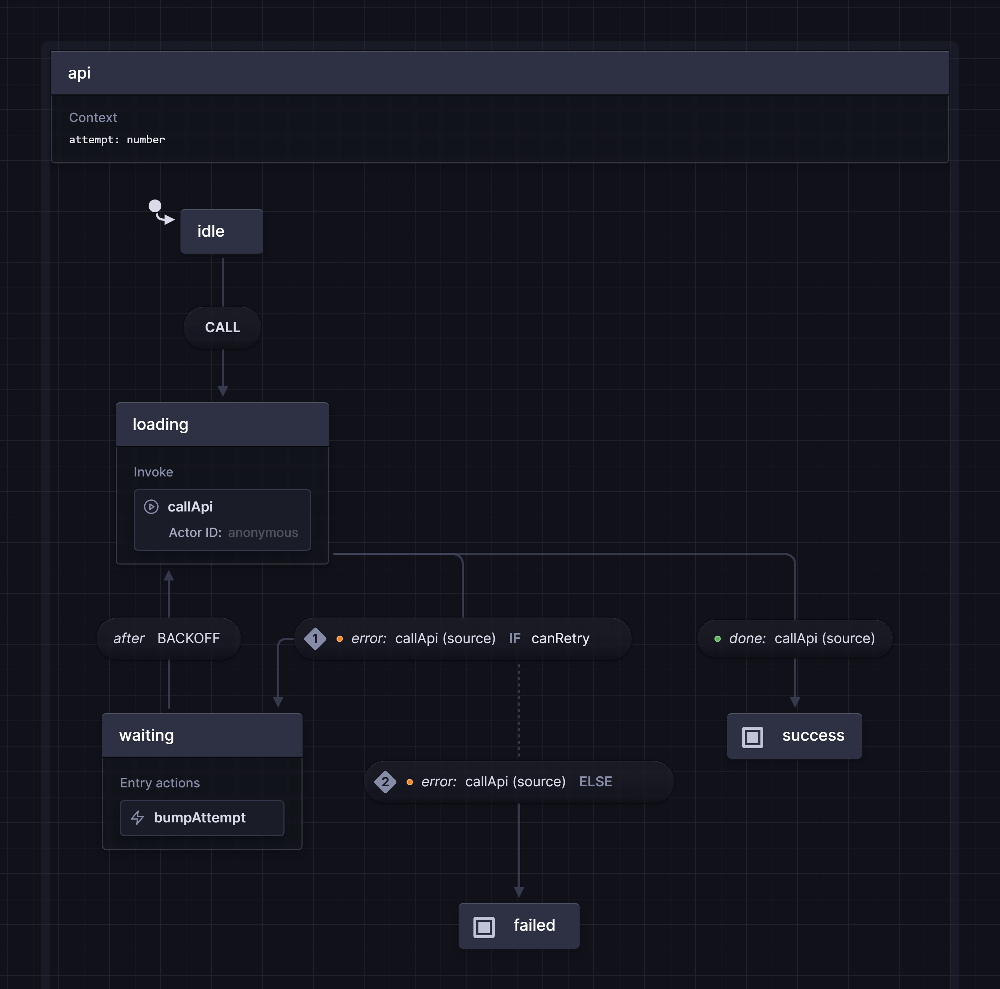</a>
<br><sub>🔗 <a href="https://stately.ai/registry/editor/4dbe1227-e533-4104-9772-dd7c7b3a86df?mode=design&machineId=738d033e-bb9b-4e1e-9e08-18e4edb72900">Open this machine in the Stately editor</a> — public, no account needed.</sub>
</div>

The pattern that turns into unreadable nested loops when hand-written:

```python
config = {
    "id": "api",
    "initial": "idle",
    "context": {"attempt": 0},
    "states": {
        "idle": {"on": {"CALL": "loading"}},
        "loading": {
            "invoke": {
                "src": "callApi",
                "onDone": "success",
                "onError": [
                    {"target": "waiting", "guard": "canRetry"},
                    {"target": "failed"},  # out of retries
                ],
            }
        },
        "waiting": {
            "entry": assign(
                {"attempt": lambda a: a["context"]["attempt"] + 1}
            ),
            "after": {"BACKOFF": "loading"},
        },
        "success": {"type": "final"},
        "failed": {"type": "final"},
    },
}

logic = MachineLogic(
    services={"call_api": call_api},
    guards={"canRetry": lambda ctx, e: ctx["attempt"] < 5},
    delays={"BACKOFF": lambda ctx, e: 2 ** ctx["attempt"] * 1000},
)
```

Attempt counting, backoff math, and the give-up condition are each in exactly one place.
`xstate_statemachine.patterns.RetryPolicy` packages this (with full / equal jitter and a
`max_ms` cap) as ready-made guards and delays.

</details>

<details>
<summary><b>🛒 Checkout that blocks duplicate submissions</b></summary>

<br>

```jsonc
"states": {
    "reviewing":  {"on": {"SUBMIT": "charging"}},
    "charging":   {                                  # ← no SUBMIT handler here
        "invoke": {"src": "chargeCard",
                   "onDone": "confirmed", "onError": "declined"},
    },
    "confirmed":  {"type": "final"},
    "declined":   {"on": {"SUBMIT": "charging"}},
}
```

The second click while `charging` does nothing because the state has no handler for it.
The local duplicate submission is blocked by the model. For the network-level twin
(the same webhook delivered twice), use `IdempotencyPlugin`; external payment calls
still need their own idempotency key.

</details>

<details>
<summary><b>🔌 Connection lifecycle with heartbeat</b></summary>

<br>

```jsonc
"states": {
    "disconnected": {"on": {"CONNECT": "connecting"}},
    "connecting": {
        "invoke": {"src": "openSocket", "onDone": "connected", "onError": "backoff"},
        "after": {"CONNECT_TIMEOUT": "backoff"},
    },
    "connected": {
        "on": {"PONG": "connected", "CLOSE": "disconnected"},   # self-transition resets timer
        "after": {"HEARTBEAT": "reconnecting"},
    },
    "backoff": {"after": {"RETRY_DELAY": "connecting"}},
    "reconnecting": {"on": {"CONNECT": "connecting"}},
}
```

A late `onDone` from a cancelled connection attempt is discarded — `disconnected` doesn't
handle it. That's the zombie-callback class of bug, gone structurally. The full version,
with a `from_callback` actor wrapping the socket, is the
[WebSocket reconnect recipe](https://basiltt.github.io/xstate-statemachine/guide/recipes/websocket-reconnect/).

</details>

<details>
<summary><b>🤖 LLM agent loop with supervised tool calls</b></summary>

<br>

```jsonc
"states": {
    "planning": {"invoke": {"src": "askModel",
                            "onDone": [{"target": "callingTool", "guard": "wantsTool"},
                                       {"target": "answering"}]}},
    "callingTool": {
        "entry": [{"type": "spawnChild",
                   "params": {"src": "toolRunner", "id": "tool", "systemId": "tool"}}],
        "on": {"TOOL_RESULT": "reflecting", "TOOL_FAILED": "recovering"},
        "after": {"TOOL_TIMEOUT": "recovering"},
    },
    "reflecting": {"always": [{"target": "planning", "guard": "needsMoreWork"},
                              {"target": "answering"}]},
    "recovering": {"always": [{"target": "planning", "guard": "canRetry"},
                              {"target": "givingUp"}]},
    "answering": {"type": "final"},
    "givingUp":  {"type": "final"},
}
```

The agent's control flow is **data you can inspect, diagram and test** — not a `while` loop
with flags. The `[agents]` extra ships this as the `TOOL_LOOP` reference chart with
allow-lists, budgets and a persisted `awaiting_human` state — see
[For LLM agents](#-for-llm-agents).

</details>

<details>
<summary><b>🧪 Testing a machine without mocks</b></summary>

<br>

`SyncInterpreter` needs no event loop, so tests stay plain:

```python
def test_declined_card_allows_retry():
    checkout = SyncInterpreter(
        create_machine(config, logic=test_logic)
    ).start()

    checkout.send("SUBMIT")
    assert checkout.matches("checkout.charging")

    checkout.send("SUBMIT")  # double click
    assert checkout.matches("checkout.charging")  # …ignored
```

Or skip the interpreter entirely with the [pure API](#-the-pure-api--no-interpreter), or
install `[testing]` and let `xsm_path` generate one test per reachable path with
`pytest --xsm-coverage` reporting which states and transitions your suite never reached.

</details>

---

## 🐍 Prefer Pure Python? Three More Ways to Define a Machine

JSON is the interop format, not an obligation. If you're not sharing definitions with a
frontend, define machines in Python instead.

### Class-based — declarative and readable

```python
from xstate_statemachine import State, StateMachine, SyncInterpreter, action


class Checkout(StateMachine):
    machine_id = "checkout"
    initial_context = {"attempts": 0}

    reviewing = State(initial=True)
    charging = State()
    confirmed = State()

    submit = reviewing.to(charging, event="SUBMIT", actions=["recordAttempt"])
    ok = charging.to(confirmed, event="PAID")

    @action
    def record_attempt(self, interpreter, ctx, evt, action_def):
        ctx["attempts"] += 1


c = SyncInterpreter(Checkout.create_machine()).start()
c.send("SUBMIT")
print(c.current_state_ids, c.context)  # {'checkout.charging'} {'attempts': 1}
c.send("SUBMIT")  # double click → ignored
print(c.context)  # {'attempts': 1}
```

> **Watch out** — `@action`, `@guard` and `@service` convert `snake_case` method names to
> `camelCase` keys. The method `record_attempt` is referenced as `"recordAttempt"`.

Compose multiple transitions for one event with `|`:

```python
flip = off.to(on, event="TOGGLE") | on.to(off, event="TOGGLE")
```

### Builder — fluent

```python
from xstate_statemachine import MachineBuilder

machine = (
    MachineBuilder("toggle")
    .state("off", initial=True)
    .state("on")
    .transition("off", "TOGGLE", "on")
    .transition("on", "TOGGLE", "off")
    .build()
)
```

`transition()` takes `(source, event, target)`, so states and transitions can be declared
in any order — handy when you're generating a machine from data.

### Functional — `build_machine()`

Plain objects and explicit wiring. The style to reach for when the machine is
data you are assembling, not a shape you are declaring:

```python
from xstate_statemachine import (
    State,
    SyncInterpreter,
    action,
    build_machine,
)


@action
def record_attempt(interpreter, ctx, evt, action_def):
    ctx["attempts"] += 1


reviewing = State(
    "reviewing",
    initial=True,
    on={"SUBMIT": {"target": "charging", "actions": ["recordAttempt"]}},
)
charging = State("charging", on={"PAID": "confirmed"})
confirmed = State("confirmed", final=True, tags=["done"])

machine = build_machine(
    id="checkout",
    states=[reviewing, charging, confirmed],
    context={"attempts": 0},
    actions=[record_attempt],
)

c = SyncInterpreter(machine).start()
c.send("SUBMIT")
print(
    sorted(c.current_state_ids), c.context
)  # ['checkout.charging'] {'attempts': 1}
c.send("PAID")
print(
    sorted(c.current_state_ids), sorted(c.tags)
)  # ['checkout.confirmed'] ['done']
```

### Everything the JSON format supports

All three styles compile to the same `MachineNode`, so none of them is a reduced
subset. Nesting, parallel regions, history, timers, tags and metadata are all
expressible:

```jsonc
State("online", initial=True, states=[configuring, running, resume],
      on={"DISCONNECT": "offline"}, tags=["connected"])

State("resume", history="deep")           // remembers the last active child
State("failed", meta={"alert": True})     // arbitrary data for your UI
State("regions", parallel=True, states=[...])
```

Machine-level properties — a global escape transition, root `entry`/`exit`, or a
parallel root — go on `root=`:

```python
from xstate_statemachine import State, SyncInterpreter, build_machine

root = State("", on={"EMERGENCY": "halted"}, tags=["v2"])
machine = build_machine(
    id="press",
    states=[State("idle", initial=True), State("running"), State("halted")],
    root=root,
)

p = SyncInterpreter(machine).start()
p.send("EMERGENCY")  # works from ANY state
print(sorted(p.current_state_ids))  # ['press.halted']
```

`MachineBuilder.root(...)` and a `machine_root` class attribute do the same for
the other two styles.

> **Runnable examples** for all three styles — building the *same* machine, with
> `invoke`, timers, guards, tags and meta — live in
> [`examples/sync/easy/pythonic_approach/`](https://github.com/basiltt/xstate-statemachine/tree/main/examples/sync/easy/pythonic_approach/).

---

## 🛠️ CLI Tool

`xsm` is the terminal companion to the library — a code generator, a validator, an inspector,
a live simulator, a diagram/docs exporter and an operations console in one zero-dependency
command. Run it bare on a terminal for an interactive launcher with a menu, recent files and
a generate wizard that previews before it writes; pipe it and every command degrades to clean
plain text (`--plain`, `--json`, `NO_COLOR`).

```bash
xsm                                                           # interactive launcher
xsm new my_service --template fastapi                         # scaffold a project from an example app
xsm gt checkout.json -t pythonic-class --with-tests --with-types -o ./app
xsm validate machines/*.json                                  # build each file with the real library
xsm inspect checkout.json                                     # tree, transitions, logic, policies
xsm simulate checkout.json                                    # live: pick events, +clock, undo
xsm sim checkout.json --events SUBMIT,+2001 --json            # scripted, for CI
xsm inspect checkout.json --live                              # stream to the Stately Inspector
xsm diagram checkout.json -f mermaid -o docs/
xsm docs machines/*.json -o docs/
xsm snapshots sqlite:///orders.db --stale --fail-if-stale     # written by another machine version?
xsm dlq --dlq sqlite:///dlq.db list                           # dead letters; `replay` is a dry run by default
xsm asyncapi checkout.json -o asyncapi.json
```

| Command | Alias | Does |
|:--|:--|:--|
| `generate-template` | `gt` | Generate Python from a machine JSON — plus `--with-tests`, `--with-types`, `--with-plugin` companions; `--check` for CI drift |
| `list-templates` | `lt` | The 10 templates, grouped |
| `validate` | `val` | Build each file with the real library; list every finding (`--lenient`, `--json`) |
| `inspect` | `ins` | State tree, transitions table, logic to implement, failure policies; `--live` streams to the Stately Inspector |
| `simulate` | `sim` | Run a machine on a simulated clock — interactively or from `--events` / `--script`; `--record` writes a JSONL session |
| `replay` | | Print or `--live`-stream a recorded inspector session |
| `diagram` | `dia` | Mermaid, PlantUML or ASCII to stdout or a file |
| `docs` | | A Markdown reference page per machine |
| `paths` | | One path to every reachable configuration — the `[testing]` plugin walks the same list |
| `coverage` | | Render a statechart coverage report from `pytest --xsm-coverage`, with a fail-under gate |
| `new` | | Scaffold a project from an example app (`--list`; `fastapi`, `flask`) |
| `snapshots` | | List persisted snapshots in a store (`sqlite:///`, `file:///`); `--stale` / `--fail-if-stale` for deploy gates |
| `dlq` | | Dead-letter store operations: `list`, `show`, `replay` (dry run unless `--no-dry-run --yes`), `purge` |
| `asyncapi` | | An AsyncAPI 3.0 document from your machines' publish / consume declarations |
| `plugins` | | Third-party plugins, stores and brokers found via entry points; `--strict` exits 1 on a broken one |
| `info` | | Library and Python version, feature summary |
| `update` | | Check PyPI and upgrade with the installer that installed you (pip / pipx / uv tool) |
| `setup` | | Windows: make `xsm` work where pip's `xsm.exe` launcher is blocked |

Code generation (`generate-template`, the companion templates and the proof-before-write
check) has [its own section](#-automatic-code-generation).

Full reference: **[CLI Tool](https://basiltt.github.io/xstate-statemachine/guide/cli/)** ·
[Templates deep dive](https://basiltt.github.io/xstate-statemachine/guide/cli-templates/) ·
[Hierarchical generation](https://basiltt.github.io/xstate-statemachine/guide/cli-hierarchy/).
Django projects get the same commands as `manage.py xsm_*`.

<details>
<summary><b>Why generate instead of hand-write?</b></summary>

<br>

Because the machine already declares every logic name it needs. The generator reads them and
emits a stub for each — so a typo in a guard name becomes a missing-function error at
generation time rather than an `ImplementationMissingError` in production.

</details>

---

## 🏭 Running It in Production

Everything above is the happy path. Here is what matters once real traffic arrives.

### Throughput, timers and threads — read this before sizing

Async interpreters attached to the **same event loop share its thread and execution
budget**. Adding more machines does not create more CPU capacity. The published reference
measurements report roughly **30k trivial events/s** on a laptop, and approximately
**45 ms `after` lateness at 500 busy machines**, compared with approximately 180 ms before
0.8.0. These are historical workload measurements, not a deployment SLA.

`after` timers use a **priority lane** ahead of the async inbox. A sync timer runs on the
owner's thread when it calls `send()` or `tick()`. Neither engine creates an OS thread per
timer. Other work can use threads: blocking `def` services in the async engine run in its
service executor, and non-blocking spawned work has engine-specific delivery.

Pass `Interpreter(machine, clock=SimulatedClock())` in tests to advance time without
sleeping. For measured tables, the benchmark runner and a sizing rule, read
**[Production Characteristics](https://basiltt.github.io/xstate-statemachine/guide/production-characteristics/)**
before deploying, then measure your own machine shapes, handlers and persistence layer.

### Failure semantics — know what is contained

Each is a **per-machine policy**. The default preserves the historical behaviour; production machines should opt in explicitly.

| What fails | Default | Opt-in policy (machine config key) | How to observe it |
|:--|:--|:--|:--|
| An **action** raises (entry, exit, or transition) | Contained; the transition still commits | `actionErrorPolicy`: `"rollback"` restores configuration *and* context · `"fail"` also **stops** the machine (`status == "stopped"`, configuration cleared) with `TransitionFailedError` on `.error` | `on_action_error`, `on_transition_failed`, `interpreter.last_transition_ok` |
| A **guard** raises | Treated as `False` | `guardErrorPolicy`: `"true"` · `"raise"` (takes the next candidate transition first, then surfaces the exception) | `on_guard_error` (distinct from a guard that *returned* `False`) |
| An invoked **service** raises | Routed to `onError` — a normal transition, not a crash | — | `onError` target, `on_service_error` |
| An **unknown event** arrives | Ignored (XState semantics) | `onUnhandled`: `"defer"` replays it after the next state change · `"error"` stops with `UnhandledEventError` | `on_unhandled_event` fires under *every* policy |
| A **transition target** does not resolve | Rejected at `create_machine()` | `strict_targets=False` downgrades to a `DeprecationWarning` (removed in 1.0) | `InvalidConfigError` lists every bad target at once |
| A **config key is misspelled** — at the root *or* inside any state, transition or invoke | Logged at WARNING with a "did you mean" hint and the path (`m.a: 'entyr' (did you mean 'entry'?)`) | `create_machine(..., strict_config=True)` or config `"strictConfig": true` refuses with `InvalidConfigError` | The build log; `x-…` keys and `meta`/`description`/`tags` are always accepted |
| A **self-generated chain runs away** — a zero-delay `raise`/self-`send` cycle or an `always` loop | Cut at `maxIterations` (default 1000); the machine stays `running` | Tune `maxIterations`; a *delayed* self-send is a timer and is never counted | Sticky: `interpreter.chain_trips`, `interpreter.last_chain_error` (cleared only by `clear_chain_error()`, survives a snapshot), `on_chain_budget_exceeded` once per trip; `on_invocation_stranded` if the cut parked a state whose service will never complete |
| An action **awaits its own `send(wait=True)`** | — | — | `ReentrantWaitError` at the call site instead of a silent deadlock (both engines); a plain-`def` action that drops the result gets a `RuntimeWarning` |
| The **inbox is full** | Unbounded (no limit) | `max_queue_size=`, `overflow_policy=OverflowPolicy.RAISE` (default once bounded) · `BLOCK` · `DROP_NEWEST` | `RAISE` raises `QueueOverflowError`; `DROP_NEWEST` calls `on_event_dropped`; `interpreter.queue_depth` |
| An **undeclared event** is sent under `strict` | N/A — `strict` is opt-in | Machine config `strict: true` or `Interpreter(strict=True)` | `UnknownEventError` at the `send()` call site, before queueing; `event_schemas=` on `create_machine()` raises `InvalidEventPayloadError` for a bad payload regardless of `strict`. Both checks also apply to events restored from a snapshot — a refusal fires `on_invalid_event` (pass `from_snapshot(..., plugins=[...])` to see it) and lands on `last_error` |

Containment by default is deliberate: a long-lived machine should not die because one
side effect had a bad day. The cost is that failures are **invisible unless you look**, so
wire up the hooks early — every one of them fires whatever policy you choose:

<!-- doc-fragment -->
```python
from xstate_statemachine import PluginBase


class ErrorReporter(PluginBase):
    def on_action_error(self, interpreter, action, error):
        sentry.capture_exception(error)


interp.use(ErrorReporter())
```

> **Note** — `actionErrorPolicy` defaults to `"continue"` today (with a one-shot
> `DeprecationWarning`); it flips to `"rollback"` in 1.0. Pin it explicitly if you need
> today's behaviour to survive the upgrade.

### Asking the machine a question

`send()` normally fires and forgets. Pass `wait=True` to get a `Receipt` once that exact
event's macrostep has run — no polling, no `wait_for()`:

```python
receipt = await interp.send("SUBMIT", wait=True)
# Receipt(state_ids=frozenset({'checkout.paying'}), changed=True, error=None,
#         deferred=False, denied=False)

await interp.send_priority(
    "CANCEL"
)  # ahead of the inbox, exempt from its bound
```

`priority=True` on `send()` does the same as `send_priority()`. A `Receipt` has five
fields — read them by attribute; `deferred` says the event was parked under
`onUnhandled: "defer"`, `denied` that a handler existed but every guard said no.

Two rules for `wait=True` **inside an action**: don't `await` your own receipt on the
action's own task (the run loop can't advance until the action returns, so it raises
`ReentrantWaitError` rather than deadlocking), and don't drop it from a plain `def`
action (it warns). Hand it out — `asyncio.ensure_future(i.send("GO", wait=True))` — or
send without `wait`; a helper task the action spawns may await freely.

### Waiting for a machine to settle

Do not poll by hand or `sleep()` and hope:

<!-- doc-fragment -->
```python
from xstate_statemachine import wait_for, wait_for_sync, to_promise

# async
await wait_for(interp, lambda i: i.matches("job.done"), timeout=30)
result = await to_promise(
    interp
)  # resolves when the machine reaches a final state

# sync
wait_for_sync(interp, lambda i: i.matches("job.done"), timeout=30)
```

### Choosing an interpreter

| Use | When |
|:--|:--|
| `Interpreter` | asyncio apps — FastAPI, aiohttp, bots, anything already async |
| `SyncInterpreter` | Django views, Celery tasks, CLI tools, scripts, tests |

Same machine JSON, same semantics, same guarantees. Timers, services and actors all work
on both engines; neither spawns an OS thread per timer — the sync engine delivers a due
`after` timer on the caller's own thread inside `send()` or `tick()`, and the async engine
delivers it through the priority lane described above. Blocking services on the async
engine use its service executor. A `SyncInterpreter` remains caller-driven; use
`send_threadsafe()` for cross-thread producers and drain its mailbox with `send()` or `tick()`.

### Long-running machines

- **Persist at settled transition boundaries.** Prefer the `persisted()` / `apersisted()`
  loop and a durable store for the documented locking and crash-recovery behavior.
  `get_persisted_snapshot()` in a `subscribe()` callback gives you a snapshot for custom
  storage; the callback alone does not make the write atomic or durable.
- **`after` timers across a restore.** A snapshot carries each pending timer's wall-clock
  deadline. The `persisted()` loop and the web registries resume the **remaining** time
  (`restart_timers="resume"`), and `DueTimerScanner` fires a deadline that matured while
  nothing was running. A bare `from_snapshot()` is a static rebuild: `has_dormant_timers`
  is `True` until you pass `restart_timers="resume"` (or `True` to re-arm from zero). A timer that had already *fired* is in the
  snapshot and replays. A **delayed self-send** (`raise`/`send` with `delay`) *is*
  persisted with its remaining time and resumes where it would have been.
- **Invokes do not restart on restore either** — `from_snapshot()` is a static rebuild
  that starts nothing by default. Call `pending_invocations()` on the restored
  interpreter to see every `PendingInvocation(state_id, invoke_id, src)` with no live
  service (`has_dormant_invocations` is the boolean), and
  `from_snapshot(..., restart_services=True)` to re-invoke each of them from scratch.
- **Snapshots carry an envelope** (`version` — layout 4 — `machine_id`, `machine_hash`, `machine_version`)
  so a restore against a machine that no longer matches the one that produced the
  snapshot fails loud with `SnapshotDriftError` instead of resuming into undefined
  behaviour. Pass `verify_machine_hash=False` after a deliberate migration. The hash is
  a drift check, not an authentication tag: if a blob crosses a trust boundary, sign it
  outside and pin `from_snapshot(..., minimum_version=4, expected_machine_hash=...)` so
  the payload cannot pick its own level of checking.
- **What else round-trips:** pending events with their lane (priority events restore
  ahead of the inbox on both engines), deferred events, armed delayed sends, history,
  child actors, the `error`, and the chain-trip latch (`chain_trips` /
  `last_chain_error`) — a restart is not an acknowledgement. `strict` and
  `event_schemas` are applied to every restored event; a refusal is reported, not
  silently admitted.
- **Always `stop()`** — it cancels timers and stops spawned actors. In a web app, tie it
  to request teardown; in a worker, to the task's `finally`.

### Testing

The [pure API](#-the-pure-api--no-interpreter) is the simplest way to test machine
*logic* — no event loop, no mocks, no sleeping:

<!-- doc-fragment -->
```python
from xstate_statemachine import get_initial_snapshot, get_next_snapshot

snap = get_initial_snapshot(machine)
snap = get_next_snapshot(machine, snap, "SUBMIT")
assert snap.matches("checkout.paying")
```

Use a real interpreter for integration tests, where you want the actions to actually run.
For an `after` timer, don't sleep — inject a `SimulatedClock` and jump virtual time:

<!-- doc-fragment -->
```python
from xstate_statemachine import SyncInterpreter, SimulatedClock

clock = SimulatedClock()
interp = SyncInterpreter(machine, clock=clock).start()
clock.increment(30_000)  # fires a 30 s `after` with no real delay
assert interp.matches("job.timedout")
```

---

## 🔐 Security & Trust Model

The short version, from [`SECURITY.md`](https://github.com/basiltt/xstate-statemachine/blob/main/SECURITY.md):
**installed packages are trusted, your machine definition is trusted, events and snapshots
are not.** Everything that crosses that line is validated.

| Boundary | What the library does |
|:--|:--|
| Snapshots | JSON only — never `pickle`; size-capped **before** `json.loads` (`SnapshotTooLargeError`), shape-validated, drift-checked (`machine_hash`), every state id must exist; a hostile blob is `SnapshotCorruptError`, never a bare `RecursionError`. `expected_machine_hash=` and `minimum_version=` are compared, never trusted from the payload |
| Events | `strict` refuses undeclared event types at the `send()` call site; `event_schemas=` validates payloads; a bounded inbox (`max_queue_size`, `overflow_policy`) caps memory under a hostile producer; `maxIterations` cuts a runaway self-send chain |
| Web adapters | **Closed by default**: `authorize=` is required, context is not served unless you opt in, error bodies never carry exception text, `Idempotency-Key` is scoped per principal, RFC 9457 problem responses |
| Stores and logs | One `redact()` denylist across every sink; `FileStore` writes `0600` atomically; `SnapshotCodec` seam for encryption at rest; Celery integration refuses pickle / YAML serializers |
| Plugins | Nothing under `contrib` loads implicitly; entry-point discovery is explicit (`discover()` / `attach_discovered(allow=[...])`), runs only `PluginBase` subclasses or `@plugin_factory`-marked callables, and `XSM_DISABLE_PLUGIN_DISCOVERY=1` turns it off. Discovered plugins run with **full privileges** — pin `allow=` to distribution names |
| Supply chain | Zero runtime dependencies; every extra has a lower bound; `pip-audit --strict` over `[all]` in CI; GitHub Actions pinned to commit SHAs; PyPI Trusted Publishing with PEP 740 attestations |

The numbered baseline every integration is built against, each item mapped to the test that
proves it: [Security](https://basiltt.github.io/xstate-statemachine/guide/security/).

---

## 📘 API Reference

<details open>
<summary><b>Core — building and running</b></summary>

<br>

| Name | Purpose |
|:--|:--|
| `create_machine(config, *, context_type=None, logic=None, logic_modules=None, logic_providers=None, strict_targets=True, event_schemas=None, strict_config=None, context_validator=None)` | Build a machine from a dict/JSON config. `strict_targets=False` downgrades unresolvable transition targets to a `DeprecationWarning` (removed in 1.0). `event_schemas={'FILL': Fill}` adds opt-in payload validation — a callable that raises to reject, a dataclass, or anything with a `model_validate`-style constructor — raising `InvalidEventPayloadError` at the `send()` call site regardless of `strict`. `strict_config=True` (or config `"strictConfig": true`) refuses an unknown key anywhere in the config with `InvalidConfigError`; the default logs a WARNING with a "did you mean" hint and the path. `context_validator=` validates changed context after actions |
| `MachineLogic(actions=, guards=, services=, delays=, *, strict=False)` | Bind names in the config to Python callables. `snake_case` and `camelCase` names match each other; two *different* callables whose names differ only by case/separators are rejected. `strict=True` refuses undecorated registrations |
| `Interpreter(machine, input=None, clock=None, max_queue_size=None, overflow_policy=OverflowPolicy.RAISE, strict=None, service_executor=None, service_pool_size=4)` | **Async** engine — `await .start(children_timeout=2.0)`, `.send()`, `.stop()`. Plain-`def` services run on a private thread pool of `service_pool_size` workers (or your `service_executor`) so a blocking service cannot stall the loop |
| `SyncInterpreter(machine, input=None, clock=None, strict=None, max_queue_size=None, overflow_policy=None)` | **Sync** engine — no event loop anywhere. No inbox bound by design (`send()` runs each event to completion before returning); the two bound kwargs exist for parity and a non-`None` bound raises `ValueError` |
| `LogicLoader` | Auto-discover logic by name from modules |
| `MachineNode` | The parsed machine; has `.to_mermaid()` / `.to_plantuml()` |

`strict` (constructor arg, wins over the machine's `strict` config key) makes `send()` raise
`UnknownEventError` synchronously — before the event is queued — for any event type the machine
has never declared, with a difflib suggestion (`'Did you mean FILL?'`).
`max_queue_size` bounds the inbox; once set, `overflow_policy` decides what happens when it's
full — see `OverflowPolicy` below.

You can also subclass `MachineLogic` and define actions, guards and services as methods —
they're registered automatically by arity: `(ctx, event)` is a guard,
`(interpreter, ctx, event)` a service, `(interpreter, ctx, event, action)` an action.

</details>

<details>
<summary><b>Interpreter surface</b></summary>

<br>

| Member | Purpose |
|:--|:--|
| `.start()` / `.stop(drain=False, timeout=None)` | Lifecycle (await both on `Interpreter`). `stop(drain=True)` processes the inbox to empty first (async also takes `timeout=`) |
| `.send(event, *, wait=False, priority=False, **payload)` | Send an event; kwargs become `event.payload`. `wait=True` returns (async: awaits) a `Receipt`; `priority=True` delivers ahead of the inbox, exempt from its bound |
| `.send_priority(event, **payload)` | **Async only** — shorthand for `send(event, priority=True, wait=True, **payload)` |
| `.send_threadsafe(event, internal=None, **payload)` | **Async only** — send from a foreign OS thread; returns a `concurrent.futures.Future`. `send()` from a foreign thread — including via `asyncio.run_coroutine_threadsafe` — raises `WrongThreadError` instead. `internal=True` charges the send to `maxIterations` as a self-send (an action that hands its own re-trigger to a plain thread) |
| `.send_threadsafe(event, **payload)` | **Sync** — enqueue from another thread into a locked mailbox; returns `None`. The owner processes it on its next `send()` / `tick()`, where admission checks run. The mailbox is unbounded; bound your producers. `send()` itself is not thread-safe |
| `.tick()` | **Sync only** — deliver any timer that has come due since the last call, outside of `send()` |
| `.current_state_ids` / `.active_state_ids` | Set of active leaf state ids |
| `.value` | Active configuration in XState's hierarchical form — a leaf key, `{parent: child}`, or one key per parallel region; `{}` before `start()` |
| `.context` | The live context dict |
| `.status` / `.is_running` | `"uninitialized"`, `"running"`, `"stopped"`, `"done"` or `"error"`; `.is_running` checks whether status is `"running"` |
| `.matches(id_or_value)` | Is this state active? Accepts a string path or a partial `.value`-shaped dict |
| `.can(event)` | Would this event cause anything? |
| `.has_tag(tag)` / `.get_meta()` | Tags and merged `meta` of active states |
| `.subscribe(fn)` | Observe every transition |
| `.use(plugin)` / `.plugins` | Register plugins |
| `.system` | Actor registry — `.get(system_id)`, `.get_all()` |
| `.queue_depth` | Current inbox depth (0 for an unbounded queue with nothing pending) |
| `.pending_events` | Accepted-but-unprocessed events, FIFO |
| `.deferred_count` | Events buffered by `onUnhandled: "defer"`, awaiting replay |
| `.last_transition_ok` / `.last_error` | Per-step: `False` / the exception when the most recent step failed (a raising action under `actionErrorPolicy`, an unresolvable target, a chain cut). **Reset by the next clean event** — not a latch |
| `.chain_trips` / `.last_chain_error` / `.clear_chain_error()` | Sticky record that `maxIterations` cut work: a monotonic count and the latched `RunawayChainError`. Survive later events *and* a snapshot; only `clear_chain_error()` clears the latch |
| `.last_plugin_error` | `(plugin_class, hook, error)` for the most recent plugin hook that raised; plugin failures never stop the machine |
| `.has_dormant_invocations` / `.has_dormant_timers` | `True` after a static restore left an active `invoke` with no live service / an `after` timer not armed |
| `.pending_invocations()` | `List[PendingInvocation]` — every active state with no live service/child actor (e.g. after a static restore) |
| `.drain_pending()` | Remove and return every pending event without processing it — both lanes on the async engine, priority first (fired timers, completions, `send_priority()`); the receipt on a drained `wait=True` event is failed |
| `.dropped_receipts` | **Async only** — count of `send(wait=True)` receipts a `def` action dropped unawaited; the gateable form of the `RuntimeWarning` (see also `on_receipt_dropped`) |
| `.restored_from_snapshot` | `True` on an instance built by `from_snapshot()`; `on_interpreter_start` fires on resume too, so read this to tell it from bring-up |
| `.wait_done()` | **Async only** — a future that resolves the instant the machine reaches `done`/`error` |
| `.get_snapshot()` / `.get_persisted_snapshot()` | Serialize (JSON string / dict) — layout **v4**: `version`, `machine_id`, `machine_hash`, `machine_version`, `taken_at`, `value`, `configuration`, `context`, `pending_events` (with `lane` and engine provenance), `deferred`, `scheduled_sends`, `history`, `actors`, `deadlines`, `error`, `chain_trips`, `last_chain_error`. Raises `SnapshotMidStepError` mid-transition and `SnapshotSerializationError` for non-JSON data |
| `.from_snapshot(snap, machine, *, verify_machine_hash=True, restart_services=False, restart_timers=None, clock=None, minimum_version=0, expected_machine_hash=None, plugins=None)` | Restore (classmethod). Older layouts upcast transparently; `SnapshotVersionError` for a newer one or one below `minimum_version`; `SnapshotDriftError` on an id/hash mismatch; `SnapshotCorruptError` for a malformed blob. `restart_services` / `restart_timers` re-drive dormant work; `plugins=` registers plugins *before* restored events are admitted so a `strict`/schema refusal reaches `on_invalid_event` |

</details>

<details>
<summary><b>Config keys — every key the parser reads</b></summary>

<br>

The complete per-level key sets. Anything else is reported as unknown (WARNING by default, `InvalidConfigError` under `strict_config=True`); `meta` / `description` / `tags` and any `x-…` key are accepted at every level.

| Level | Keys |
|:--|:--|
| **Root** (everything a state accepts, plus) | `context` · `version` · `strict` · `strictTargets` · `strictConfig` · `maxIterations` · `spawnBlockingTimeout` · `actionErrorPolicy` (`continue` \| `rollback` \| `fail`) · `guardErrorPolicy` (`false` \| `true` \| `raise`) · `onUnhandled` (`ignore` \| `defer` \| `error`) |
| **State** | `id` · `type` (`atomic` \| `compound` \| `parallel` \| `final` \| `history`) · `initial` · `states` · `entry` · `exit` · `on` · `always` · `after` · `invoke` · `onDone` · `history` (`shallow` \| `deep`) · `target` (a history state's default) · `output` (final state's done-data) · `meta` · `description` · `tags` |
| **Transition** | `target` · `actions` · `guard` (alias `cond`) · `reenter` (alias `internal`, inverted) · `meta` · `description` · `tags` |
| **Invoke** | `src` (a service *name*) · `id` · `input` · `systemId` · `onDone` · `onError` · `meta` · `description` · `tags` |

Constants: `DEFAULT_CHILDREN_TIMEOUT` (2.0 s, `Interpreter.start(children_timeout=)`), `DEFAULT_SERVICE_POOL_SIZE` (4, `Interpreter(service_pool_size=)`), `ENGINE_EVENT_SHAPES` / `SYSTEM_EVENT_PREFIXES` (the name shapes the engine mints — for documentation and build-time checks only; provenance is decided by `is_system_event`, not by name). `BaseInterpreter` is the shared base of both engines, for type annotations that accept either. Full semantics of every key: **[JSON Configuration](https://basiltt.github.io/xstate-statemachine/guide/json-config/)**.

</details>

<details>
<summary><b>Action creators</b></summary>

<br>

`assign` · `log` · `raise_` · `send_to` · `send_parent` · `choose` · `pure` ·
`enqueue_actions` · `ActionEnqueuer` · `spawn_child` · `stop_child` · `cancel` · `emit` ·
`escalate` · `forward_to`

</details>

<details>
<summary><b>Clock</b></summary>

<br>

| Name | Purpose |
|:--|:--|
| `Clock` | Protocol every clock implements: `.now()`, `.set_timeout(fn, delay_sec, owner=)`, `.clear_timeout(handle)`, `.pending` |
| `RealClock()` | Default clock: `.now()` is monotonic for scheduling; `.wall_now()` is epoch time for durable deadlines. Delivers a fired `after` timer through a priority lane the async loop checks ahead of its inbox |
| `SimulatedClock(wall_start=...)` | Virtual time — nothing advances until you do. `.now()`, `.set(ms)`, `.increment(ms)`, `.pump()` (fire everything due, returns the count fired), `.pending` (count of armed timers). Await `.set()` / `.increment()` in async code; call them directly in sync code. `wall_start` models elapsed wall time across a restart |

Pass `Interpreter(clock=)` / `SyncInterpreter(clock=)`; spawned and invoked children inherit the
parent's clock (and its `strict` setting). `SyncInterpreter` never spawns an OS thread for an
`after` timer or delayed send — a due deadline is delivered on the caller's thread at the top of
`send()`, in the macrostep loop, or by `.tick()`.

</details>

<details>
<summary><b>Pure API & helpers</b></summary>

<br>

| Name | Purpose |
|:--|:--|
| `initial_transition(machine)` | → `(PureSnapshot, actions)` for the initial state |
| `pure_transition(machine, snap, event)` | → `(PureSnapshot, actions)` — no side effects |
| `get_next_snapshot(machine, snap, event)` | → next `PureSnapshot` only |
| `get_initial_snapshot(machine)` | → initial `PureSnapshot` |
| `PureSnapshot` | `.state_ids` `.context` `.status` `.output` `.matches()` |
| `wait_for(interp, pred, timeout=)` | Await a predicate (async) |
| `wait_for_sync(interp, pred, timeout=)` | Block on a predicate (sync) |
| `to_promise(interp)` | Await a machine reaching a final state |

</details>

<details>
<summary><b>Plugins, data classes & exceptions</b></summary>

<br>

**Plugins — `PluginBase` hooks** (`LoggingInspector(redact_keys=, log_context=)` implements the
transition/action/guard/service/lifecycle ones):
`on_interpreter_start` · `on_interpreter_stop` · `on_transition` · `on_before_send` ·
`on_event_received` · `on_event_processed` · `on_event_refused` · `on_event_sent` ·
`on_action_execute` · `on_action_error` · `on_guard_evaluated` · `on_guard_error` ·
`on_service_start` · `on_service_done` · `on_service_error` · `on_transition_failed` ·
`on_unhandled_event` · `on_event_dropped` · `on_error` · `on_done` ·
`on_resolve_error` · `on_plugin_error` · `on_invalid_event` · `on_snapshot_error` ·
`on_invocation_stranded` · `on_chain_budget_exceeded` · `on_receipt_dropped`

Hooks are synchronous callbacks; an `async def` hook is never awaited and is reported through
`on_plugin_error` / `last_plugin_error`.

**Data classes:**

| Name | Purpose |
|:--|:--|
| `Receipt(state_ids, changed, error, deferred, denied)` | Returned by `send(wait=True)` once the macrostep for that event has run. Five fields — read by attribute; a positional destructure written for fewer raises `ValueError` |
| `Event` / `DoneEvent` / `ErrorEvent` / `AfterEvent` | The event types an action or hook receives. Service and child failures arrive as `ErrorEvent(type, error, src)`. `is_system_event(ev)` is `True` only for events the engine minted — a hand-built `DoneEvent("done.invoke.x", ...)` is user traffic and is refused under `strict`. `ev._replace(...)` on an engine event is a one-way demotion to user traffic; `re_mint(ev, **fields)` is the sanctioned way to patch a field and keep provenance (it accepts only an engine-minted input) |
| `OverflowPolicy` | `RAISE` (default once `max_queue_size` is set) · `BLOCK` · `DROP_NEWEST` |
| `PendingInvocation(state_id, invoke_id, src)` | An active state with no live service/child actor |
| `ActionDefinition(config)` | The 4th positional arg every action callable receives — `.type` (action name) and `.params` (static params from the config, if any) |

**Exceptions:** `XStateMachineError` (base) · `InvalidConfigError` (and its subclass
`RootTargetError`) · `StateNotFoundError` · `ImplementationMissingError` ·
`ActorSpawningError` · `NotSupportedError` · `UnhandledEventError` ·
`TransitionFailedError` · `WrongThreadError` · `QueueOverflowError` ·
`InterpreterStoppedError` · `UnknownEventError` · `InvalidEventError` (also a `TypeError`) ·
`InvalidEventPayloadError` · `RunawayChainError` · `ReentrantWaitError` · `RestoredError` ·
`RestoredChainError` (both a `RestoredError` and a `RunawayChainError`) ·
`SnapshotDriftError` · `SnapshotVersionError` · `SnapshotCorruptError` ·
`SnapshotMidStepError` · `SnapshotSerializationError`

**Version:** `from xstate_statemachine import __version__` gives the installed
version string — the same value `xsm -v` / `xsm info` report.

</details>

---

## 🚨 Troubleshooting

The errors you are most likely to meet, and what each actually means.

<details>
<summary><b><code>ImplementationMissingError</code> — "no implementation was found"</b></summary>

<br>

Your machine names an action, guard or service that nothing provides. This is a
**feature**: a typo in a guard name becomes an error at load time instead of a
transition that mysteriously never fires.

```python
create_machine(
    {"id": "a", "initial": "s", "states": {"s": {"entry": "logStart"}}}
)
# ImplementationMissingError: Action 'logStart' is defined in the machine
# but no implementation was found …
```

**Fix** — supply it, or opt out explicitly:

```python
create_machine(config, logic=MachineLogic(actions={"logStart": my_fn}))
create_machine(config, logic=MachineLogic())  # accept the stubs; nothing runs
```

`MachineLogic()` with no arguments is the right choice for tests, diagram export,
and the [pure API](#-the-pure-api--no-interpreter), where actions never execute.

</details>

<details>
<summary><b><code>StateNotFoundError</code> — a transition points nowhere</b></summary>

<br>

```jsonc
{"s": {"on": {"GO": "ghost"}}}     # 'ghost' is not a sibling of 's'
```

Targets are **scope-relative**, resolved from the source state outward. Common causes:

| Symptom | Cause |
|:--|:--|
| Target is a *child* of another state | Use `"parent.child"` or `"#machineId.parent.child"` |
| Target is in a different branch | Use an absolute `"#machineId.path"` reference |
| `.child` did not resolve | A leading dot resolves from the source's **parent**, not the source |

Run `xsm validate machine.json` to catch these before runtime.

</details>

<details>
<summary><b><code>InvalidConfigError</code> — the machine itself is malformed</b></summary>

<br>

Missing `states`, a bad `initial`, an `invoke.src` that is not a service *name*
(an inline machine dict, say), or — under `strict_config=True` — a misspelled key anywhere
in the config. Without `strict_config` a misspelled key is a **WARNING** naming the path
and the likely intent, and the machine builds with that key ignored, which is why the
warning exists: `"entyr"` means an entry action that never runs, `"onn"` a transition that
does not exist.

```python
create_machine({"id": "c"})  # InvalidConfigError: 'states' key is missing
create_machine(
    {"id": "c", "initial": "a", "states": {"a": {"entyr": ["x"]}}},
    strict_config=True,
)
# InvalidConfigError: Machine 'c' has unknown config key(s) -- c.a: 'entyr'
#   (did you mean 'entry'?) ...
```

A corrupt snapshot string is `SnapshotCorruptError`, not this.

</details>

<details>
<summary><b><code>RunawayChainError</code> — "exceeded N chained self-generated events"</b></summary>

<br>

An action `raise`s (or `send`s to its own machine) the event that triggers it again with
no delay, or two `always` transitions target each other. The machine cuts the tail at
`maxIterations` (default 1000), discards it, and **keeps running** — so the only signals
are the ones you read:

```python
interp.chain_trips  # monotonic, survives a snapshot
interp.last_chain_error  # the RunawayChainError, latched until clear_chain_error()
receipt.error  # on the send(wait=True) that tripped it
```

`last_error` also carries it, but only until the next clean event. A **delayed**
self-send (`raise` with `delay`, or `after`) is a timer and never counts: a heartbeat of
any period runs indefinitely.

</details>

<details>
<summary><b><code>ReentrantWaitError</code> — "awaited send(..., wait=True) on its own interpreter"</b></summary>

<br>

An action did `await i.send("GO", wait=True)`. The receipt resolves when the run loop
processes `GO`, and the loop cannot advance until the action returns — a deadlock, so it
raises immediately instead. Send without `wait` (the event runs right after the current
step), or hand the receipt to another task:

```python
async def act(i, ctx, event, action):
    i.send("GO")  # fine
    fut = asyncio.ensure_future(
        i.send("GO", wait=True)
    )  # fine: awaited elsewhere
    await i.send("GO", wait=True)  # ReentrantWaitError
```

A helper task the action spawns may await the machine freely — the rule is about the
action's *own* task. A plain `def` action that calls `send(wait=True)` and drops the result
gets a `RuntimeWarning` instead: it received an awaitable it cannot await.

</details>

<details>
<summary><b>My action ran but nothing happened</b></summary>

<br>

Action failures are **contained** — the transition completes and the machine keeps
running. That is deliberate for long-lived machines, but it means a raising action
is invisible unless you look:

```python
class ErrorReporter(PluginBase):
    def on_action_error(self, interpreter, action, error):
        raise error  # or log it, or ship it to Sentry


interp.use(ErrorReporter())
```

</details>

<details>
<summary><b>My event did nothing</b></summary>

<br>

An event that the current state does not handle is **ignored**, by design —
`send("BANANA")` is a no-op, never an exception. Three ways to find out why:

```python
interp.can("SUBMIT")  # False → not handled here at all
interp.current_state_ids  # are you in the state you think you are?
interp.use(LoggingInspector())  # shows guards evaluating and rejecting
```

`can()` evaluates guards: `False` can mean either no handler or no passing guard. The
`on_guard_evaluated` hook distinguishes those cases. If `can()` is `True` but the state
does not change, inspect for a targetless or self-transition; it may legitimately run
actions without moving to another state. For async sends, await `send(..., wait=True)`
before inspecting the settled result.

</details>

<details>
<summary><b>My <code>after</code> timer never fired after restoring a snapshot</b></summary>

<br>

Correct for a **static restore**: `from_snapshot()` does not start timers by default,
and `interp.has_dormant_timers` reports them. Current snapshots do record wall-clock
deadlines. Pass `restart_timers="resume"` to resume the remaining time, or
`restart_timers=True` to restart the delay from zero. A timer event that had already
fired, and a delayed self-`raise`, are also persisted.

The `persisted()` loop and web registries use remaining-time resume; `DueTimerScanner`
wakes instances whose deadlines elapsed while no interpreter was running. A manual
deadline is still an option for an application-specific expiry rule:

```jsonc
"entry": assign({"deadline": lambda a: time.time() + 30}),
```

Compare that explicit deadline against wall time on resume. For ordinary statechart
timers, persisted `after` deadlines already provide this behavior.

</details>

---

## ❓ FAQ

<details>
<summary><b>Do I have to use JSON?</b></summary>

<br>

No. JSON is what makes frontend interop possible, but the class-based, builder and functional
APIs are all first-class. Use JSON when you're sharing a definition; use Python when you're not.

</details>

<details>
<summary><b>Async or sync — which interpreter?</b></summary>

<br>

`SyncInterpreter` if your code isn't already async: Django/WSGI views, Celery tasks, CLI
tools, scripts, tests. It is genuinely synchronous — there is no hidden event loop, and it
raises `NotSupportedError` rather than silently starting one if you hand it async logic.
Cross-thread access is `send_threadsafe()` only; `send()` is single-threaded by contract.

`Interpreter` for asyncio applications, and whenever you need concurrent services or timers
that don't block.

Both share one correctness core, so a machine behaves identically on either.

</details>

<details>
<summary><b>Can I really run an unmodified Stately.ai export?</b></summary>

<br>

Structurally, yes — 103 of the 104 real-world exports in the test suite parse unchanged, and
both v4 `cond` and v5 `guard` spellings are accepted. The statechart screenshots link to
the editor, and their source configurations are kept in the repository. Structural parsing
is not a blanket promise of parity with every JavaScript runtime feature.

What doesn't transfer is JS/TS action *implementations*, because those are code rather than
data. You supply Python equivalents through `MachineLogic`. That separation is the point:
the shape of the flow is shared, the side effects are native to each platform.

</details>

<details>
<summary><b>How does this survive a deploy, a crash, or two workers at once?</b></summary>

<br>

Through the persistence layer, not luck. `persisted()` loads (or creates) an instance from a
store, runs your events, and saves with an `expected_version` — a concurrent writer gets
`ConflictError`, never a silent lost update. `IdempotencyPlugin` makes a redelivered webhook
return its original receipt. `after` deadlines are stored as wall-clock instants and
`DueTimerScanner` fires the ones that matured while nothing was running. The ordering of
side effect, save, inbox mark and timer fire — and what happens if the process dies between
any two of them — is written down on the
[Guarantees](https://basiltt.github.io/xstate-statemachine/guide/guarantees/) page.

</details>

<details>
<summary><b>What happens if an action raises?</b></summary>

<br>

By default it's logged and contained: the transition completes and the interpreter keeps
running, so one bad side effect can't kill a long-lived machine. Per machine you can choose
`actionErrorPolicy: "rollback"` (configuration *and* context restored) or `"fail"` (the
machine stops with `TransitionFailedError`). Either way `on_action_error` fires.

Invoked **services** are different — their failures *are* routed back into the machine as
`onError`, which is the idiomatic way to model expected errors.

</details>

<details>
<summary><b>Is this production ready?</b></summary>

<br>

The 0.11.0 README reference snapshot records **8,601 tests and 93% coverage**; those are
recorded figures, not a live badge. The repository enforces a **90% coverage gate**.
CI covers Python 3.9–3.15 on Linux with Windows and macOS spot-checks, plus an
`[all]`-extras wheel smoke on all three OSes and a compatibility
matrix that installs each framework version the docs claim. Every integration and recipe has
been through an adversarial "battle" pass — a scenario test written from the user's point of
view, two independent reviewers attacking correctness and docs, and a regression file for
every defect found; the issues are labelled `battle-tested` on GitHub. The engine implements
the SCXML transition-selection algorithm with a dedicated suite pinning that behaviour, and
another pinning XState v5 parity.

The core's zero runtime dependencies reduce the third-party dependency surface and simplify
deployment in slim containers or restricted environments. The library itself, Python and
any optional extras still need security review and maintenance.

The package is currently classified **Beta**, and `contrib` integrations are provisional.
Evaluate the [failure semantics](#failure-semantics--know-what-is-contained),
[security model](#-security--trust-model) and workload-specific tests for your deployment;
there is no managed-service SLA implied by the library.

</details>

<details>
<summary><b>Does it support SCXML files?</b></summary>

<br>

No. The engine *implements the SCXML algorithm* — which is why nested and parallel behaviour
matches XState rather than approximating it — but it does not read or write `.scxml` documents.

</details>

<details>
<summary><b>I'm on django-fsm / transitions today. How do I move?</b></summary>

<br>

For django-fsm: `manage.py xsm_migrate_fsm` converts the model, `FSMDualWriteMixin` keeps
both columns in sync during the transition, and `persistence.from_state_ids()` mints a valid
snapshot from your existing state column. The
[django-fsm comparison](https://basiltt.github.io/xstate-statemachine/guide/vs-django-fsm/)
and [Django guide](https://basiltt.github.io/xstate-statemachine/guide/integration-django/)
walk through it. For `transitions` and `python-statemachine`, the comparison pages map each
concept to its equivalent here.

</details>

---

## 🗺️ Diagrams

Every machine can draw itself, with no graphviz install — the diagrams in this README were
made by importing the same JSON into the Stately editor; `to_mermaid()` gives you the version
GitHub renders inline:

```python
print(machine.to_mermaid())  # paste into GitHub, Notion, Obsidian…
print(machine.to_plantuml())
```

```bash
xsm diagram checkout.json -f mermaid      # or plantuml / ascii
```

---

<div align="center">

## 📖 Full Documentation

**[basiltt.github.io/xstate-statemachine](https://basiltt.github.io/xstate-statemachine/)**

Guides · API reference · [What's new and the upgrade notes](https://basiltt.github.io/xstate-statemachine/guide/getting-started/#-upgrading-from-older-versions) · [Changelog](https://basiltt.github.io/xstate-statemachine/guide/changelog/) · [Recipes](https://basiltt.github.io/xstate-statemachine/guide/recipes/) · [Comparisons](https://basiltt.github.io/xstate-statemachine/guide/vs-transitions/)

<br>

### Versioning & support

**Semantic Versioning.** From **1.0**, the core API, JSON machine format, `xsm` CLI and persistence layer (including the snapshot layout) carry the documented [Semantic Versioning](https://semver.org/spec/v2.0.0.html) stability promise: breaking changes only in a new major. The current **0.x** series is pre-1.0. `contrib` extras remain **provisional**, including in 1.0, and may change in a minor release. A deprecated API warns for at least one minor release and is removed no earlier than the next major under the published policy. See the [Deprecation Policy](https://basiltt.github.io/xstate-statemachine/guide/deprecation-policy/) and tested framework versions in [Compatibility](https://basiltt.github.io/xstate-statemachine/guide/compatibility/).

**Install the integration stack:** `pip install "xstate-statemachine[all]"` pulls the shipped integration and testing extras. Each is also installable alone; add `[format]` separately for Black/isort formatting tools. See [Integrations & extras](https://basiltt.github.io/xstate-statemachine/guide/integrations-extras/).

**Supported Python: 3.9 – 3.15** (CPython), tested on Linux, plus Windows and macOS spot-checks, on every PR.

<br>

### Contributing

Issues and PRs welcome — see [CONTRIBUTING.md](https://github.com/basiltt/xstate-statemachine/blob/main/CONTRIBUTING.md) and [AGENTS.md](https://github.com/basiltt/xstate-statemachine/blob/main/AGENTS.md) for the engine conventions.
Every PR runs the full matrix: lint, the full test suite, a coverage gate, a packaging check, a dependency audit and the compatibility cells.

<br>

**[MIT Licensed](https://github.com/basiltt/xstate-statemachine/blob/main/LICENSE)** · Built with precision. Tested with rigour.

<br>

### Build something you can reason about.

Start with one workflow: an order, an approval, a retry loop or an agent tool call.
Make its states explicit. Send the first event. Then add the integrations your project needs.

[**Run the quick start →**](#-the-60-second-start) · [**Choose a runnable example**](#-real-problems-this-solves) · [**Explore the documentation**](https://basiltt.github.io/xstate-statemachine/)

<br>

If the project helps your team, a GitHub star helps other developers discover it.
Feedback, bug reports and contributions are welcome.

</div>
