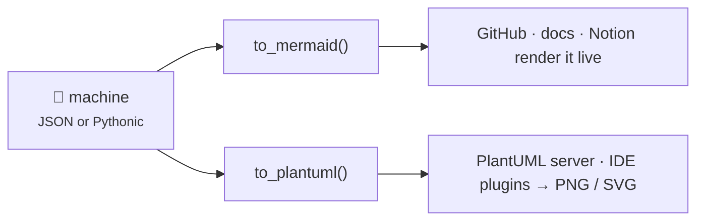
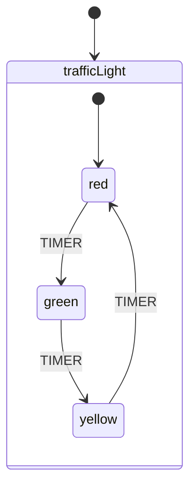

Every `MachineNode` can export its structure as a **PlantUML** or **Mermaid** diagram. This lets you visualize your state machines, generate documentation, and keep diagrams in sync with your code automatically.

## 🖼️ Overview



The library provides two export methods on every `MachineNode`:

| Method | Format | Use Case |
|--------|--------|----------|
| `machine.to_plantuml()` | PlantUML | Rich diagrams, IDE plugins, PDF generation |
| `machine.to_mermaid()` | Mermaid | GitHub README, Markdown docs, online editors |

Both methods return a string that you can print, save to a file, or embed in documentation.

## Viewing diagrams in these docs

The documentation includes both exported Mermaid illustrations and live Stately
embeds. You can enlarge either without leaving the guide:

- **Stately diagrams:** choose **Fullscreen** below the chart to open a
  page-sized viewer in the current tab. The same public diagram gets the full
  available canvas, including on phones and tablets. Use Stately's pan, zoom,
  and **Center in view** controls to explore larger machines. **Close** returns
  to your place in the guide; **Open in Stately** remains a separate link to the
  editor in a new tab.
- **Mermaid illustrations:** choose **Full screen** on the figure, then use
  **+**, **−**, or **Fit**. A fitted overview can make a large chart's labels
  small; zoom in for detailed reading.

The Stately viewer follows the site theme and opens a separate embedded view,
so reopening it resets that view's pan and zoom without moving the inline
chart. Its toolbar stays outside the embed and keeps **Close** accessible.
**Escape** closes the viewer when its toolbar has keyboard focus; Stately can
handle the key itself when focus is inside the embedded editor. After tabbing
through its controls, activate **Back to viewer controls** to return to Close;
this shortcut appears when focused. **Shift+Tab** also moves back toward the
toolbar, and you can select **Close** directly at any time.

Live Stately diagrams need a network connection to Stately. If an embed does
not load, the guide and its code remain available, and **Open in Stately** gives
you a direct editor link. Enlarging a diagram does not edit the machine.

## 🌿 PlantUML Export

### Basic Example

```python
from xstate_statemachine import create_machine

config = {
    "id": "trafficLight",
    "initial": "red",
    "states": {
        "red": {
            "on": {
                "TIMER": "green",
            },
        },
        "green": {
            "on": {
                "TIMER": "yellow",
            },
        },
        "yellow": {
            "on": {
                "TIMER": "red",
            },
        },
    },
}

machine = create_machine(config)
plantuml = machine.to_plantuml()
print(plantuml)
```

<div class="stately" data-machine="9716e04c54" data-height="320" data-title="trafficLight"></div>

### Sample Output

```
@startuml
hide empty description
state "trafficLight" as trafficLight {
  [*] --> trafficLight_red
  state "red" as trafficLight_red
  state "green" as trafficLight_green
  state "yellow" as trafficLight_yellow
}
[*] --> trafficLight_red
trafficLight_red --> trafficLight_green : TIMER
trafficLight_green --> trafficLight_yellow : TIMER
trafficLight_yellow --> trafficLight_red : TIMER
@enduml
```

### How to Render PlantUML

There are several ways to render PlantUML diagrams:

**1. Save to file and use the PlantUML CLI:**

```bash
pip install plantuml
```

```python
# Save the diagram
with open("traffic_light.puml", "w") as f:
    f.write(machine.to_plantuml())
```

```bash
# Render to PNG
plantuml traffic_light.puml
```

**2. Use the PlantUML online server:**

Paste the output at [https://www.plantuml.com/plantuml/uml/](https://www.plantuml.com/plantuml/uml/)

**3. VS Code extension:**

Install the "PlantUML" extension and preview `.puml` files directly in the editor.

## 🧜 Mermaid Export

### Basic Example

```python
from xstate_statemachine import create_machine

config = {
    "id": "trafficLight",
    "initial": "red",
    "states": {
        "red": {
            "on": {
                "TIMER": "green",
            },
        },
        "green": {
            "on": {
                "TIMER": "yellow",
            },
        },
        "yellow": {
            "on": {
                "TIMER": "red",
            },
        },
    },
}

machine = create_machine(config)
mermaid = machine.to_mermaid()
print(mermaid)
```

<div class="stately" data-machine="9716e04c54" data-height="320" data-title="trafficLight"></div>

### Sample Output

```
stateDiagram-v2
[*] --> trafficLight
state "trafficLight" as trafficLight {
    [*] --> red
    state "red" as red
    state "green" as green
    state "yellow" as yellow
}
red --> green : TIMER
green --> yellow : TIMER
yellow --> red : TIMER
```

The top-level machine is wrapped in its own `state "<id>" as <id> { ... }` block. The overall entry arrow points to that wrapper, and its inner entry arrow points to the initial child. Every leaf state is declared inside its parent before transitions are emitted, so non-initial and unconnected states retain their correct containment. Nested compound states follow the same pattern.

> **Mermaid alias limitation:** The exporter uses local state keys as diagram IDs. Use distinct keys across the whole chart, including the machine ID. Repeated local keys in different parents are ambiguous in this format; use the PlantUML exporter or Stately for those charts. This visualization limitation does not affect interpreter state resolution.

### Embedding in GitHub README

Mermaid diagrams render natively in GitHub Markdown. Wrap the output in a fenced code block:

````markdown

````

> **Tip:** You can automate this by writing a script that regenerates your README's diagram section from your machine definition. This ensures your documentation always matches your code.

## 📄 Export from JSON Machines

Both export methods work with any machine created via `create_machine()`:

<!-- doc-fragment -->
```python
import json
from xstate_statemachine import create_machine

# Load config from a JSON file
with open("my_machine.json") as f:
    config = json.load(f)

machine = create_machine(config)

# Export both formats
with open("docs/machine.puml", "w") as f:
    f.write(machine.to_plantuml())

with open("docs/machine.mmd", "w") as f:
    f.write(machine.to_mermaid())

print("Diagrams exported!")
```

## 🐍 Export from Pythonic API Machines

Machines built with the Pythonic API export diagrams the same way — `StateMachine.create_machine()`, `build_machine()`, and `MachineBuilder.build()` all return a `MachineNode`:

```python
from xstate_statemachine import State, StateMachine

class DoorLock(StateMachine):
    machine_id = "doorLock"

    locked = State("locked", initial=True)
    unlocked = State("unlocked")

    unlock = locked.to(unlocked, event="UNLOCK")
    lock = unlocked.to(locked, event="LOCK")

machine = DoorLock.create_machine()

# PlantUML
print(machine.to_plantuml())

# Mermaid
print(machine.to_mermaid())
```

**Mermaid output:**

```
stateDiagram-v2
[*] --> doorLock
state "doorLock" as doorLock {
    [*] --> locked
    state "locked" as locked
    state "unlocked" as unlocked
}
locked --> unlocked : UNLOCK
unlocked --> locked : LOCK
```

The functional `build_machine()` and fluent `MachineBuilder` produce the same kind of `MachineNode`:

```python
from xstate_statemachine import State, build_machine

idle = State("idle", initial=True)
running = State("running")

machine = build_machine(
    id="switch",
    states=[idle, running],
    transitions=[idle.to(running, event="START")],
)

print(machine.to_mermaid())
```

```python
from xstate_statemachine import MachineBuilder

machine = (
    MachineBuilder("switch")
    .state("idle", initial=True)
    .state("running")
    .transition("idle", "START", "running")
    .build()
)

print(machine.to_mermaid())
```

Both produce:

```
stateDiagram-v2
[*] --> switch
state "switch" as switch {
    [*] --> idle
    state "idle" as idle
    state "running" as running
}
idle --> running : START
```

## 🪆 Nested State Diagrams

Both exporters handle hierarchical (compound) states with proper nesting:

```python
from xstate_statemachine import create_machine

config = {
    "id": "editor",
    "initial": "idle",
    "states": {
        "idle": {
            "on": {
                "OPEN": "editing",
            },
        },
        "editing": {
            "initial": "drafting",
            "states": {
                "drafting": {
                    "on": {
                        "PREVIEW": "previewing",
                        "SAVE": "saving",
                    },
                },
                "previewing": {
                    "on": {
                        "EDIT": "drafting",
                    },
                },
                "saving": {
                    "on": {
                        "SAVE_DONE": "drafting",
                    },
                },
            },
            "on": {
                "CLOSE": "idle",
            },
        },
    },
}

machine = create_machine(config)
print(machine.to_plantuml())
```

<div class="stately" data-machine="274db684e7" data-height="420" data-title="editor"></div>

**PlantUML output (nested):**

```
@startuml
hide empty description
state "editor" as editor {
  [*] --> editor_idle
  state "idle" as editor_idle
  state "editing" as editor_editing {
    [*] --> editor_editing_drafting
    state "drafting" as editor_editing_drafting
    state "previewing" as editor_editing_previewing
    state "saving" as editor_editing_saving
  }
}
[*] --> editor_idle
editor_idle --> editor_editing : OPEN
editor_editing_drafting --> editor_editing_previewing : PREVIEW
editor_editing_drafting --> editor_editing_saving : SAVE
editor_editing_previewing --> editor_editing_drafting : EDIT
editor_editing_saving --> editor_editing_drafting : SAVE_DONE
editor_editing --> editor_idle : CLOSE
@enduml
```

## 🎛️ Parallel State Diagrams

Parallel states are also exported, but both exporters render each parallel region as an ordinary nested composite state — there is no parallel-specific visual marker (no Mermaid `--` region divider, no distinct styling in PlantUML). The nesting itself is what shows you the regions:

```python
from xstate_statemachine import create_machine

config = {
    "id": "player",
    "initial": "playing",
    "states": {
        "playing": {
            "type": "parallel",
            "states": {
                "video": {
                    "initial": "loading",
                    "states": {
                        "loading": {
                            "on": {
                                "VIDEO_READY": "streaming",
                            },
                        },
                        "streaming": {
                            "on": {
                                "BUFFER": "loading",
                            },
                        },
                    },
                },
                "audio": {
                    "initial": "muted",
                    "states": {
                        "muted": {
                            "on": {
                                "UNMUTE": "audible",
                            },
                        },
                        "audible": {
                            "on": {
                                "MUTE": "muted",
                            },
                        },
                    },
                },
            },
            "on": {
                "STOP": "stopped",
            },
        },
        "stopped": {
            "type": "final",
        },
    },
}

machine = create_machine(config)
print(machine.to_mermaid())
```

<div class="stately" data-machine="77056f1d1c" data-height="520" data-title="player"></div>

**Mermaid output:**

```
stateDiagram-v2
[*] --> player
state "player" as player {
    [*] --> playing
    state "playing" as playing {
        state "video" as video {
            [*] --> loading
            state "loading" as loading
            state "streaming" as streaming
        }
        state "audio" as audio {
            [*] --> muted
            state "muted" as muted
            state "audible" as audible
        }
    }
    state "stopped" as stopped
}
playing --> stopped : STOP
loading --> streaming : VIDEO_READY
streaming --> loading : BUFFER
muted --> audible : UNMUTE
audible --> muted : MUTE
```

## 📚 Using Diagrams for Documentation

### From the command line

For machines you keep as JSON, the CLI wraps these exporters — no script needed:

```bash
xsm diagram checkout.json                     # Mermaid to stdout
xsm diagram checkout.json -f plantuml -o docs/  # docs/checkout.puml
xsm docs machines/*.json -o docs/             # a Markdown page per machine, diagram embedded
```

`xsm diagram` calls the same `to_mermaid()` / `to_plantuml()` shown above, so the output is identical to the Python API. See the [CLI Tool](../cli/) guide.

### Auto-Generate Documentation Script

Create a script that generates diagrams for all your machines:

```python
"""generate_docs.py — Export diagrams for all state machines."""
import json
from pathlib import Path
from xstate_statemachine import create_machine

MACHINES_DIR = Path("configs")
DOCS_DIR = Path("docs/diagrams")
DOCS_DIR.mkdir(parents=True, exist_ok=True)

for config_file in MACHINES_DIR.glob("*.json"):
    with open(config_file) as f:
        config = json.load(f)

    machine = create_machine(config)
    machine_id = config["id"]

    # Export PlantUML
    puml_path = DOCS_DIR / f"{machine_id}.puml"
    puml_path.write_text(machine.to_plantuml())

    # Export Mermaid
    mmd_path = DOCS_DIR / f"{machine_id}.mmd"
    mmd_path.write_text(machine.to_mermaid())

    print(f"Exported: {machine_id} -> {puml_path}, {mmd_path}")

print(f"\nAll diagrams written to {DOCS_DIR}/")
```

```bash
python generate_docs.py
```

## Complete Example: Complex Machine with All Features

```python
from pathlib import Path

from xstate_statemachine import MachineLogic, create_machine

config = {
    "id": "orderSystem",
    "initial": "browsing",
    "context": {
        "cart": [],
        "total": 0,
    },
    "states": {
        "browsing": {
            "on": {
                "ADD_ITEM": {
                    "actions": "addToCart",
                },
                "CHECKOUT": {
                    "target": "checkout",
                    "guard": "cartNotEmpty",
                },
            },
        },
        "checkout": {
            "initial": "shipping",
            "states": {
                "shipping": {
                    "on": {
                        "SUBMIT_ADDRESS": "payment",
                    },
                },
                "payment": {
                    "on": {
                        "SUBMIT_PAYMENT": "processing",
                    },
                },
                "processing": {
                    "invoke": {
                        "src": "processPayment",
                        "onDone": "confirmation",
                        "onError": "payment",
                    },
                },
                "confirmation": {
                    "type": "final",
                },
            },
            "on": {
                "CANCEL": "browsing",
            },
            "onDone": "complete",
        },
        "complete": {
            "type": "final",
        },
    },
}

# Diagrams need only the SHAPE; stub the named logic so the build-time
# check for missing implementations passes.
machine = create_machine(
    config,
    logic=MachineLogic(
        actions={
            "addToCart": lambda *a: None,
        },
        guards={
            "cartNotEmpty": lambda c, e: True,
        },
        services={
            "processPayment": lambda *a: None,
        },
    ),
)

# Save both diagram formats
Path("order_system.puml").write_text(machine.to_plantuml())
Path("order_system.mmd").write_text(machine.to_mermaid())

# Print Mermaid for quick preview
print(machine.to_mermaid())
```

<div class="stately" data-machine="10fa219c77" data-height="520" data-title="orderSystem"></div>

> **Note:** The `onDone` transition from compound states is included in the exported diagrams, showing the flow from the compound state to the next top-level state.
