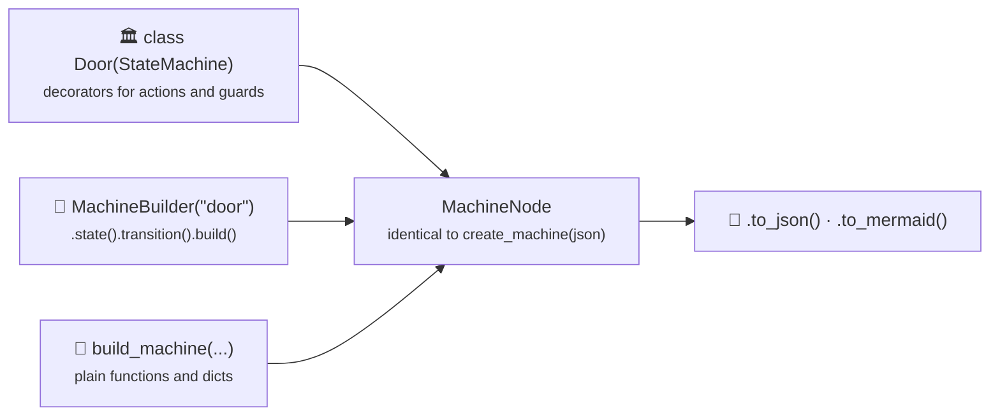

> **New in v0.5.0** — Define state machines in pure Python. No JSON needed.

The Pythonic API lets you define states, transitions, actions, guards, and services using native Python constructs — classes, decorators, and function calls. Under the hood, everything compiles to the same `MachineNode` that the JSON-based `create_machine()` produces.

Three styles, same result. Pick the one that matches your team:



| Style | Best For | Entry Point | Pros |
|-------|----------|-------------|------|
| **Class-Based** | OOP teams, large machines | `class MyMachine(StateMachine)` | Self-contained, IDE-friendly, decorators for logic |
| **Builder** | Fluent/chained construction | `MachineBuilder("id").state(...).build()` | Concise, easy to compose dynamically |
| **Functional** | Simple, explicit assembly | `build_machine(id=..., states=[...])` | Module-level, great for small machines |

All three compile to the same internal `MachineNode` and work with both `Interpreter` (async) and `SyncInterpreter` (sync).

---

## ⚡ The short way (v0.12.0)

> **New in v0.12.0** — a `StateMachine` subclass is a running machine. Events are named by the attribute you assign them to, callbacks are found by name, and each callback declares only the arguments it wants.

```python
from xstate_statemachine import State, StateMachine


class TrafficLight(StateMachine):
    green = State(initial=True)
    yellow = State()
    red = State()

    # The attribute name is the event: CYCLE
    cycle = green.to(yellow) | yellow.to(red) | red.to(green)

    def __init__(self, *args, **kwargs):
        self.count = 0
        super().__init__(*args, **kwargs)

    # Naming-convention hooks: on_enter_<state>, on_exit_<state>,
    # on_<event>, before_<event>, after_<event>, and the generic
    # on_enter_state / on_exit_state / on_transition /
    # before_transition / after_transition.
    def on_enter_red(self):
        print("Don't move.")

    # Only the arguments you name are injected: payload fields,
    # `context`, `event`, `interpreter`, `source`, `target`, `state`.
    def on_cycle(self, amount=1):
        self.count += amount
        return f"counted {amount}"


with TrafficLight() as light:  # started, in `green`; stopped on exit
    print(light.state)  # green
    print(light.cycle(amount=3))  # counted 3   <- return values come back
    print(light.send("CYCLE"))  # counted 1   <- same thing, by name
    print(light.state)  # red
    print(light.red.is_active, light.count)  # True 4
    print(light.configuration)  # frozenset({'red'})
    print(light.can("CYCLE"), sorted(light.allowed_events))  # True ['CYCLE']
    print(light)  # TrafficLight(state='red', context={})
print(light.status)  # stopped
```

**Use the context manager.** `with Machine() as sm:` (or `async with` for the asyncio engine) is the recommended way to run an instance: it stops the machine on the way out, including when an exception escapes, and it never depends on method names. For a long-lived machine that outlives a block, hold the instance and call `sm.interpreter.stop()` when you are done; `sm.interpreter.start()` / `sm.interpreter.stop()` are the explicit escape hatch that always reaches the lifecycle, whatever the chart's events are called.

Everything above still compiles to the same XState JSON (`TrafficLight.create_machine().to_json()`), and `TrafficLight.create_machine()` still returns the bare `MachineNode` when you want to drive it with your own `Interpreter` or `SyncInterpreter` (snapshots, custom clocks, actor systems).

### Compound and parallel states as nested classes

Nested classes may hold child states, their own transitions, and any `State(...)` keyword (`after=`, `on_done=`, `history=`, `tags=`, `entry=`, …). `State.Compound` and `State.Parallel` are aliases for readers coming from other libraries.

```python
from xstate_statemachine import State, StateMachine


class Order(StateMachine):
    created = State(initial=True)

    class paid(State.Compound, on_done="fulfil"):
        packing = State(initial=True)
        shipped = State(final=True)
        ship = packing.to(shipped)  # event SHIP, declared where it belongs

    class fulfil(State.Parallel):
        class payment(State.Compound):
            pending = State(initial=True)
            settled = State(final=True)
            settle = pending.to(settled)

        class notify(State.Compound):
            idle = State(initial=True)
            sent = State(final=True)
            send_mail = idle.to(sent)

    closed = State(final=True)
    pay = created.to(paid)  # a nested class is a valid target...
    close = fulfil.to(closed)  # ...and a valid source


with Order() as order:
    order.pay()
    order.ship()
    print(sorted(order.configuration))  # ['fulfil.notify.idle', 'fulfil.payment.pending']
    order.settle()
    order.send_mail()
    order.close()
    print(order.state, order.status)  # closed done
```

### Strict mode and build-time validation

```python
from xstate_statemachine import (
    ImplementationMissingError,
    State,
    StateMachine,
    TransitionNotAllowedError,
    UnknownEventError,
)


class Door(StateMachine):
    strict = True  # refuse events that cannot be taken right now

    closed = State(initial=True)
    opened = State()
    open = closed.to(opened)
    close = opened.to(closed)


with Door() as door:
    door.open()
    try:
        door.open()  # already open
    except TransitionNotAllowedError as exc:
        print(exc)  # Can't 'OPEN' when in 'opened': no enabled transition ...
    try:
        door.send("OPNE")  # typo
    except UnknownEventError as exc:
        print("unknown:", exc.event_type)
    print(door.state)  # opened  <- the machine is untouched

# Logic the chart names but nobody implemented is reported when the
# class is instantiated (or on create_machine(validate=True)), not at
# the first send.
try:

    class Broken(StateMachine):
        a = State(initial=True)
        b = State()
        go = a.to(b, guard="isReady", actions=["save"])

    Broken()
except ImplementationMissingError as exc:
    print(exc)  # Broken references logic that is not implemented: ...
```

### Lifecycle: `with`, `async with`, and the escape hatch

There are three ways to control an instance's lifecycle, in order of preference:

| Idiom | When |
|---|---|
| `with Machine() as sm:` / `async with Machine() as sm:` | **Recommended.** Starts (async) and stops the machine for you, also on exceptions, and never depends on what the chart's events are called. |
| `sm.interpreter.start()` / `sm.interpreter.stop()` | The explicit escape hatch for a machine that outlives a block (a module-level singleton, a machine owned by a request handler). Always reaches the lifecycle. |
| `sm.start()` / `sm.stop()` | Convenience methods on the instance; same effect as the escape hatch. |

`sm.start()` and `sm.stop()` always start and stop the machine. Timers, jobs and media players naturally have `START` / `STOP` *events* too, and that is allowed: declare the transition as usual, and send the event by name. The attribute just does not get the `sm.stop()` shortcut, and a warning at class-definition time tells you so. With the context manager you never have to think about it.

```python
import logging

from xstate_statemachine import State, StateMachine

logging.basicConfig(level=logging.WARNING)


class Timer(StateMachine):
    idle = State(initial=True)
    running = State()
    start = idle.to(running)  # the START event -- warning logged here
    stop = running.to(idle)  # the STOP event  -- and here


with Timer() as t:
    t.send("START")  # the event
    print(t.state)  # running
    t.send("STOP")  # the event
    print(t.state)  # idle
# leaving the block stopped the machine
print(t.status)  # stopped

# The same machine kept beyond a block: the explicit escape hatch.
t2 = Timer()
t2.send("START")
print(t2.state)  # running
t2.interpreter.stop()  # always the lifecycle, whatever the events are called
print(t2.status)  # stopped
```

Why the lifecycle wins: event methods are new in this release, so no code relied on `sm.stop()` sending an event, whereas a shutdown call that silently sent an event instead would leave the interpreter and its timers running. Names that would break the façade itself (`send`, `state`, `context`, `status`, `can`, `matches`, `machine`, `interpreter`, …) are reserved and raise `InvalidConfigError`; give the transition another attribute name and keep the event name with `event="STATE"` if you need it.

### Async machines

If any callback is `async def`, the instance runs on the asyncio `Interpreter`; start it with `await sm.start()` (or `async with`) and `await` its events. Set `engine = "async"` to force it for sync callbacks.

```python
import asyncio

from xstate_statemachine import State, StateMachine


class Fetch(StateMachine):
    idle = State(initial=True)
    done = State()
    fetch = idle.to(done)

    async def on_fetch(self, url):
        await asyncio.sleep(0)
        return url.upper()


async def main():
    async with Fetch() as sm:
        print(sm.engine)  # async
        print(await sm.fetch(url="http://x"))  # HTTP://X
        print(sm.state)  # done


asyncio.run(main())
```

The rest of this page documents the three styles in full, including the explicit `@action` / `@guard` / `@service` decorators and the legacy positional callback signatures, which keep working unchanged.

---

## 🏛️ Style 1: Class-Based (`StateMachine`)

The class-based style is the most expressive. States are class attributes, transitions use `.to()`, and logic is defined with `@action`, `@guard`, and `@service` decorators.

### Full TrafficLight Example

```python
from xstate_statemachine import (
    State,
    StateMachine,
    SyncInterpreter,
    action,
    guard,
    service,
)


class TrafficLight(StateMachine):
    machine_id = "trafficLight"
    initial_context = {
        "cycle_count": 0,
        "mode": "normal",
    }

    # ── States ──────────────────────────────────────────────
    green = State("green", initial=True)
    yellow = State("yellow")
    red = State("red")

    # ── Transitions ─────────────────────────────────────────
    slow_down = green.to(yellow, event="TIMER")
    stop = yellow.to(red, event="TIMER")
    go = red.to(green, event="TIMER")

    # ── Actions ─────────────────────────────────────────────
    @action
    def log_change(self, interpreter, context, event, action_def):
        states = interpreter.active_state_ids
        print(f"🚦 Light changed → {states}")

    @action
    def increment_cycle(self, interpreter, context, event, action_def):
        context["cycle_count"] += 1

    # ── Guards ──────────────────────────────────────────────
    @guard
    def is_rush_hour(self, context, event):
        return context.get("hour", 12) in range(7, 10)

    @guard
    def is_night_mode(self, context, event):
        return context.get("mode") == "night"

    # ── Services ────────────────────────────────────────────
    @service
    def fetch_schedule(self, interpreter, context, event):
        # Could be an API call or database lookup
        return {
            "rush_hours": [7, 8, 9],
            "night_start": 22,
        }


# ── Run it ──────────────────────────────────────────────────
machine = TrafficLight.create_machine()
interp = SyncInterpreter(machine).start()

print(interp.active_state_ids)  # {'trafficLight.green'}
interp.send("TIMER")  # green → yellow
print(interp.active_state_ids)  # {'trafficLight.yellow'}
interp.send("TIMER")  # yellow → red
interp.send("TIMER")  # red → green
interp.stop()
```

### Key Points

- `machine_id` sets the machine's ID (defaults to the class name if omitted).
- `initial_context` provides the starting context dictionary.
- States are `State(...)` instances assigned to class attributes.
- Transitions use `source.to(target, event="EVENT_NAME")`.
- `create_machine()` is a classmethod that compiles everything and returns a `MachineNode`.

---

## 🔗 Style 2: Builder (`MachineBuilder`)

The builder style uses a fluent API with method chaining. Great for constructing machines dynamically or in configuration-driven scenarios.

### Full Example

```python
from xstate_statemachine import MachineBuilder, SyncInterpreter


def log_change(interpreter, context, event, action_def):
    print(f"Now: {interpreter.active_state_ids}")


def validate_input(interpreter, context, event, action_def):
    if not context.get("value"):
        context["errors"] = ["Value is required"]
    else:
        context["errors"] = []


def is_valid(context, event):
    return len(context.get("errors", [])) == 0


def process_data(interpreter, context, event):
    return {
        "result": f"processed {context['value']}",
    }


machine = (
    MachineBuilder("formProcessor")
    .context(
        {
            "value": "",
            "errors": [],
            "result": None,
        }
    )
    # ── States ──────────────────────────────────────────
    .state("idle", initial=True)
    .state("validating")
    .state(
        "processing",
        invoke={
            "src": "processData",
            "onDone": {
                "target": "success",
                "actions": "storeResult",
            },
            "onError": {
                "target": "error",
            },
        },
    )
    .state("success", final=True)
    .state(
        "error",
        on={
            "RETRY": "idle",
        },
    )
    # ── Transitions ─────────────────────────────────────
    .transition("idle", "SUBMIT", "validating", actions=["validate"])
    .transition("validating", "VALID", "processing", guard="isValid")
    .transition("validating", "INVALID", "error")
    # ── Logic Registration ──────────────────────────────
    .action("logChange", log_change)
    .action("validate", validate_input)
    .guard("isValid", is_valid)
    .service("processData", process_data)
    .build()
)

interp = SyncInterpreter(machine).start()
interp.send("SUBMIT")
interp.stop()
```

### Builder Methods

| Method | Signature | Description |
|--------|-----------|-------------|
| `.context(ctx)` | `dict → self` | Set initial context. |
| `.state(name, ...)` | `str, **kwargs → self` | Add a state. Supports `initial`, `final`, `parallel`, `on`, `entry`, `exit`, `after`, `invoke`, `on_done`, `always`. |
| `.transition(src, event, target, ...)` | `str, str, str, **kwargs → self` | Add a transition. Supports `guard`, `actions`, `reenter`, `internal`. |
| `.action(name, fn)` | `str, callable → self` | Register an action function. |
| `.guard(name, fn)` | `str, callable → self` | Register a guard function. |
| `.service(name, fn)` | `str, callable → self` | Register a service function. |
| `.child_states(parent, ...)` | `str, **kwargs → self` | Add child states to a parent. Supports `initial`, `states`, `parallel`. |
| `.build(context=None)` | `dict? → MachineNode` | Compile and return the machine. Optional context override. |

### Adding Child States (Hierarchy)

```python
machine = (
    MachineBuilder("app")
    .state("loggedOut", initial=True)
    .state("loggedIn")
    .child_states(
        "loggedIn",
        initial="dashboard",
        states={
            "dashboard": {
                "on": {
                    "VIEW_PROFILE": "profile",
                },
            },
            "profile": {
                "on": {
                    "BACK": "dashboard",
                },
            },
            "settings": {
                "on": {
                    "BACK": "dashboard",
                },
            },
        },
    )
    .transition("loggedOut", "LOGIN", "loggedIn")
    .transition("loggedIn", "LOGOUT", "loggedOut")
    .build()
)
```

### Builder with Delayed Transitions and Invoke

```python
machine = (
    MachineBuilder("orderProcessor")
    .context(
        {
            "orderId": None,
            "result": None,
            "error": None,
        }
    )
    .state("idle", initial=True)
    .state(
        "processing",
        invoke={
            "src": "processOrder",
            "onDone": {
                "target": "completed",
                "actions": "storeResult",
            },
            "onError": {
                "target": "failed",
                "actions": "storeError",
            },
        },
        after={
            30000: {
                "target": "timeout",
            },  # 30s timeout
        },
    )
    .state("completed", final=True)
    .state(
        "failed",
        on={
            "RETRY": "processing",
        },
    )
    .state(
        "timeout",
        on={
            "RETRY": "processing",
        },
    )
    .transition("idle", "PROCESS", "processing", actions=["setOrderId"])
    .action(
        "setOrderId",
        lambda i, ctx, e, a: ctx.update(
            {
                "orderId": e.payload.get("id"),
            }
        ),
    )
    .action(
        "storeResult",
        lambda i, ctx, e, a: ctx.update(
            {
                "result": e.data,
            }
        ),
    )
    .action(
        "storeError",
        lambda i, ctx, e, a: ctx.update(
            {
                "error": str(e.error),
            }
        ),
    )
    .service(
        "processOrder",
        lambda i, ctx, e: {
            "status": "shipped",
            "tracking": "TRK-001",
        },
    )
    .build()
)
```

### Builder with Parallel Child States

```python
machine = (
    MachineBuilder("dashboard")
    .state("loading", initial=True)
    .state("active")
    .child_states(
        "active",
        parallel=True,
        states={
            "notifications": {
                "initial": "unread",
                "states": {
                    "unread": {
                        "on": {
                            "MARK_READ": "read",
                        },
                    },
                    "read": {},
                },
            },
            "feed": {
                "initial": "loading",
                "states": {
                    "loading": {
                        "on": {
                            "LOADED": "showing",
                        },
                    },
                    "showing": {},
                },
            },
        },
    )
    .transition("loading", "READY", "active")
    .build()
)
```

---

## 🐍 Style 3: Functional (`build_machine`)

The functional style defines states and transitions at module level, then assembles them with a single `build_machine()` call. It's the most explicit — nothing is hidden in class magic.

### Full Example

```python
from xstate_statemachine import (
    State,
    build_machine,
    SyncInterpreter,
    action,
    guard,
    service,
)

# ── Define States ───────────────────────────────────────────
idle = State("idle", initial=True)
loading = State(
    "loading",
    invoke={
        "src": "fetchItems",
        "onDone": {
            "target": "loaded",
            "actions": "storeItems",
        },
        "onError": {
            "target": "error",
            "actions": "storeError",
        },
    },
)
loaded = State("loaded")
error = State("error")

# ── Define Transitions ─────────────────────────────────────
# `.to()` RETURNS a Transition; hand them to build_machine(transitions=...)
fetch = idle.to(loading, event="FETCH")
refresh = loaded.to(loading, event="REFRESH")
retry = error.to(loading, event="RETRY", guard="hasRetriesLeft")
cancel = error.to(idle, event="CANCEL")


# ── Define Logic ────────────────────────────────────────────
@action
def store_items(interpreter, context, event, action_def):
    context["items"] = event.data


@action
def store_error(interpreter, context, event, action_def):
    context["error"] = str(event.error)


@guard
def has_retries_left(context, event):
    return context.get("retries", 0) < 3


@service
def fetch_items(interpreter, context, event):
    # In real code: an HTTP call. Its return value becomes `event.data`.
    return [
        {
            "id": 1,
            "name": "widget",
        }
    ]


# ── Build and Run ───────────────────────────────────────────
machine = build_machine(
    id="itemLoader",
    states=[idle, loading, loaded, error],
    transitions=[fetch, refresh, retry, cancel],
    actions=[store_items, store_error],
    guards=[has_retries_left],
    services=[fetch_items],
    context={
        "items": [],
        "error": None,
        "retries": 0,
    },
)

interp = SyncInterpreter(machine).start()
interp.send("FETCH")
print(interp.active_state_ids)  # {'itemLoader.loaded'}
print(interp.context["items"])  # [{'id': 1, 'name': 'widget'}]
interp.stop()
```

### `build_machine()` Parameters

| Parameter | Type | Required | Description |
|-----------|------|:--------:|-------------|
| `id` | `str` | **Yes** | Machine identifier. |
| `states` | `list[State]` | **Yes** | All top-level states. |
| `transitions` | `list[Transition]` | No | The machine's transitions. `State.to()` only *builds* a `Transition` object; it is not registered until listed here (inside a `StateMachine` class the metaclass does this for you). |
| `actions` | `list[callable]` | No | Action functions (decorated with `@action` or raw). |
| `guards` | `list[callable]` | No | Guard functions (decorated with `@guard` or raw). |
| `services` | `list[callable]` | No | Service functions (decorated with `@service` or raw). |
| `context` | `dict` | No | Initial context. |

---

## 🎀 Decorator Details

The `@action`, `@guard`, and `@service` decorators mark functions for automatic registration. They work in all three API styles.

### Auto-Naming: `snake_case` → `camelCase`

When used without arguments, the function name is automatically converted from `snake_case` to `camelCase`:

```python
@action
def increment_counter(interpreter, context, event, action_def):
    context["count"] += 1


# Registered as "incrementCounter"


@guard
def is_valid_email(context, event):
    return "@" in context.get("email", "")


# Registered as "isValidEmail"


@service
def fetch_user_data(interpreter, context, event):
    return {
        "name": "Alice",
    }


# Registered as "fetchUserData"
```

### Explicit Naming

Pass a string to override the auto-generated name:

```python
@action("myCustomAction")
def some_function(interpreter, context, event, action_def):
    pass


# Registered as "myCustomAction"


@guard("canProceed")
def check_requirements(context, event):
    return context.get("ready", False)


# Registered as "canProceed"


@service("loadProfile")
def get_profile_data(interpreter, context, event):
    return {
        "profile": "data",
    }


# Registered as "loadProfile"
```

### Decorator Signatures

Each decorator type has a specific function signature:

```python
# @action — receives interpreter, context, event, and action_def
@action
def my_action(interpreter, context, event, action_def):
    context["count"] += 1          # modify context
    print(event.type)              # read event info
    # No return value needed

# @guard — receives context and event, returns bool
@guard
def my_guard(context, event):
    return context.get("value", 0) > 0
    # MUST return True or False
    # MUST be synchronous (async guards raise NotSupportedError)

# @service — receives interpreter, context, event, returns Any
@service
def my_service(interpreter, context, event):
    result = do_some_work()
    return result
    # Return value becomes event.data in onDone
    # Can be sync or async
```

> **Warning:** Guard functions **must be synchronous**. Async guards will raise `NotSupportedError`. If you need async logic, use a service with `invoke` instead.

### Class-Based Decorator Signatures

In `StateMachine` subclasses, all decorated methods receive `self` as the first argument:

```python
class MyMachine(StateMachine):
    @action
    def my_action(self, interpreter, context, event, action_def):
        pass  # self is the StateMachine instance

    @guard
    def my_guard(self, context, event):
        return True

    @service
    def my_service(self, interpreter, context, event):
        return {
            "data": "value",
        }
```

---

## 🚪 Entry/Exit Actions (Class-Based)

Use the `@state.enter` and `@state.exit` decorators to bind actions to state entry and exit:

```python
from xstate_statemachine import State, StateMachine, SyncInterpreter

class DocumentEditor(StateMachine):
    machine_id = "editor"

    editing    = State("editing", initial=True)
    saving     = State("saving")
    saved      = State("saved")

    # Transitions
    save     = editing.to(saving, event="SAVE")
    complete = saving.to(saved,   event="DONE")
    edit     = saved.to(editing,  event="EDIT")

    # Entry/Exit decorators
    @editing.enter
    def on_enter_editing(self, interpreter, context, event, action_def):
        print("📝 Entered editing mode")
        context["dirty"] = False

    @editing.exit
    def on_exit_editing(self, interpreter, context, event, action_def):
        print("💾 Auto-saving draft before leaving editing...")
        context["draft_saved"] = True

    @saving.enter
    def on_enter_saving(self, interpreter, context, event, action_def):
        print("⏳ Saving document...")

    @saved.enter
    def on_enter_saved(self, interpreter, context, event, action_def):
        print("✅ Document saved successfully!")


machine = DocumentEditor.create_machine()
interp = SyncInterpreter(machine).start()
# Output: 📝 Entered editing mode

interp.send("SAVE")
# Output: 💾 Auto-saving draft before leaving editing...
# Output: ⏳ Saving document...

interp.send("DONE")
# Output: ✅ Document saved successfully!

interp.stop()
```

> **Note:** `@state.enter` and `@state.exit` decorators are **only valid inside a `StateMachine` class**. Using them in the functional API will raise `InvalidConfigError`.

---

## 🛡️ Multiple Guarded Transitions

Use the `|` (pipe) operator to combine multiple transitions for the same event. The first matching guard wins:

```python
from xstate_statemachine import State, StateMachine, guard, SyncInterpreter


class SubscriptionRouter(StateMachine):
    machine_id = "subscriptionRouter"
    initial_context = {
        "plan": "premium",
        "trial_expired": False,
    }

    checking = State("checking", initial=True)
    premium = State("premium")
    basic = State("basic")
    trial = State("trial")
    expired = State("expired")

    # Multiple guarded transitions — first match wins
    route = (
        checking.to(premium, event="ROUTE", guard="isPremium")
        | checking.to(basic, event="ROUTE", guard="isBasic")
        | checking.to(trial, event="ROUTE", guard="hasActiveTrial")
        | checking.to(expired, event="ROUTE")  # fallback — no guard
    )

    @guard
    def is_premium(self, context, event):
        return context.get("plan") == "premium"

    @guard
    def is_basic(self, context, event):
        return context.get("plan") == "basic"

    @guard
    def has_active_trial(self, context, event):
        return not context.get("trial_expired", True)


machine = SubscriptionRouter.create_machine()
interp = SyncInterpreter(machine).start()
interp.send("ROUTE")
print(interp.active_state_ids)
# {'subscriptionRouter.premium'}
interp.stop()
```

> **Tip:** The `|` operator creates a `TransitionGroup` internally. The transitions are evaluated **in order** — put the most specific guards first, and leave the fallback (no guard) last.

> **Note:** `Transition` and `TransitionGroup` are the classes that back `.to()`, `transition()`, and the `|` operator. Import them from `xstate_statemachine.pythonic` for type hints or introspection, e.g. `isinstance(login | login_via_sso, TransitionGroup)`.

---

## ↩️ Internal Transitions

Internal transitions run actions **without exiting and re-entering** the current state. Entry and exit actions do NOT fire:

```python
from xstate_statemachine import State, StateMachine, action, SyncInterpreter


class Counter(StateMachine):
    machine_id = "counter"
    initial_context = {
        "count": 0,
    }

    counting = State("counting", initial=True)
    done = State("done", final=True)

    # Internal transition — stays in "counting", runs action
    increment = counting.internal("INCREMENT", actions=["addOne"])
    decrement = counting.internal("DECREMENT", actions=["subtractOne"])

    # External transition — exits "counting" and enters "done"
    finish = counting.to(done, event="FINISH")

    @action
    def add_one(self, interpreter, context, event, action_def):
        context["count"] += 1

    @action
    def subtract_one(self, interpreter, context, event, action_def):
        context["count"] -= 1


machine = Counter.create_machine()
interp = SyncInterpreter(machine).start()

interp.send("INCREMENT")  # count: 1 (no exit/entry actions fire)
interp.send("INCREMENT")  # count: 2
interp.send("DECREMENT")  # count: 1
interp.send("FINISH")  # counting → done

print(interp.context["count"])  # 1
interp.stop()
```

> **Note:** Internal transitions are created with `state.internal(event, ...)` instead of `state.to(target, event=...)`. They have no target state — the machine stays where it is.

---

## 🔁 Reenter Transitions

By default, a self-transition (same source and target) is treated as internal — no exit/entry actions fire. Use `reenter=True` to force a full exit and re-entry:

```python
from xstate_statemachine import State, StateMachine, SyncInterpreter

class Poller(StateMachine):
    machine_id = "poller"

    polling = State("polling", initial=True, entry=["startPolling"])
    stopped = State("stopped")

    # reenter=True forces exit + re-entry, restarting the entry action
    refresh = polling.to(polling, event="REFRESH", reenter=True)
    stop    = polling.to(stopped, event="STOP")


machine = Poller.create_machine()
```

With `reenter=True`, sending `REFRESH` while in `"polling"` will:
1. Run exit actions on `"polling"`
2. Run entry actions on `"polling"` (e.g., restart a timer)

Without `reenter=True`, the state would stay in `"polling"` and **no entry/exit actions would fire**. (For a state *with children*, a self-transition without `reenter` still resets the children: the active child exits and the `initial` child is entered again, while the state itself stays — XState v5 semantics. See [Core Concepts → Self-Transitions](../core-concepts/#self-transitions).)

---

## Hierarchy in the Pythonic API

Nested (compound) states are created by passing `states=[...]` to a parent `State`:

```python
from xstate_statemachine import State, StateMachine, SyncInterpreter

class AuthMachine(StateMachine):
    machine_id = "auth"

    logged_out = State("loggedOut", initial=True)
    logged_in  = State("loggedIn", states=[
        State("dashboard", initial=True),
        State("profile"),
        State("settings"),
    ])

    login  = logged_out.to(logged_in,  event="LOGIN")
    logout = logged_in.to(logged_out, event="LOGOUT")


machine = AuthMachine.create_machine()
interp = SyncInterpreter(machine).start()

interp.send("LOGIN")
print(interp.active_state_ids)
# {'auth.loggedIn.dashboard'}

interp.send("LOGOUT")
print(interp.active_state_ids)
# {'auth.loggedOut'}
interp.stop()
```

### Deep Nesting

```python
app = State("app", initial=True, states=[
    State("main", initial=True, states=[
        State("home", initial=True),
        State("search"),
    ]),
    State("settings", states=[
        State("general", initial=True),
        State("privacy"),
    ]),
])
```

---

## Parallel States in the Pythonic API

Create parallel states with `parallel=True`:

```python
from xstate_statemachine import State, StateMachine, SyncInterpreter

class MediaPlayer(StateMachine):
    machine_id = "player"

    player = State("player", initial=True, parallel=True, states=[
        State("video", states=[
            State("loading", initial=True),
            State("playing"),
            State("paused"),
        ]),
        State("audio", states=[
            State("muted", initial=True),
            State("unmuted"),
        ]),
        State("controls", states=[
            State("visible", initial=True),
            State("hidden"),
        ]),
    ])


machine = MediaPlayer.create_machine()
interp = SyncInterpreter(machine).start()

print(interp.active_state_ids)
# All three regions are active simultaneously (leaf/atomic states only):
# {'player.player.video.loading', 'player.player.audio.muted',
#  'player.player.controls.visible'}
interp.stop()
```

> **Note:** Children of parallel states should **not** have `initial=True` — all regions are active simultaneously. Each child region must define its own `initial` child state.

---

## Delayed Transitions (`after`) in the Pythonic API

The `after` parameter on `State` defines timer-based transitions. Keys are delay times in milliseconds; values are target state names (or transition dicts with guards and actions):

### Basic Timeout

```python
from xstate_statemachine import State, StateMachine, SyncInterpreter, action


class SessionTimeout(StateMachine):
    machine_id = "session"
    initial_context = {
        "warnings": 0,
    }

    active = State(
        "active",
        initial=True,
        after={
            300000: "warning",  # 5 minutes → show warning
        },
    )
    warning = State(
        "warning",
        after={
            60000: "expired",  # 1 minute after warning → expire
        },
    )
    expired = State("expired", final=True)

    # User activity resets the timer by re-entering 'active'
    activity = active.to(active, event="USER_ACTIVITY", reenter=True)
    dismiss = warning.to(active, event="DISMISS_WARNING")

    @expired.enter
    def on_expire(self, interpreter, context, event, action_def):
        print("Session expired — please log in again")


machine = SessionTimeout.create_machine()
interp = SyncInterpreter(machine).start()
# Timer-based transitions fire automatically
# (SyncInterpreter processes pending timers on each send())
interp.stop()
```

### Delayed Transition with Guard and Actions

```python
from xstate_statemachine import (
    State,
    StateMachine,
    SyncInterpreter,
    guard,
    action,
)


class AutoSave(StateMachine):
    machine_id = "autosave"
    initial_context = {
        "dirty": False,
        "save_count": 0,
    }

    editing = State(
        "editing",
        initial=True,
        after={
            2000: {
                "target": "saving",
                "guard": "isDirty",
                "actions": ["markClean"],
            },
        },
    )
    saving = State(
        "saving",
        after={
            500: "editing",  # Return to editing after save completes
        },
    )

    @guard
    def is_dirty(self, context, event):
        return context.get("dirty", False)

    @action
    def mark_clean(self, interpreter, context, event, action_def):
        context["dirty"] = False
        context["save_count"] += 1
        print(f"Auto-saved (save #{context['save_count']})")


machine = AutoSave.create_machine()
```

### Multiple Timers on One State

```python
notification = State(
    "notification",
    initial=True,
    after={
        3000: {
            "actions": ["fadeIn"],
        },  # Fade in after 3s
        8000: {
            "actions": ["startFadeOut"],
        },  # Start fading at 8s
        10000: "dismissed",  # Dismiss at 10s
    },
)
```

> **Tip:** In the Builder API, use `.state("name", after={...})` — the syntax is identical. In JSON config, use the `"after"` key on a state definition.

---

## Eventless Transitions (`always`) in the Pythonic API

Eventless (transient) transitions fire automatically when a state is entered, without waiting for an event. They're defined with the `always` parameter on `State`:

### Basic Auto-Transition

```python
from xstate_statemachine import State, StateMachine, SyncInterpreter, guard


class AgeRouter(StateMachine):
    machine_id = "ageRouter"
    initial_context = {
        "age": 25,
    }

    # This state immediately routes to the correct target
    checking = State(
        "checking",
        initial=True,
        always=[
            {
                "target": "senior",
                "guard": "isSenior",
            },
            {
                "target": "adult",
                "guard": "isAdult",
            },
            {
                "target": "minor",
            },  # fallback
        ],
    )
    senior = State("senior")
    adult = State("adult")
    minor = State("minor")

    @guard
    def is_senior(self, context, event):
        return context.get("age", 0) >= 65

    @guard
    def is_adult(self, context, event):
        return context.get("age", 0) >= 18


machine = AgeRouter.create_machine()
interp = SyncInterpreter(machine).start()
print(interp.active_state_ids)
# {'ageRouter.adult'} — immediately routed based on context
interp.stop()
```

### Single Always Target

When there's only one unconditional target, pass a string:

```python
# Immediately transition to "processing" upon entering "submitted"
submitted = State("submitted", always="processing")
```

Or a dict for actions:

```python
submitted = State(
    "submitted",
    always={
        "target": "processing",
        "actions": ["logSubmission"],
    },
)
```

> **Note:** Eventless transitions are evaluated **immediately** when the state is entered. If guards are used, they're evaluated in order — the first match wins. If no guard matches, the state remains active until an event triggers a normal transition.

---

## Completion Transitions (`on_done`) in the Pythonic API

The `on_done` parameter defines a transition that fires when all child states of a compound state reach a final state. This is essential for multi-step workflows:

### Basic Completion

```python
from xstate_statemachine import State, StateMachine, SyncInterpreter

class Pipeline(StateMachine):
    machine_id = "pipeline"

    # Each step has a "working" and "done" child
    step1 = State("step1", initial=True, states=[
        State("working", initial=True),
        State("done", final=True),
    ], on_done="step2")    # When step1's child reaches "done" → go to step2

    step2 = State("step2", states=[
        State("working", initial=True),
        State("done", final=True),
    ], on_done="complete")

    complete = State("complete", final=True)


machine = Pipeline.create_machine()
interp = SyncInterpreter(machine).start()
print(interp.active_state_ids)
# {'pipeline.step1.working'}
interp.stop()
```

### Completion with Actions

```python
step1 = State(
    "step1",
    initial=True,
    states=[
        State("working", initial=True),
        State("finished", final=True),
    ],
    on_done={
        "target": "step2",
        "actions": ["logStepComplete", "saveProgress"],
    },
)
```

### Completion in Parallel States

In parallel states, `on_done` fires when **all regions** reach a final state:

```python
from xstate_statemachine import State, StateMachine, SyncInterpreter

class ParallelPipeline(StateMachine):
    machine_id = "parallelPipeline"

    processing = State("processing", initial=True, parallel=True, states=[
        State("validation", states=[
            State("validating", initial=True),
            State("valid", final=True),
        ]),
        State("enrichment", states=[
            State("enriching", initial=True),
            State("enriched", final=True),
        ]),
    ], on_done="complete")  # Fires when BOTH regions reach final

    complete = State("complete", final=True)


machine = ParallelPipeline.create_machine()
```

> **Tip:** `on_done` is the Pythonic equivalent of the JSON `"onDone"` key on compound states. It's distinct from `invoke`'s `onDone`, which fires when a service completes.

---

## Context in the Pythonic API

### Class-Based

```python
class ShoppingCart(StateMachine):
    machine_id = "cart"
    initial_context = {
        "items": [],
        "total": 0.0,
        "discount": None,
        "coupon_code": None,
    }

    browsing = State("browsing", initial=True)
    checkout = State("checkout")
    # ...
```

### Builder

```python
machine = (
    MachineBuilder("cart")
    .context(
        {
            "items": [],
            "total": 0.0,
        }
    )
    .state("browsing", initial=True)
    # ...
    .build()
)
```

### Functional

```python
machine = build_machine(
    id="cart",
    states=[browsing, checkout],
    context={
        "items": [],
        "total": 0.0,
    },
)
```

### Overriding Context at Runtime

All three styles support context overrides when creating the machine:

```python
# Class-based
machine = ShoppingCart.create_machine(
    context={
        "items": ["preset"],
        "total": 9.99,
    }
)

# Builder — pass context to .build()
machine = builder.build(
    context={
        "items": ["preset"],
        "total": 9.99,
    }
)
```

---

## Complete Real-World Example: Form Wizard

This example demonstrates a multi-step form wizard using the class-based API with hierarchy, guards, actions, entry/exit actions, and context:

```python
from xstate_statemachine import (
    State,
    StateMachine,
    SyncInterpreter,
    action,
    guard,
)


class FormWizard(StateMachine):
    machine_id = "wizard"
    initial_context = {
        "current_step": 1,
        "steps_completed": [],
        "form_data": {
            "name": "",
            "email": "",
            "plan": "",
            "payment_method": "",
        },
        "errors": [],
        "submitted": False,
    }

    # ── Top-Level States ────────────────────────────────────
    step1 = State(
        "step1",
        initial=True,
        states=[
            State("editing", initial=True),
            State("complete", final=True),
        ],
        on_done="step2",
    )

    step2 = State(
        "step2",
        states=[
            State("editing", initial=True),
            State("complete", final=True),
        ],
        on_done="step3",
    )

    step3 = State(
        "step3",
        states=[
            State("editing", initial=True),
            State("complete", final=True),
        ],
        on_done="review",
    )

    review = State("review")
    submitted = State("submitted", final=True)

    # ── Transitions ─────────────────────────────────────────
    # Going back
    back_to_step1 = step2.to(step1, event="BACK")
    back_to_step2 = step3.to(step2, event="BACK")
    back_to_edit = review.to(step1, event="EDIT")

    # Submit from review
    submit = review.to(submitted, event="SUBMIT", guard="allStepsValid")

    # ── Entry/Exit Actions ──────────────────────────────────
    @step1.enter
    def on_enter_step1(self, interpreter, context, event, action_def):
        context["current_step"] = 1
        print("📋 Step 1: Personal Information")

    @step2.enter
    def on_enter_step2(self, interpreter, context, event, action_def):
        context["current_step"] = 2
        if 1 not in context["steps_completed"]:
            context["steps_completed"].append(1)
        print("📋 Step 2: Choose Your Plan")

    @step3.enter
    def on_enter_step3(self, interpreter, context, event, action_def):
        context["current_step"] = 3
        if 2 not in context["steps_completed"]:
            context["steps_completed"].append(2)
        print("📋 Step 3: Payment Details")

    @review.enter
    def on_enter_review(self, interpreter, context, event, action_def):
        if 3 not in context["steps_completed"]:
            context["steps_completed"].append(3)
        print("📋 Review Your Submission")
        print(f"   Data: {context['form_data']}")

    @submitted.enter
    def on_enter_submitted(self, interpreter, context, event, action_def):
        context["submitted"] = True
        print("✅ Form submitted successfully!")

    # ── Guards ──────────────────────────────────────────────
    @guard
    def all_steps_valid(self, context, event):
        required_steps = [1, 2, 3]
        return all(s in context["steps_completed"] for s in required_steps)

    @guard
    def has_name(self, context, event):
        return bool(context["form_data"].get("name"))

    @guard
    def has_email(self, context, event):
        return "@" in context["form_data"].get("email", "")

    # ── Actions ─────────────────────────────────────────────
    @action
    def update_form(self, interpreter, context, event, action_def):
        if hasattr(event, "payload") and event.payload:
            context["form_data"].update(event.payload)

    @action
    def clear_errors(self, interpreter, context, event, action_def):
        context["errors"] = []


# ── Run the Wizard ──────────────────────────────────────────
machine = FormWizard.create_machine()
interp = SyncInterpreter(machine).start()
# Output: 📋 Step 1: Personal Information

print(interp.active_state_ids)
# {'wizard.step1', 'wizard.step1.editing'}

interp.stop()
```

---

## Entry/Exit Action Decorators

The class-based style supports `@state.enter` and `@state.exit` decorators that register functions as entry or exit actions directly on a state. This is more readable than listing action names as strings.

### Basic Entry/Exit Example

```python
from xstate_statemachine import State, StateMachine, SyncInterpreter, action

class DoorMachine(StateMachine):
    machine_id = "door"

    closed = State("closed", initial=True)
    opened = State("opened")
    locked = State("locked")

    # ── Transitions ──────────────────────────────────────
    open_door  = closed.to(opened, event="OPEN")
    close_door = opened.to(closed, event="CLOSE")
    lock       = closed.to(locked, event="LOCK")
    unlock     = locked.to(closed, event="UNLOCK")

    # ── Entry/Exit Actions via Decorators ────────────────
    @opened.enter
    def announce_open(self, interpreter, context, event, action_def):
        print("🚪 Door is now OPEN")

    @opened.exit
    def announce_closing(self, interpreter, context, event, action_def):
        print("🚪 Door is closing...")

    @locked.enter
    def announce_locked(self, interpreter, context, event, action_def):
        print("🔒 Door is LOCKED")

    @locked.exit
    def announce_unlocking(self, interpreter, context, event, action_def):
        print("🔓 Unlocking door...")

machine = DoorMachine.create_machine()
interp = SyncInterpreter(machine).start()

interp.send("OPEN")
# 🚪 Door is now OPEN

interp.send("CLOSE")
# 🚪 Door is closing...

interp.send("LOCK")
# 🔒 Door is LOCKED

interp.send("UNLOCK")
# 🔓 Unlocking door...

interp.stop()
```

### Entry/Exit with Context Mutation

```python
from xstate_statemachine import State, StateMachine, SyncInterpreter


class SessionMachine(StateMachine):
    machine_id = "session"
    initial_context = {
        "login_count": 0,
        "active_since": None,
    }

    logged_out = State("logged_out", initial=True)
    logged_in = State("logged_in")

    login = logged_out.to(logged_in, event="LOGIN")
    logout = logged_in.to(logged_out, event="LOGOUT")

    @logged_in.enter
    def on_login(self, interpreter, context, event, action_def):
        import time

        context["login_count"] += 1
        context["active_since"] = time.time()
        print(f"Login #{context['login_count']}")

    @logged_in.exit
    def on_logout(self, interpreter, context, event, action_def):
        context["active_since"] = None
        print("Session ended")


machine = SessionMachine.create_machine()
interp = SyncInterpreter(machine).start()

interp.send("LOGIN")
# Login #1
print(interp.context["login_count"])
# 1

interp.send("LOGOUT")
# Session ended

interp.send("LOGIN")
# Login #2

interp.stop()
```

> **Note:** `@state.enter` and `@state.exit` decorators are only available in the class-based `StateMachine` style. For builder and functional styles, use the `entry` and `exit` parameters on `State()`.

---

## The `transition()` Standalone Function

The `transition()` function is a module-level alternative to `State.to()`. It creates transitions between existing `State` objects without calling a method on one of them. This is useful in the functional API style.

```python
from xstate_statemachine import State, build_machine, SyncInterpreter, transition

# Define states
idle    = State("idle", initial=True)
loading = State("loading")
success = State("success")
error   = State("error")

# Define transitions using the standalone function
fetch  = transition(idle, "FETCH", loading)
loaded = transition(loading, "SUCCESS", success)
failed = transition(loading, "FAILURE", error)
retry  = transition(error, "RETRY", loading, guard="hasRetries")
reset  = transition(error, "RESET", idle)
reload = transition(success, "REFRESH", loading)

machine = build_machine(
    id="dataFetcher",
    states=[idle, loading, success, error],
    transitions=[fetch, loaded, failed, retry, reset, reload]
)

interp = SyncInterpreter(machine).start()
print(interp.active_state_ids)
# {'dataFetcher.idle'}

interp.send("FETCH")
print(interp.active_state_ids)
# {'dataFetcher.loading'}

interp.stop()
```

### `transition()` with Guards and Actions

```python
from xstate_statemachine import (
    State,
    build_machine,
    SyncInterpreter,
    transition,
    action,
    guard,
)

off = State("off", initial=True)
on  = State("on")

toggle_on  = transition(off, "TOGGLE", on, actions=["logToggle"])
toggle_off = transition(on, "TOGGLE", off, actions=["logToggle"])

# With reenter flag
reset = transition(on, "RESET", on, reenter=True, actions=["clearState"])

machine = build_machine(
    id="switch",
    states=[off, on],
    transitions=[toggle_on, toggle_off, reset]
)

interp = SyncInterpreter(machine).start()
interp.stop()
```

> **Tip:** `transition()` is equivalent to `source.to(target, event=event, ...)`. Use whichever reads more naturally in your code. The `.to()` method is more common in class-based code; `transition()` is more common in functional code.

---

## Style Comparison Summary

| Feature | Class-Based | Builder | Functional |
|---------|:-----------:|:-------:|:----------:|
| Self-contained file | ✅ | ✅ | ✅ |
| IDE autocomplete | ✅✅ | ✅ | ✅ |
| Decorators (`@action`, `@guard`) | ✅ | ❌ (use `.action()`) | ✅ |
| `@state.enter` / `@state.exit` | ✅ | ❌ | ❌ |
| `\|` operator for guards | ✅ | ❌ (use multiple `.transition()`) | ✅ |
| `.internal()` transitions | ✅ | ✅ (via `internal=True`) | ✅ |
| Dynamic construction | ❌ | ✅✅ | ✅ |
| Hierarchy | ✅ | ✅ (via `.child_states()`) | ✅ (via `states=[...]`) |
| Parallel states | ✅ | ✅ | ✅ |

> **Tip:** Start with the **class-based** style. It's the most Pythonic, the most readable in code reviews, and the most IDE-friendly. Switch to the builder if you need to construct machines dynamically (e.g., from a database or config file).

> **Tip:** All three styles can be mixed in the same project. A class-based machine and a builder-based machine produce identical `MachineNode` objects and run on the same interpreters.

---

## Runnable Examples

All three styles, building the same machine, live in
[`examples/sync/easy/pythonic_approach/`](https://github.com/basiltt/xstate-statemachine/tree/main/examples/sync/easy/pythonic_approach):

```bash
python class_style/download_manager_runner.py
python builder_style/download_manager_runner.py
python functional_style/download_manager_runner.py
```

Each `*_logic.py` there was generated by `xsm` and verified to build a machine
structurally identical to its source JSON. Between them they exercise `invoke`
with `onDone`/`onError`, `after` timers, guarded transitions, `tags`, `meta` and
a final state.

---

## History States

A history pseudo-state remembers which child of its parent was last active, so
re-entering the parent resumes where you left off instead of restarting.

```python
from xstate_statemachine import State, build_machine

# 🕰️ "shallow" restores the immediate child; "deep" restores the whole subtree.
resume = State("resume", history="deep")
configuring = State("configuring", initial=True)
running = State("running")

online = State(
    "online",
    initial=True,
    states=[configuring, running, resume],
    on={
        "DISCONNECT": "offline",
    },
)
offline = State(
    "offline",
    on={
        "RECONNECT": "online.resume",
    },
)

machine = build_machine(id="device", states=[online, offline])
```

Without `history=`, `RECONNECT` would drop you back into `configuring`.

> **Note:** History states have no behaviour of their own — they are targets,
> not states you "do" anything in. They take no `entry`, `exit` or `on`.

---

## Tags and Metadata

`tags` group states so you can ask a question about the machine without
enumerating state IDs. `meta` attaches arbitrary data for your own use.

```python
loading = State(
    "loading",
    tags=["busy", "network"],
    meta={
        "spinner": "large",
        "timeout_ms": 5000,
    },
)
saving = State("saving", tags=["busy"])
idle = State("idle", initial=True)
```

```python
# 🏷️ One check instead of `state.matches("loading") or state.matches("saving")`
if "busy" in snapshot.tags:
    show_spinner()
```

Both are available on all three styles — `State(...)`, `MachineBuilder.state(...)`
and class attributes.

---

## Machine-Level Properties

Real machines often need a transition that works from *anywhere* — an emergency
stop, a logout, a global reset. That belongs on the machine root, not on every
state.

Use `root=` with `build_machine()`:

<!-- doc-fragment -->
```python
from xstate_statemachine import State, build_machine

root = State(
    "",
    on={
        "EMERGENCY": "halted",
    },
    tags=["v2"],
)

machine = build_machine(
    id="press",
    states=[idle, running, halted],
    root=root,
)
```

…or `MachineBuilder.root()`:

```python
machine = (
    MachineBuilder("press")
    .state("idle", initial=True)
    .state("running")
    .state("halted")
    .root(
        on={
            "EMERGENCY": "halted",
        },
        tags=["v2"],
    )
    .build()
)
```

…or the `machine_root` class attribute:

```python
class Press(StateMachine):
    machine_id = "press"
    machine_root = State(
        "",
        on={
            "EMERGENCY": "halted",
        },
    )

    idle = State("idle", initial=True)
    # ...
```

> **Note:** `machine_root` is a reserved class attribute. A state that genuinely needs to be called `machine_root` raises `InvalidConfigError` rather than being silently dropped — rename the state.

`root` accepts `on`, `always`, `entry`, `exit`, `after`, `invoke`, `on_done`,
`tags`, `meta` and `parallel=True`. Use JSON key spellings with
`MachineBuilder.root()` (`onDone`, not `on_done`).

> **Note:** A transition on the root is live in every state, and a state-level
> transition for the same event wins over it — normal XState scoping.
