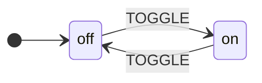

One recommended path: describe the machine as a Python class, run it with a `with` block. Everything else on this page (XState JSON, the CLI, the older Python styles) builds the same machine and is collected under [Also](#also-load-xstate-json-or-design-in-stately).



## 🐍 1. Write a class, run it with `with`

A `StateMachine` subclass is a **running machine**. The attribute you assign a transition to is its event (`toggle` becomes `TOGGLE`), and hooks are found by name (`on_toggle`, `on_enter_<state>`, `on_exit_<state>`, `before_<event>`, `after_<event>`).

```python
from xstate_statemachine import State, StateMachine


class LightSwitch(StateMachine):
    initial_context = {
        "flips": 0,
    }

    off = State(initial=True)
    on = State()

    # The attribute name is the event: TOGGLE
    toggle = off.to(on) | on.to(off)

    def on_toggle(self, context):
        # Only the arguments you name are injected.
        context["flips"] += 1

    def on_enter_on(self):
        print("Light is on")


with LightSwitch() as light:  # started, in `off`; stopped on exit
    print(light.state)
    light.toggle()  # same as light.send("TOGGLE")
    print(light.state)
    light.send("TOGGLE")
    print(light.state)
    print(f"Total flips: {light.context['flips']}")
print(light.status)
```

**Output:**

```
off
Light is on
on
off
Total flips: 2
stopped
```

`with Machine() as sm:` starts the machine and stops it on the way out, also when an exception escapes. Use `async with` on the asyncio engine (see [Choose your engine](#choose-your-engine)).

### Payloads, guards and return values

Event arguments are plain keyword arguments. Each callback declares only the ones it wants, `send()` hands back what the callbacks returned, and a guard that says no leaves the machine where it was.

```python
from xstate_statemachine import State, StateMachine, guard


class Cart(StateMachine):
    shopping = State(initial=True)
    paid = State(final=True)

    pay = shopping.to(paid, guard="can_pay")

    @guard
    def can_pay(self, amount):
        return amount > 0

    def on_pay(self, amount):
        return f"charged {amount}"


with Cart() as cart:
    print(cart.pay(amount=0))
    print(cart.state)
    print(cart.pay(amount=25))
    print(cart.state, cart.status)
```

**Output:**

```
None
shopping
charged 25
paid done
```

Add `strict = True` to the class and an event the machine cannot take right now raises `UnknownEventError` or `TransitionNotAllowedError` instead of being ignored. The [Pythonic API](../pythonic-api/) page covers nested `State.Compound` / `State.Parallel` classes, strict mode, `after` timers and the full hook list.

## 📄 Also: load XState JSON or design in Stately

Use the JSON route when the chart already exists as an XState file, is edited in [Stately](https://stately.ai/editor), or is shared with a JavaScript frontend. The library reads XState v5 JSON and follows XState v5 statechart semantics (engine event names keep the v4 spelling, such as `done.invoke.<id>`), and a class machine exports the same format (`LightSwitch.create_machine().to_json()`).

**Step 1: `light_switch.json`**

```json
{
  "id": "lightSwitch",
  "initial": "off",
  "context": {
    "flips": 0
  },
  "states": {
    "off": {
      "on": {
        "TOGGLE": {
          "target": "on",
          "actions": "incrementFlips"
        }
      }
    },
    "on": {
      "on": {
        "TOGGLE": {
          "target": "off",
          "actions": "incrementFlips"
        }
      }
    }
  }
}
```

<div class="stately" data-machine="e0b70fe57c" data-height="320" data-title="lightSwitch"></div>

**Step 2: `light_switch_logic.py`**

```python
from xstate_statemachine import MachineLogic

class LightSwitchLogic(MachineLogic):
    def increment_flips(self, interpreter, context, event, action_def):
        context["flips"] += 1
        print(f"Flipped! Total: {context['flips']}")
```

**Step 3: run it**

<!-- doc-fragment -->
```python
import json
from xstate_statemachine import create_machine, SyncInterpreter
from light_switch_logic import LightSwitchLogic

config = json.load(open("light_switch.json"))
machine = create_machine(config, logic=LightSwitchLogic())

interpreter = SyncInterpreter(machine).start()
interpreter.send("TOGGLE")  # off -> on
interpreter.send("TOGGLE")  # on -> off
interpreter.stop()

print(f"Total flips: {interpreter.context['flips']}")
```

**Output:**

```
Flipped! Total: 1
Flipped! Total: 2
Total flips: 2
```

### Generate boilerplate with the CLI

Already have the JSON? One command writes the logic stubs and a runner:

```bash
xsm generate-template light_switch.json --template pythonic-class --force
```

| File | Contents |
|------|----------|
| `light_switch_logic.py` | Action, guard, and service stubs with full type hints |
| `light_switch_runner.py` | Interpreter bootstrap code, ready to execute |

Short form: `xsm gt light_switch.json -t pythonic-class -f`. Pythonic templates generate sync code by default; add `--async-mode yes` for async, or `--file-count 1` to merge logic and runner into a single file. The templates:

```bash
xsm gt machine.json --template pythonic-class        # Class-based OOP
xsm gt machine.json --template pythonic-builder       # Fluent builder
xsm gt machine.json --template pythonic-functional    # Functional style
xsm gt machine.json --template class-json             # Class-based with JSON
xsm gt machine.json --template function-json          # Functions with JSON
```

### Other Python spellings of the same machine

These three styles predate the short way and keep working. They compile to the same `MachineNode`, so pick one only if it suits your code better; the [Pythonic API](../pythonic-api/) page documents each in full.

**Functional** (`build_machine`, explicit `@action` functions):

```python
from xstate_statemachine import State, build_machine, SyncInterpreter, action

off = State("off", initial=True)
on = State("on")

# State.to() only *creates* a transition; pass it to build_machine().
t1 = off.to(on, event="TOGGLE", actions=["logToggle"])
t2 = on.to(off, event="TOGGLE", actions=["logToggle"])


@action
def log_toggle(interpreter, context, event, action_def):
    context["flips"] = context.get("flips", 0) + 1


machine = build_machine(
    id="lightSwitch",
    states=[off, on],
    transitions=[t1, t2],
    actions=[log_toggle],
    context={
        "flips": 0,
    },
)

interpreter = SyncInterpreter(machine).start()
interpreter.send("TOGGLE")  # off -> on
print(f"Light is now: {interpreter.active_state_ids}")
interpreter.send("TOGGLE")  # on -> off
print(f"Light is now: {interpreter.active_state_ids}")
interpreter.stop()
print(f"Total flips: {interpreter.context['flips']}")
```

**Output:**

```
Light is now: {'lightSwitch.on'}
Light is now: {'lightSwitch.off'}
Total flips: 2
```

**Class with decorators and explicit events** (the positional `(interpreter, context, event, action_def)` signature):

```python
from xstate_statemachine import State, StateMachine, SyncInterpreter, action


class TrafficLight(StateMachine):
    machine_id = "trafficLight"
    initial_context = {
        "cycle_count": 0,
    }

    green = State("green", initial=True)
    yellow = State("yellow")
    red = State("red")

    slow_down = green.to(yellow, event="TIMER")
    caution = yellow.to(red, event="TIMER")
    go = red.to(green, event="TIMER", actions="countCycle")

    @action
    def count_cycle(self, interpreter, context, event, action_def):
        context["cycle_count"] += 1
        print(f"Cycle {context['cycle_count']} complete")

    @red.enter
    def on_enter_red(self, interpreter, context, event, action_def):
        print("STOP! Red light.")

    @green.enter
    def on_enter_green(self, interpreter, context, event, action_def):
        print("GO! Green light.")


machine = TrafficLight.create_machine()  # the bare MachineNode
interp = SyncInterpreter(machine).start()
interp.send("TIMER")  # green -> yellow
interp.send("TIMER")  # yellow -> red
interp.send("TIMER")  # red -> green (cycle complete)
interp.stop()
```

**Output:**

```
GO! Green light.
STOP! Red light.
Cycle 1 complete
GO! Green light.
```

**Builder** (fluent, good for machines assembled at run time):

```python
from xstate_statemachine import MachineBuilder, SyncInterpreter

machine = (
    MachineBuilder("doorLock")
    .context(
        {
            "attempts": 0,
        }
    )
    .state("locked", initial=True)
    .state("unlocked")
    .state("blocked")
    .transition("locked", "UNLOCK", "unlocked", guard="hasKey")
    .transition("locked", "UNLOCK", "blocked")
    .transition("unlocked", "LOCK", "locked")
    .transition("blocked", "RESET", "locked")
    .guard("hasKey", lambda ctx, evt: ctx.get("has_key", False))
    .build()
)

interp = SyncInterpreter(machine).start()
interp.send("UNLOCK")  # no key -> blocked
print(f"Locked out: {interp.active_state_ids}")
interp.send("RESET")
interp.context["has_key"] = True  # give them the key
interp.send("UNLOCK")
print(f"Unlocked: {interp.active_state_ids}")
interp.stop()
```

**Output:**

```
Locked out: {'doorLock.blocked'}
Unlocked: {'doorLock.unlocked'}
```

## ⚙️ Choose your engine

| Engine | Use it when | Lifecycle |
|--------|-------------|-----------|
| **Sync** (`SyncInterpreter`, the default for a class machine) | Scripts, CLIs, tests, request handlers, anything whose callbacks are plain functions | `with Machine() as sm:` |
| **Async** (`Interpreter`) | Your callbacks are `async def`, or the machine lives on an event loop (web servers, workers, real-time apps) | `async with Machine() as sm:` and `await` the events |

A class machine picks the engine for you: if any callback is `async def` it runs on the asyncio `Interpreter`, otherwise on the sync one. Set `engine = "async"` on the class to force the asyncio engine for plain callbacks.

```python
import asyncio

from xstate_statemachine import State, StateMachine


class Fetch(StateMachine):
    idle = State(initial=True)
    done = State()
    fetch = idle.to(done)

    async def on_fetch(self, url):
        await asyncio.sleep(0)
        return url.upper()


async def main():
    async with Fetch() as sm:
        print(sm.engine)
        print(await sm.fetch(url="http://x"))
        print(sm.state)


asyncio.run(main())
```

**Output:**

```
async
HTTP://X
done
```

With the explicit interpreters the same choice is `SyncInterpreter(machine).start()` versus `await Interpreter(machine).start()` (pass `wait=True` to `await interp.send(...)` to get a `Receipt` once the transition ran). Both accept a clock, so `after` timers can be driven deterministically in tests. See [Interpreters](../interpreters/) for the full comparison.

## 🤔 What just happened?

Every example above plays out the same way:

1. **Define states**: the distinct modes your system can be in (`off`, `on`, `green`, `red`)
2. **Define transitions**: rules that say _"when event X happens in state A, go to state B"_
3. **Attach logic**: hooks, actions and guards that run during transitions (logging, updating data, saying no)
4. **Build the machine**: compile the definition into a runnable `MachineNode` (a class instance does this for you)
5. **Run it on an interpreter**: the engine that processes events and manages state
6. **Send events**: drive the machine with `"TOGGLE"` or `"TIMER"`, or call the event method

> **Key insight:** The machine definition is _data_. The interpreter is the _engine_. This separation means you can serialize machines, visualize them, test them in isolation, and swap interpreters (async vs sync) without changing your machine logic.

## ➡️ Next steps

- [Core Concepts](../core-concepts/): states, events, transitions, guards, and actions in depth
- [Pythonic API](../pythonic-api/): the full class DSL, nested states, strict mode and the other Python styles
- [Coming from python-statemachine](../coming-from-python-statemachine/) or [Coming from transitions](../coming-from-transitions/): a port of a worked machine, concept by concept
- [Actions](../actions/), [Guards](../guards/) and [Context](../context/): logic and data
- [JSON Configuration](../json-config/): the XState JSON format reference
- [CLI Tool](../cli/): generate, inspect and simulate machines from XState JSON
- [Interpreters](../interpreters/): async vs sync execution
- [Integrations](../integrations/): persistence, web frameworks, brokers and testing
